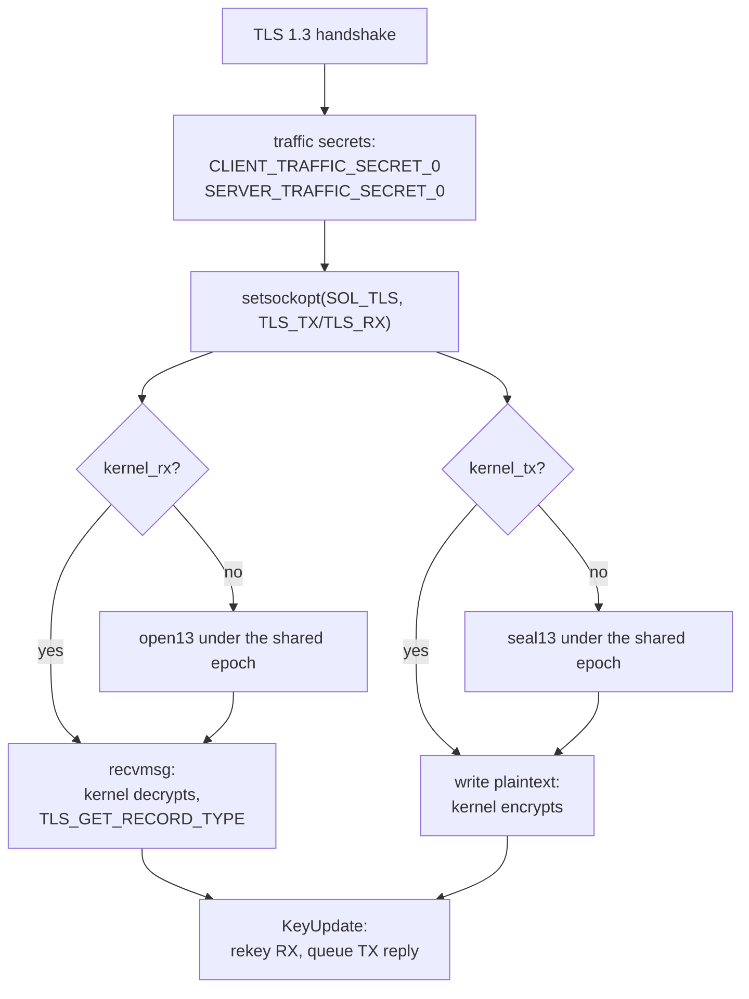

# kTLS

`tlsSettings.kernel_tx` and `kernel_rx` move one or both directions of a TLS 1.3 session into the Linux kernel after the handshake. Both roles read them: a dial hands its TX and/or RX traffic secrets to `setsockopt(SOL_TLS)`, and a listener does the same for the connection it accepted. The request is refused, not silently ignored, when the transport is not a direct TCP socket (KCP, a `finalmask` chain, or a Unix socket). The rustls dial and listener offload after a TLS 1.3 handshake and refuse any other version; the shaped dial does the same when it settles on 1.3. A BoringSSL or REALITY lane, a shaped listener, and a TLS 1.2 listener write their own handshake and cannot hand the traffic secrets over, so they keep the userspace record layer and the flags are inert there, as they are in the reference.

The kernel path uses the three TLS 1.3 suites the kernel carries: `TLS_AES_128_GCM_SHA256`, `TLS_AES_256_GCM_SHA384` and `TLS_CHACHA20_POLY1305_SHA256`. The userspace direction, when only one is offloaded, runs the shaped record layer at the same traffic-secret epoch, so a KeyUpdate advances both directions together. A peer's `update_requested` is answered under the current TX key and only then is the TX key advanced.

## Data path

## Measured

<!-- counts:begin -->
| key | value | checked by |
| --- | --- | --- |
| ops-retired-instructions | UNBLESSED | scripts/count-ops.sh |
| syscalls-per-offloaded-record | UNBLESSED | scripts/count-ops.sh |
| user-space-copies-per-offloaded-record | UNBLESSED | no copy checker yet |
| seconds-per-offloaded-record | UNBLESSED | CI bench.yml (no cell yet) |
| both-directions-carried-by-the-kernel | 1 | ferrox-core-tls::rustls_backend::tests::a_ktls_loopback_carries_both_directions |
<!-- counts:end -->

The loopback witness is Linux-only: it accepts a stock rustls connection, hands both directions to the kernel, writes `ping` through the client kernel and reads the same four bytes back through the server kernel. It is the only checker that observes the offload itself; a byte comparison on this host would pass with or without kTLS. This host is macOS/aarch64, so the witness and every kernel path are CI-only.

## Ops

The offload replaces the userspace record layer rather than adding a pass: one `write` becomes one plaintext `write` to the socket, and one `recvmsg` becomes one plaintext record. The exact retired-instruction and syscall counts are `UNBLESSED` because `scripts/count-ops.sh` needs a Linux frame with kTLS installed, and this host has neither. The loopback witness gates the bytes and both directions, not the count.

## Time

No matrix cell isolates a kTLS session: the bench cells time relays whose transport is selected by config, and there is no kTLS cell in `README.md`. No duration is quoted here.

## What we removed

- **A second record layer for the userspace half.** The kernel and userspace directions share one `Layer` and one traffic-secret epoch; a KeyUpdate cannot advance one side without the other.
- **A read-ahead buffered handshake.** The kTLS dial and listener drive rustls one TLS record at a time, so no post-handshake record is consumed before `setsockopt`; the stock `complete_io` path would read ciphertext the kernel must then decrypt.
- **A fallback when the kernel refuses.** A config that asks for kTLS and cannot get it fails instead of sending userspace ciphertext, so the bytes on the wire never diverge silently.

What was **not** removed: the kernel still allocates its own record buffers, and the RX path does not use `splice`. A server-side RX splice is disabled by the reference for the same reason it is absent here. TLS 1.2 sessions never take this path; a rustls server sends no tickets when TX is offloaded, because rustls emits them before the kernel starts at sequence zero, and a received ticket is dropped.

## Pins

| what | where |
| --- | --- |
| config fields and both wrappers | `upstream/sing-box/common/tls/ktls.go`, `upstream/sing-box/option/tls.go` |
| kernel driver, RX/TX and key update | `upstream/sing-box/common/ktls/` |
| kernel interface | `https://kernel.org/doc/html/latest/networking/tls.html` |
| rustls unbuffered/kernel connection | `~/.cargo/registry/src/*/rustls-0.23.46/src/conn/kernel.rs` |

## CI scope

What a change here owes, read by `scripts/ci-scope.py`; see [`docs/ci-scope.md`](../ci-scope.md).

<!-- scope:begin -->
- paths: crates/ferrox-core/src/tls/ktls.rs
- symbols: tls_kernel, settle_ktls, transport_ktls_fd
- go: ./common/ktls/..., ./common/tls/...
<!-- scope:end -->
