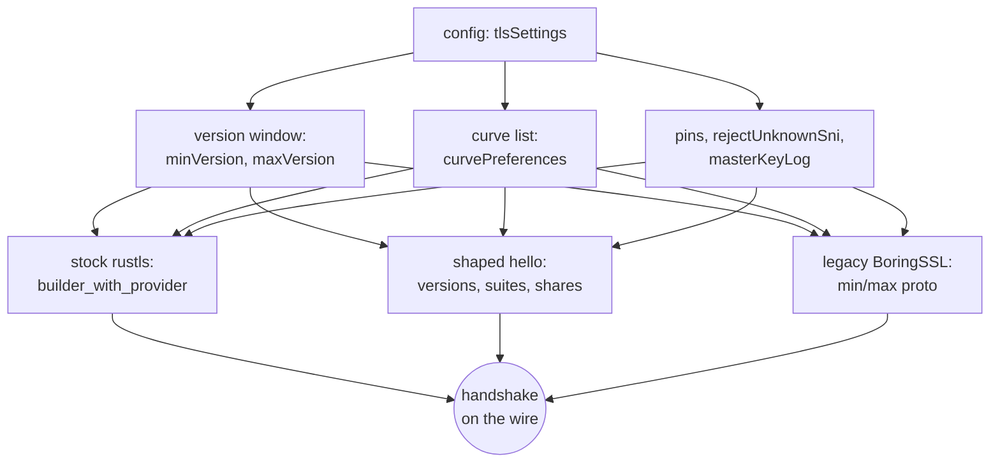

# TLS options

`tlsSettings.minVersion` and `maxVersion` are one protocol window on both roles. A dial applies the window to every client lane: the stock rustls builder, the shaped hello (its `supported_versions` list, its TLS 1.3 suites, its hybrid group and its key share), and the legacy BoringSSL context. A listener applies the same window to the rustls, BoringSSL and shaped TLS 1.2 lanes. xray clamps Go's versions onto what the backend carries: a floor below 1.2 starts at 1.2 and a ceiling above 1.3 stops at 1.3, and a window with no supported version is refused rather than widened. ECH is TLS 1.3 only, so a client maximum below 1.3 refuses the dial instead of silently ignoring the cap.

`tlsSettings.curvePreferences` is one group list on both roles. A dial offers it on the stock rustls provider, the shaped hello and the legacy BoringSSL context; a listener orders the rustls provider, the BoringSSL context and the shaped TLS 1.2 pick. A name the reference knows but this build cannot carry warns and drops, and a list that leaves nothing keeps the backend's stock order. The shaped TLS 1.2 listener carries X25519, P-256 and P-384 only; P-521 is reachable on the BoringSSL lane.

`pinnedPeerCertSha256`, `rejectUnknownSni` and `masterKeyLog` are read on the same block and are documented by their own pages. `useSystemCA`'s base-pool choice is not carried: `disableSystemRoot` still decides whether the system roots join the named ones.

## Data path

## Measured

<!-- counts:begin -->
| key | value | checked by |
| --- | --- | --- |
| ops-retired-instructions | UNBLESSED | scripts/count-ops.sh |
| syscalls-per-tls-handshake | UNBLESSED | scripts/count-ops.sh |
| user-space-copies-per-tls-handshake | UNBLESSED | no copy checker yet |
| seconds-per-tls-handshake | UNBLESSED | CI bench.yml (no cell yet) |
| client-version-ceilings-narrowing-the-shaped-hello | 1 | ferrox-core-tls::shaped::hello::tests::a_client_version_ceiling_narrows_the_shaped_hello |
| client-version-ceilings-refused-by-the-stock-lane | 1 | ferrox-core-tls::rustls_backend::tests::a_client_version_ceiling_refuses_a_newer_listener |
| server-curve-lists-ordered-by-the-stock-lane | 1 | ferrox-core-tls::rustls_backend::tests::a_configured_server_curve_orders_the_listener_provider |
| server-curve-lists-picked-by-the-shaped-lane | 1 | ferrox-core-tls::shaped::server::tests::a_configured_server_curve_is_the_one_the_listener_picks |
<!-- counts:end -->

The shaped-hello witness builds a Chrome preset under a 1.2 ceiling and reads the wire: the version body ends at 1.2, no key share rides, the hybrid group leaves and no TLS 1.3 suite remains. The stock witness refuses a TLS 1.3 listener from a client capped at 1.2. The two curve witnesses read the rustls provider order and the shaped listener's pick. Config parsing is witnessed by `ferrox-app::config::tests::inbound_tls_identity_reads_the_version_bounds_and_suites` and `ferrox-app::config::tests::outbound_tls_reads_the_client_version_bounds`.

## Ops

The window and the group list are setup inputs, not per-record work: they are read once per config and baked into the built context or hello. No probe isolates them, so the retired-instruction row stays `UNBLESSED` until `scripts/count-ops.sh` has a call frame to price. This host is macOS/aarch64, where valgrind has no build, so the exact-count gate in `./scripts/check.sh` is CI-only for these rows.

## Time

No matrix cell isolates these fields: the bench cells time a relay after the handshake, and a window or group list changes which handshake is offered, not the per-byte path. No duration is quoted here.

## What we removed

- **A second hello for a version ceiling.** The shaped hello filters its existing version, cipher and group lists in place and re-encodes the message it already owns; it does not build a second preset.
- **A per-dial provider copy for server curves.** The rustls listener orders the provider it already clones for the cipher list, and BoringSSL sets the curve list on the context it already builds.
- **A cache key that could cross windows.** The client config key now holds both bounds, so two dials with different windows cannot share one built config.

What was **not** removed: P-521 remains unreachable on the rustls and shaped lanes because neither carries the group, and `useSystemCA`'s base-pool choice is still not read. A shaped ECH dial with a ceiling below 1.3 is refused, because the reference's ECH path is TLS 1.3 only.

## Pins

| what | where |
| --- | --- |
| version and curve parsing, both roles | `upstream/xray-core/transport/internet/tls/config.go` |
| JSON fields and `useSystemCA` | `upstream/xray-core/infra/conf/transport_security.go` |
| BoringSSL curve names | `~/.cargo/registry/src/*/boring-5.4.0/src/ssl/mod.rs` |
| rustls provider ordering | `~/.cargo/registry/src/*/rustls-0.23.46/src/crypto/mod.rs` |

## CI scope

What a change here owes, read by `scripts/ci-scope.py`; see [`docs/ci-scope.md`](../ci-scope.md).

<!-- scope:begin -->
- paths: -
- symbols: inbound_tls_identity, tls_identity_from_settings, tls_curves, tls_version, outbound_tls, curve_list, client_versions, server_versions, outbound_tls_reads_the_client_version_bounds, inbound_tls_identity_reads_the_version_bounds_and_suites
- go: ./transport/internet/tls/...
<!-- scope:end -->
