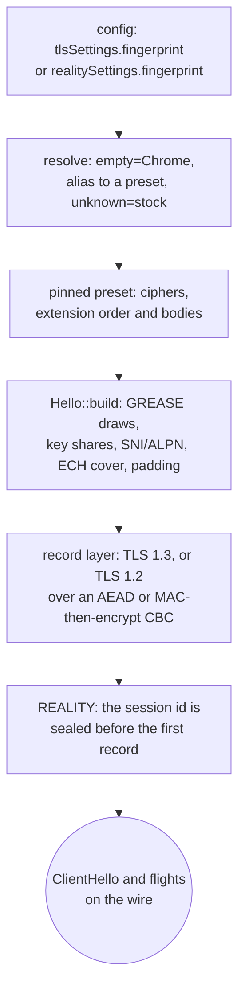

# uTLS fingerprints

`streamSettings.tlsSettings.fingerprint` and `realitySettings.fingerprint` name a browser whose ClientHello goes on the wire, and xray resolves that name through three tables in `transport/internet/tls/tls.go`: an empty name is `HelloChrome_Auto`, a name it does not know is `nil` and dials the stock hello, and every other name lands on a uTLS preset. `crates/ferrox-core/src/tls/shaped/` carries 28 of those presets as data, builds the hello from that table, and runs the TLS 1.3 or TLS 1.2 handshake under its own record layer — TLS 1.2 through either key transport (ECDHE, or a pre-master encrypted to the leaf) and either record shape (AEAD, or MAC-then-encrypt CBC at the suite's own block width); both client lanes — plain `security: tls` and REALITY — dial through it. uTLS shapes a client hello only, so this method has one role: the outbound dialer.

The reference is not copied. A preset is a `Profile` of cipher ids and `Ext` bodies, the builder walks that table once, and every hex in the oracle's golden is checked against the uTLS revision xray-core pins (`v1.8.3-0.20260301010127-aa6edf4b11af`, `upstream/xray-core/go.mod:18`). The xray name table is the reference for *which* names exist; the uTLS preset is the reference for their bytes.

## Data path



## Measured

<!-- counts:begin -->
| key | value | checked by |
| --- | --- | --- |
| ops-retired-instructions | UNBLESSED | scripts/count-ops.sh |
| oracle-cases-replayed-byte-identical | 46 | ferrox-core-tls::shaped::hello::tests::oracle_replay_matches_utls |
| distinct-presets-behind-those-names | 28 | ferrox-core-tls::shaped::hello::tests::oracle_replay_matches_utls |
| shaped-dials-that-complete-a-tls13-handshake | 1 | ferrox-core-tls::rustls_backend::tests::a_shaped_chrome_handshake_reaches_a_stock_server |
| shaped-dials-that-complete-a-tls12-handshake | 1 | ferrox-core-tls::rustls_backend::tests::a_shaped_tls12_handshake_hashes_its_client_key_exchange |
| relayed-records-that-allocate-once-warm | 0 | ferrox-core-tls::rustls_backend::tests::a_shaped_record_relays_without_allocating_once_the_handshake_is_done |
| carrier-records-that-allocate-once-warm | 0 | ferrox-core-tls::rustls_backend::tests::a_carrier_record_lands_in_the_callers_window_without_a_stage |
| carrier-records-staged-into-a-fitting-window | 0 | ferrox-core-tls::rustls_backend::tests::a_carrier_record_lands_in_the_callers_window_without_a_stage |
| tls12-gcm-records-that-shift-their-plaintext | 0 | ferrox-core-tls::shaped::record::tests::a_tls12_gcm_record_opens_behind_its_explicit_nonce |
| tls12-cbc-records-that-shift-their-plaintext | 0 | ferrox-core-tls::shaped::record::tests::a_tls12_cbc_record_pads_to_the_rfc_length_and_open_back |
| tls12-3des-records-that-shift-their-plaintext | 0 | ferrox-core-tls::shaped::record::tests::a_tls12_3des_record_pads_to_its_own_block_and_open_back |
| tls12-sessions-replayed-byte-identical | 13 | ferrox-core-tls::shaped::oracle::tls12_sessions_match_go |
| rsa-key-transport-vectors-replayed-byte-identical | 20 | ferrox-core-tls::shaped::oracle::rsa_key_transport_matches_go |
| table-spelling-resolutions-that-allocate | 0 | ferrox-core-tls::shaped::tests::a_table_spelling_resolves_without_a_heap_buffer |
| heap-buffers-for-a-chrome-hello | 18 | ferrox-core-tls::shaped::hello::tests::a_shaped_hello_writes_into_one_buffer |
| heap-buffers-for-an-rsa-exponentiation | 8 | ferrox-core-tls::shaped::oracle::rsa_key_transport_matches_go |
| heap-buffers-for-a-post-handshake-flight | 0 | ferrox-core-tls::shaped::client::tests::a_post_handshake_flight_is_read_where_it_lies |
<!-- counts:end -->

The 46 cases are the 28 presets plus the 18 xray names that alias onto them, so the alias table is gated by the same bytes it resolves to rather than asserted. `scripts/utls-oracle` zeroes the hello-phase entropy (random, session id, both 32-byte reads and the 10 GREASE bytes), erases the key-share, ECH-payload and key material after the fact, and prints the remaining body; both seeds are fixed, so the golden is stable.

`scripts/tls12-oracle` captures thirteen Go-to-Go TLS 1.2 sessions — one per suite Go's record layer keys past the AEAD names xray already reached: the six ECDHE-CBC ids, the five static-RSA ones and the two 3DES-EDE-CBC rows — and freezes both directions' bytes plus the master secret from the key log. `shaped::oracle::tls12_sessions_match_go` expands the key block from that secret, opens and authenticates every encrypted record, checks both `Finished` messages, then re-seals them so a CBC record's header — its explicit IV, MAC and padding count included — is Go's byte for byte despite a fresh random IV. The two 3DES sessions are what pins the block width: their two application records — the same payloads the AES rows carry — finish at 40 and 48 bytes past the header, where an AES row's finish at 48 and 64, and the block width is the only thing that moves. The same golden's 20 `RSA` and `MODEXP` lines gate the key transport itself: the DER walk of a leaf's public key, `EncryptPKCS1v15`'s `0x00 || 0x02 || PS || 0x00 || M` for four moduli and exponents, and the modular exponentiation behind it for 1024- to 4096-bit keys.

## Ops

```bash
./scripts/count-ops.sh report \
  shaped::hello::tests::oracle_replay_matches_utls 'tls::shaped::hello'
```

`UNBLESSED`. The parse and the build run once per dial, not per byte relayed: this is a connection-setup cost, and no row here quotes it as a figure until `ops.yml` measures it. The exact-count gate in `./scripts/check.sh` cannot run on this macOS/aarch64 host because valgrind has no arm64 macOS build; that gate is CI's (`ops.yml`, artefact `method-ops`), and this slice names it rather than pretending it ran.

## Time

**Not measured yet.** No matrix cell carries a fingerprint: `vless-tls-raw-*` measures the stock rustls client, and the shaped path is gated for completion by the loopback handshakes and relays above, not for rate. The counts block gates the operations removed — a warm relayed record takes no heap, a carrier record stages no plaintext, and a TLS 1.2 GCM record moves none — but a copy count is not a duration, and no bench, parity or matrix artefact for this path has been read. Durations come only from CI runners.

## What we removed

- **The extension object graph.** uTLS models a hello as a list of extension interfaces, each marshalling itself and each holding its own state. Here a preset is plain data — `Profile`, `Ext`, `Body` — and `Hello::encode_with` walks it in one pass into a single message buffer. There is no trait object per extension and no dynamic dispatch in the build.
- **rustls's handshake on a shaped dial.** `crate::tls::connect` routes a config whose fingerprint resolves to a preset to `shaped::Session`, which owns the record layer, the transcript and the key schedule. rustls is still used, but only its certificate verifier: the shaped dial never constructs a `rustls::ClientConnection`.
- **A second copy of the cipher table.** The shaped record layer accepts every TLS 1.2 suite Go's `crypto/tls` keys for a shaped dial — the AEAD names, the ECDHE-CBC six, the static-RSA five and the two 3DES rows — through `Suite::from_id`, so a negotiated suite is looked up once instead of being matched again per record, and the `{key, mac, iv}` lengths, the PRF hash, the record MAC and the block width each come from that one table rather than from a second switch per site.
- **The CBC record's staging pass.** A MAC-then-encrypt body used to be copied into a staging buffer, decrypted there and copied out again. `open12_into` now decrypts straight from the wire into the caller's window: the explicit IV and the ciphertext block behind each result are read where they lie, so the record costs no body copy and the plaintext is never shifted over the IV. What that path does *not* remove is the copy the pulled path makes when the caller's window is too small for the chunk, nor the padding walk, which reads the record's public length rather than its secret one.
- **The CBC decrypt's serial walk.** Eight blocks go through the AES backend per call, because CBC decryption chains through the XOR behind each block, not through the permutation: `decrypt8` runs eight independent `aesdec` chains on AES-NI and ARMv8, and the backend's own tail pass covers a length that is not a multiple of the batch, one block at a time. A 200-byte body is two calls instead of fourteen single-block ones. What was *not* removed is the encryption chain: a CBC *write* must feed each block's ciphertext into the next, so `encrypt` stays one `encrypt_block` per block. The batch is a call-count claim no test in this tree can see — `scripts/count-ops.sh` and the `ops.yml` artefact are its only checkers and both are CI's, so `ops-retired-instructions` stays `UNBLESSED` until one of them is read; the bytes are gated by `a_tls12_cbc_record_past_one_batch_opens_the_same_both_ways`, whose 14-block record is the one that crosses a batch edge.
- **A second CBC record walk.** Adding an eight-byte-block cipher could have meant copying `seal`, `open` and the padding read again. The reference does keep one record walk for every MAC-then-encrypt suite, but it picks the cipher through a per-suite `cipher func(key, iv []byte, isRead bool) any` and then type-switches the result on `cbcMode`, `aead` or `cipher.Stream` inside every `halfConn.encrypt` (`conn.go:483-560`), so the block size is a method call on an interface per record. Here the framing, the HMAC over `seq ‖ header ‖ plain`, the padding walk and both open paths are written once over a `Chain` trait whose `WIDTH` is a per-cipher constant, and a 3DES direction is one enum arm and one key schedule beside AES's; the AES arm keeps the width literal it already had, so its walk does not depend on the second implementor. What was *not* removed is 3DES's own per-block step: `TdesEde3` permutes one block per call (`ParBlocksSize = U1`), so the eight-block batch stays AES-only and a 3DES record walks one block at a time — and taking the schedule from `des` puts a second `cipher` major (0.5, for `des` 0.9) beside the 0.4 that `aes` already uses, which is the price of refusing less instead of writing the arithmetic in this tree. No local gate sees either cost, and no matrix cell times this path, so the two 3DES sessions in the golden are the witness that the shared walk is Go's, and the width claim is theirs alone.
- **The hello's staged body.** `Hello::encode_with` used to build the hello body, then a message around it, then copy the body in; the cipher list was a `Vec<u16>` on the way as well. One `Vec::with_capacity` sized by `fixed_len()` now takes the handshake header, the version, random, session id, cipher list, compression and extensions in order, and a Chrome hello's 18 heap buffers are its 16 extension bodies, the entry list that orders them and that message. `a_shaped_hello_writes_into_one_buffer` gates the number, the exact fit of the reserve, and that the counted bytes are the oracle's. What was *not* removed is a `Vec<u8>` per extension body: giving the walk a length-only pass over `Body` would be a second way of laying out the same table, and it is the list order, not the buffers, the oracle pins.
- **An RSA dependency.** The static-RSA arm needs a public-key exponentiation, and this tree takes no `rsa` crate for it: `shaped::rsa.rs` walks the leaf's `RSAPublicKey` DER, builds the PKCS#1 v1.5 block, and does the modular exponentiation with hand-written Montgomery arithmetic over `u64` limbs — a multiply is one schoolbook pass into a `2k+1`-limb window and one REDC pass out of it, and 20 golden vectors from Go gate every step. What was *not* removed is the walk's eight buffers: the modulus's limbs, `Mont`'s `R²`, the accumulator, three result limbs and the caller's output are each allocated once and held for every multiply, and `rsa_key_transport_matches_go` counts them for all 16 `MODEXP` vectors — eight whether the exponent is `3` or `65537` and the modulus 128 or 512 bytes, which is the shape a per-multiply accumulator would break. `R² mod n` is built by doubling from one and is reached at the modulus's own top limb: a power of two below `2^(64·(k−1))` is below `n`, so the first `64·(k − 1)` shifts can neither carry out nor need a subtraction, and skipping them drops half the walk for a 4096-bit key. A handshake does the walk once and no relay ever reaches it.
- **The post-handshake copy.** A flight of finished handshake messages used to be drained into a `Vec<u8>` per message before its type byte was read — a NewSessionTicket, the commonest of them, copied whole to be thrown away unread. The walk now reads the type and `KeyUpdate`'s one request byte where they lie, consumes the message with a `drain`, and seals the reply straight into the session's own `reply` buffer instead of a temporary it copies out of. `a_post_handshake_flight_is_read_where_it_lies` counts zero allocations over a 44-byte ticket, which a copy — any copy, including a `to_vec` of the staged flight — turns into one. What was *not* removed is the staging itself: a chunk whose record is larger than the caller's window still lands in `plain` before it is read.
- **The per-record heap.** A record is read into `plain` on the pulled path and decrypted where it lies, a carrier record whose window holds the whole chunk is decrypted at the front of that window, and the session's buffers keep their capacity, so a relayed record allocates nothing once warm; a write is sealed into one reused buffer, and a single-part write skips the staged segment list. The staging buffer `plain` holds only what a window too small for the chunk cannot take, so a normal carrier relay never writes it.
- **The carrier's second copy.** A roomy window used to receive plaintext only after the record had been decrypted in `inbuf` and copied out of it. `open` now copies each body once, straight to the front of the caller's window, and decrypts it there; the loopback carrier test still gates the zero-staging and zero-allocation rows, and no counter observes the copy itself.
- **The record header's slot.** `read_record` used to lay the five header bytes ahead of the body in the same buffer, then decrypt from offset five. The header is passed to the decryptor by value and never needed after, so the body fills the buffer from offset zero: one fewer five-byte copy per record and five fewer bytes of high-water.
- **The TLS 1.2 GCM shift.** A GCM record's explicit nonce leads the body, and the plaintext used to be moved eight bytes down over it. `open12` returns the plaintext's offset instead, so the nonce stays where it arrived and the plaintext is never moved; the record test asserts the plaintext opens at offset eight with the nonce bytes intact.
- **A dial that built its own client.** The KCP arm of `security: tls` — one `relay_kcp_under_tls` helper, which both VLESS and Trojan dial through — called `RustlsProvider::connect` directly instead of `crate::tls::connect`, so it read the config's roots and name but dropped its `fingerprint` and wrote rustls's hello. It now takes the same route as every other carrier, and `a_fingerprint_shapes_the_hello_a_kcp_session_dials` reads the GREASE code point off the KCP stream — pre-wiring that first suite was `0x1302`, not `0x?a?a`.
- **The normalization copy.** A fingerprint name already written the way the preset table spells it is borrowed and looked up in place; only input that has to change (case, a `-`/`.` separator, a `hello_` prefix) is normalized into a new string. The test gates zero allocations for the seven table spellings.

## The parts that are not byte-identical, named

- **Four PSK presets.** `hellochrome_100_psk`, `hellochrome_112_psk_shuf`, `hellochrome_114_padding_psk_shuf` and `hellochrome_115_pq_psk` are in xray's name table but uTLS cannot build their hello at this pin — `ApplyPreset` refuses the empty `UtlsPreSharedKeyExtension` and xray's own dial fails. This tree resolves them to the stock hello and dials, which is a superset of a reference that errors, not a missing shape.
- **Names xray refuses.** xray's JSON parser refuses `unsafe` and `hellogolang` (`invalid "fingerprint"`) and any unknown name (`unknown "fingerprint"`); this tree dials the stock hello for all of them and adds zeronet's `none`/`unshaped` spellings for the same hello. It also reads sing-box's five `chrome_psk`/`chrome_pq` names as the plain Chrome hello sing-box sends, and takes any preset name with `-`/`.` folded to `_`, uTLS's `hello` prefix written with a separator or left off entirely. Each of those resolves to a preset the oracle already replays or to the stock hello, so the wider vocabulary adds no bytes; `shaped::tests::alternate_spellings_resolve_to_the_oracle_gated_profile` holds the pointers equal and the oracle gates the presets. That stock hello is rustls's, not Go's `crypto/tls` — `HelloGolang` marshals through Go's handshake, which nothing in this tree builds, and row 18's `unsafe` already means the same stock rustls shape.
- **`random`, `randomized`, `hellorandomized*`.** The weights are reproduced (`shaped::draw`), but uTLS seeds a SHAKE256 stream through Go's `math/rand` per connection and this tree draws once per process through its own SHAKE256 reader, so the bytes cannot be compared and are not. The draw-once-per-process shape matches xray seeding its preset once.
- **Chrome's shuffle.** Six presets (`chrome`, `hellochrome_106_shuffle`, `hellochrome_115_pq`, `hellochrome_120`, `hellochrome_120_pq`, `hellochrome_131`) reorder their middle extensions from fresh entropy in uTLS and here. The oracle therefore gates the sorted extension multiset plus the positions of the GREASE, padding and PSK entries, which the shuffle never moves, instead of a fixed order.
- **Go's three RC4-SHA TLS 1.2 rows.** The record layer keys 3DES-EDE-CBC (`0x000a`, `0xc012`) now — thirteen presets advertise the first and five the second, and both are byte-gated by the golden's two sessions. RC4-SHA is still refused: uTLS's `cipher_suites.go:170-172` carries `0x0005`, `0xc011` and `0xc007` at `{key, mac, iv}` lengths `(16,20,0)`, the `360` preset advertises all three, and the client accepts whichever of the hello's own ids the server picks (`handshake_client.go:666` matches against `hs.hello.cipherSuites`, not the config list), so a server that chooses one completes there and fails here with `NoSharedCipher`. RC4 is the reference's third case in its per-record switch, not a third block width: Go's `crypto/tls` runs the payload and its 20-byte MAC through `XORKeyStream` with no explicit IV and no padding at all (`conn.go:509-518`), so it needs a direction arm beside AEAD and CBC. Go 1.24 still negotiates all three when both sides name one suite over loopback — checked by running that shape for each id — so this slice's oracle reaches them and each can land with golden sessions of its own.
- **Ids Go's table does not contain.** `0x0004` (RC4-MD5), `0x003d`, `0xc024`, `0xc028`, the DHE and static-ECDH names and the SEED rows are advertised by the `360`, `firefox_55/63` and iOS/Safari presets but are implemented by nothing in the pinned reference's client table — `0x003d`, `0xc024` and `0xc028` sit in uTLS's `EnableWeakCiphers` list, which xray never calls (checked against `upstream/xray-core`), and the rest are in no Go table at all (`crypto/tls/cipher_suites.go:681-705`). Refusing them matches the reference; its own shaped client fails the same handshake.
- **ECH, PSK and client certificates.** The ECH extension is a GREASE cover (row 39 is real ECH); there is no session resumption, no PSK mode and no client-certificate request, because no preset here negotiates one.
- **Conformance is a completion gate, not a byte gate.** `upstream/xray-rust` injects `ferrox-app` as the dialing client through the `XRAY_VLESS_FULL_BINARY` seam, and its `local_xray_interop_tests` suite names the fingerprints: `rust_socks_client_reaches_echo_server_through_local_xray_vless_reality_vision_selected_fingerprints`, `rust_socks_clients_open_parallel_echo_flows_through_local_xray_vless_reality_vision_selected_fingerprints` and `xray_core_socks_clients_open_parallel_echo_flows_through_local_xray_vless_reality_vision_selected_fingerprints` each dial REALITY Vision once per name in `chrome`, `hellochrome_133`, `hellofirefox_148`, `hellosafari_26_3`, `helloios_13`, `hello360_11_0`, `hellochrome_120_pq` and `hellofirefox_99` — eight names per row, all eight of which this tree resolves to a preset. `conformance.yml` runs that suite unmodified; on this slice's own run all three rows are `ok` and the job records `PASS: xray-rust suite green against ferrox-app at 5834b86 (injected via XRAY_VLESS_FULL_BINARY)`. What that proves is that a shaped hello completes the reference's handshake, which a stock hello also does, so it cannot witness a byte: `oracle_replay_matches_utls` stays the byte gate. uTLS's own tests are in-package Go with no binary seam, and xray-core's scenario suite still holds its TLS/REALITY siblings at the pb `streamSettings` refusal (row 24's note), so no `conformance.yml` leg compares hello bytes against the reference.

## Pins

| what | where |
| --- | --- |
| empty-name default, unknown-name `nil`, the three name tables | `upstream/xray-core/transport/internet/tls/tls.go` |
| names refused at config parse | `upstream/xray-core/infra/conf/transport_security.go` |
| sing-box's five Chrome spellings | `upstream/sing-box/common/tls/utls_client.go` (`uTLSClientHelloID`) |
| zeronet's `none`/`unshaped` stock spellings | `upstream/zeronet/crates/zero-security/src/fingerprint.rs` |
| the fourth name table, and the seam that dials eight names through this client | `upstream/xray-core-rust/crates/xray-tls/src/fingerprint.rs`, `upstream/xray-rust/crates/xray-core-rs/tests/local_xray_interop_tests.rs` (`selected_reality_interop_fingerprints`) |
| preset bytes, GREASE draws, shuffle, ECH cover | uTLS `v1.8.3-0.20260301010127-aa6edf4b11af` (the revision in `upstream/xray-core/go.mod`) |
| the presets as data | `crates/ferrox-core/src/tls/shaped/profiles.rs` |
| the replay oracle | `scripts/utls-oracle` |
| the thirteen TLS 1.2 sessions and the 20 RSA key-transport vectors | `scripts/tls12-oracle` |
| Go's TLS 1.2 suite table, its `{key, mac, iv}` lengths and its weak rows | uTLS `cipher_suites.go:150-172`, `u_common.go:741-765`, `crypto/tls/cipher_suites.go:681-705` |

## CI scope

What a change here owes, read by `scripts/ci-scope.py`; see [`docs/ci-scope.md`](../ci-scope.md).

<!-- scope:begin -->
- paths: crates/ferrox-core/src/tls/shaped/*, scripts/utls-oracle/*, scripts/tls12-oracle/*
- go: ./transport/internet/tls/...
<!-- scope:end -->
