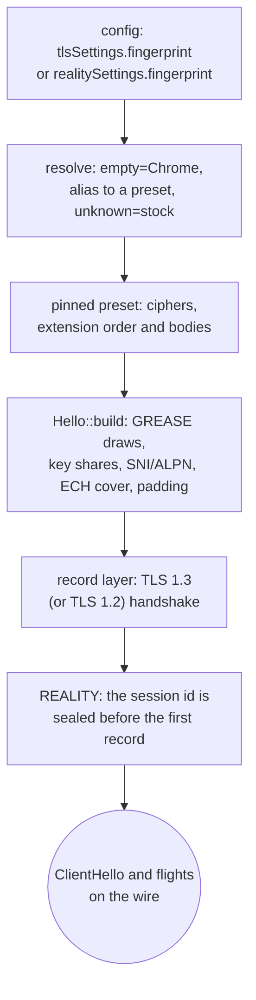

# uTLS fingerprints

`streamSettings.tlsSettings.fingerprint` and `realitySettings.fingerprint` name a browser whose ClientHello goes on the wire, and xray resolves that name through three tables in `transport/internet/tls/tls.go`: an empty name is `HelloChrome_Auto`, a name it does not know is `nil` and dials the stock hello, and every other name lands on a uTLS preset. `crates/ferrox-core/src/tls/shaped/` carries 28 of those presets as data, builds the hello from that table, and runs the TLS 1.3 or TLS 1.2 handshake under its own record layer; both client lanes — plain `security: tls` and REALITY — dial through it. uTLS shapes a client hello only, so this method has one role: the outbound dialer.

The reference is not copied. A preset is a `Profile` of cipher ids and `Ext` bodies, the builder walks that table once, and every hex in the oracle's golden is checked against the uTLS revision xray-core pins (`v1.8.3-0.20260301010127-aa6edf4b11af`, `upstream/xray-core/go.mod:18`). The xray name table is the reference for *which* names exist; the uTLS preset is the reference for their bytes.

## Data path



## Measured

<!-- counts:begin -->
| key | value | checked by |
| --- | --- | --- |
| ops-retired-instructions | UNBLESSED | scripts/count-ops.sh |
| oracle-cases-replayed-byte-identical | 46 | ferrox-core-tls::shaped::hello::tests::oracle_replay_matches_utls |
| distinct-presets-behind-those-names | 28 | ferrox-core-tls::shaped::hello::tests::oracle_replay_matches_utls |
| shaped-dials-that-complete-a-tls13-handshake | 1 | ferrox-core-tls::rustls_backend::tests::a_shaped_chrome_handshake_reaches_a_stock_server |
| shaped-dials-that-complete-a-tls12-handshake | 1 | ferrox-core-tls::rustls_backend::tests::a_shaped_tls12_handshake_hashes_its_client_key_exchange |
<!-- counts:end -->

The 46 cases are the 28 presets plus the 18 xray names that alias onto them, so the alias table is gated by the same bytes it resolves to rather than asserted. `scripts/utls-oracle` zeroes the hello-phase entropy (random, session id, both 32-byte reads and the 10 GREASE bytes), erases the key-share, ECH-payload and key material after the fact, and prints the remaining body; both seeds are fixed, so the golden is stable.

## Ops

```bash
./scripts/count-ops.sh report \
  shaped::hello::tests::oracle_replay_matches_utls 'tls::shaped::hello'
```

`UNBLESSED`. The parse and the build run once per dial, not per byte relayed: this is a connection-setup cost, and no row here quotes it as a figure until `ops.yml` measures it. The exact-count gate in `./scripts/check.sh` cannot run on this macOS/aarch64 host because valgrind has no arm64 macOS build; that gate is CI's (`ops.yml`, artefact `method-ops`), and this slice names it rather than pretending it ran.

## Time

**Not measured yet.** No matrix cell carries a fingerprint: `vless-tls-raw-*` measures the stock rustls client, and the shaped path is gated for completion by the two loopback handshakes above, not for rate. Durations come only from CI runners, and no `bench.yml`, `parity.yml` or `benchmark-matrix.yml` artefact for this path has been read.

## What we removed

- **The extension object graph.** uTLS models a hello as a list of extension interfaces, each marshalling itself and each holding its own state. Here a preset is plain data — `Profile`, `Ext`, `Body` — and `Hello::encode_with` walks it in one pass into a single message buffer. There is no trait object per extension and no dynamic dispatch in the build.
- **rustls's handshake on a shaped dial.** `crate::tls::connect` routes a config whose fingerprint resolves to a preset to `shaped::Session`, which owns the record layer, the transcript and the key schedule. rustls is still used, but only its certificate verifier: the shaped dial never constructs a `rustls::ClientConnection`.
- **A second copy of the cipher table.** The shaped record layer accepts exactly the suites the presets advertise (TLS 1.3's trio and the ECDHE-AEAD TLS 1.2 six), keyed by `Suite::from_id`, so a negotiated suite is looked up once instead of being matched again per record.

## The parts that are not byte-identical, named

- **Four PSK presets.** `hellochrome_100_psk`, `hellochrome_112_psk_shuf`, `hellochrome_114_padding_psk_shuf` and `hellochrome_115_pq_psk` are in xray's name table but uTLS cannot build their hello at this pin — `ApplyPreset` refuses the empty `UtlsPreSharedKeyExtension` and xray's own dial fails. This tree resolves them to the stock hello and dials, which is a superset of a reference that errors, not a missing shape.
- **`unsafe`, `hellogolang`, and unknown names.** xray's JSON parser refuses `unsafe` and `hellogolang` (`invalid "fingerprint"`) and any unknown name (`unknown "fingerprint"`); this tree accepts all three and dials the stock hello, so a config xray rejects still works here. That stock hello is rustls's, not Go's `crypto/tls` — `HelloGolang` marshals through Go's handshake, which nothing in this tree builds, and row 18's `unsafe` already means the same stock rustls shape.
- **`random`, `randomized`, `hellorandomized*`.** The weights are reproduced (`shaped::draw`), but uTLS seeds a SHAKE256 stream through Go's `math/rand` per connection and this tree draws once per process through its own SHAKE256 reader, so the bytes cannot be compared and are not. The draw-once-per-process shape matches xray seeding its preset once.
- **Chrome's shuffle.** Six presets (`chrome`, `hellochrome_106_shuffle`, `hellochrome_115_pq`, `hellochrome_120`, `hellochrome_120_pq`, `hellochrome_131`) reorder their middle extensions from fresh entropy in uTLS and here. The oracle therefore gates the sorted extension multiset plus the positions of the GREASE, padding and PSK entries, which the shuffle never moves, instead of a fixed order.
- **TLS 1.2's CBC and static-RSA suites.** The presets advertise them, and the record layer keys only the ECDHE-AEAD suites (`0xc02b`/`0xc02f`, `0xc02c`/`0xc030`, `0xcca9`/`0xcca8`). A TLS 1.2 server that picks a CBC or static-RSA id makes the dial fail with `NoSharedCipher`, where uTLS would complete it. Adding those suites is a crypto-subsystem change, named rather than half-done.
- **ECH, PSK and client certificates.** The ECH extension is a GREASE cover (row 39 is real ECH); there is no session resumption, no PSK mode and no client-certificate request, because no preset here negotiates one.
- **Conformance.** No pinned suite injects `ferrox-app` as the fingerprinted client — uTLS ships library tests, and xray-core's scenario suite puts `ferrox-app` behind a `dokodemo` front whose TLS/REALITY siblings are still held by the pb `streamSettings` refusal (row 24's note). No `conformance.yml` job is owed for this method, and none was run; the oracle replay is the byte gate.

## Pins

| what | where |
| --- | --- |
| empty-name default, unknown-name `nil`, the three name tables | `upstream/xray-core/transport/internet/tls/tls.go` |
| names refused at config parse | `upstream/xray-core/infra/conf/transport_security.go` |
| preset bytes, GREASE draws, shuffle, ECH cover | uTLS `v1.8.3-0.20260301010127-aa6edf4b11af` (the revision in `upstream/xray-core/go.mod`) |
| the presets as data | `crates/ferrox-core/src/tls/shaped/profiles.rs` |
| the replay oracle | `scripts/utls-oracle` |

## CI scope

What a change here owes, read by `scripts/ci-scope.py`; see [`docs/ci-scope.md`](../ci-scope.md).

<!-- scope:begin -->
- paths: crates/ferrox-core/src/tls/shaped/*, scripts/utls-oracle/*
- go: ./transport/internet/tls/...
<!-- scope:end -->
