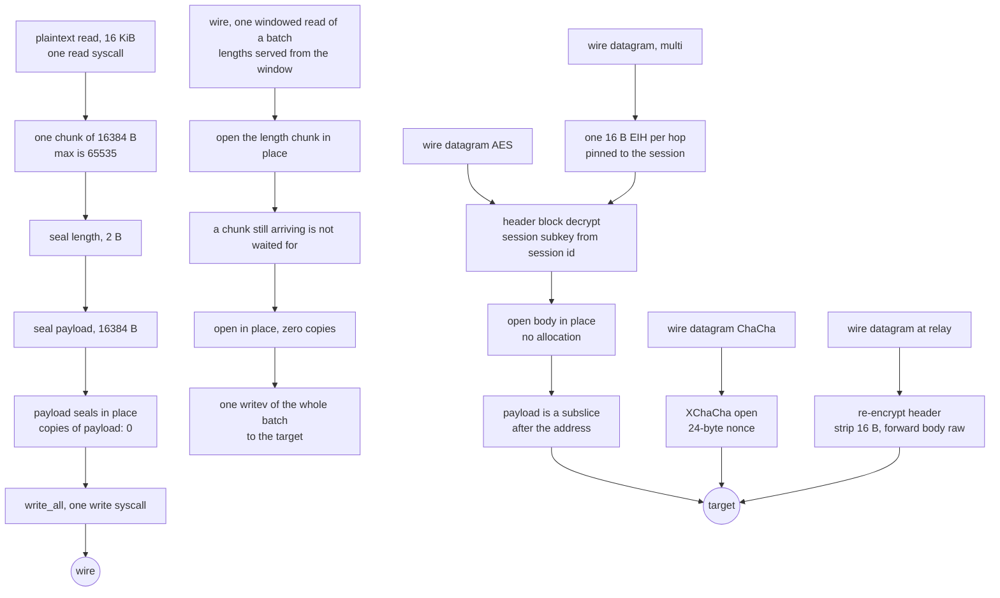

# Shadowsocks 2022

SIP022 (`2022-blake3-aes-128-gcm`, `2022-blake3-aes-256-gcm`, `2022-blake3-chacha20-poly1305`) on the same relay shape as the AEAD rung: one buffer per relay read, one write per read, seals and opens in place.

A TCP session is `salt || AEAD(fixed) || AEAD(variable) || data*` where `fixed` is `type(0) || timestamp(8) || var_len(2)` and `variable` is `address || padding_len(2) || padding || early*`. The response is `salt || AEAD(fixed)` with `type(1) || timestamp(8) || request_salt || first_len(2)` and `first_len 0` here, so the first payload rides the next chunk rather than the handshake. Data chunks are `AEAD(len(2)) || AEAD(payload)` up to 65535 bytes, so a 16 KiB relay read is one chunk. UDP AES is `AES(header) || AEAD(body)` with the body nonce from the header and a per-session subkey; UDP ChaCha is `nonce(24) || XChaCha(body)` under the PSK. Server replies are server-typed (`type(1)` plus the client session id) with the server's own session and packet counters, so an Xray or sing-box peer accepts them and a foreign client session is refused. Multi-user (AES only) prefixes one 16-byte EIH per hop: the identity subkey from the master decrypts to the user hash on TCP, and the raw block plus an XOR does it on UDP. Relay (AES, TCP and UDP) strips that outer EIH and forwards the rest raw: `salt || rest` on TCP, re-encrypted header plus untouched body on UDP. That `address` is SOCKS-shaped, so a dial that was handed a name writes ATYP 3 with its own length and lets the edge answer the lookup.

The AEAD sits on the same ladder as the AEAD rung: AES-GCM through `aesgcm`, ChaCha through `aead`, XChaCha through `hchacha` plus the IETF AEAD. The KDF is `blake3::derive_key` (`shadowsocks 2022 session subkey`, `shadowsocks 2022 identity subkey`) and `blake3::hash` truncated for the user hash. Timestamps and the salt filter live in `ferrox-app`, so `ferrox-core` stays deterministic.

## Data path



## Measured

Every row is a claim with a checker that runs. `scripts/method-counts.txt`
holds the same rows and `scripts/check-method-docs.sh` fails if this page and
that file disagree.

<!-- counts:begin -->
| key | value | checked by |
| --- | --- | --- |
| ops-retired-instructions | UNBLESSED | scripts/count-ops.sh |
| aead-calls-per-chunk | 2 | ferrox-core-shadowsocks2022::tests::every_method_round_trips_a_chunk_and_refuses_a_forged_tag |
| maximum-payload-per-chunk | 65535 | ferrox-core-shadowsocks2022::tests::every_method_round_trips_a_chunk_and_refuses_a_forged_tag |
| write-syscalls-per-16KiB-relay-read | 1 | ferrox-app-shadowsocks2022::tests::one_relay_read_becomes_one_write_and_reads_back_whole |
| payload-chunks-per-16KiB-relay-read | 1 | ferrox-app-shadowsocks2022::tests::one_relay_read_becomes_one_write_and_reads_back_whole |
| user-space-copies-per-byte-written | 0 | ferrox-app-shadowsocks2022::tests::one_relay_read_becomes_one_write_and_reads_back_whole |
| user-space-copies-per-byte-read | 0 | ferrox-app-shadowsocks2022::tests::chunks_open_that_seal_sealed_and_reject_damage |
| zero-filled-bytes-per-chunk | 0 | ferrox-app-shadowsocks2022::tests::chunks_open_that_seal_sealed_and_reject_damage |
| chunk-buffer-allocations-per-connection | 1 | ferrox-app-shadowsocks2022::tests::chunks_open_that_seal_sealed_and_reject_damage |
| downlink-stage-bytes-per-connection | 0 | ferrox-app-shadowsocks2022::tests::the_carrier_and_the_window_ask_the_socket_as_one |
| downlink-chunks-per-carrier-ask | 2 | ferrox-app-shadowsocks2022::tests::the_carrier_and_the_window_ask_the_socket_as_one |
| target-write-syscalls-per-opened-batch | 1 | ferrox-app-shadowsocks2022::tests::a_bulk_read_serves_every_buffered_chunk |
| reads-spent-waiting-for-an-incomplete-chunk | 0 | ferrox-app-shadowsocks2022::tests::a_batch_never_waits_for_a_chunk_that_has_not_arrived |
| udp-payload-buffers-per-datagram | 1 | ferrox-app-shadowsocks2022::tests::an_opened_payload_is_the_datagrams_own_bytes |
| udp-datagram-reallocations-after-the-first | 0 | ferrox-app-shadowsocks2022::tests::an_opened_payload_is_the_datagrams_own_bytes |
| udp-multi-user-eih-bytes-per-packet | 16 | ferrox-app-shadowsocks2022::tests::udp_multi_user_packs_one_eih_and_opens_with_the_pinned_psk |
| udp-relay-header-bytes-stripped-per-packet | 16 | ferrox-app-shadowsocks2022::tests::udp_relay_strips_one_header_and_still_opens |
| udp-server-reply-client-session-bytes | 8 | ferrox-app-shadowsocks2022::tests::udp_server_replies_are_server_typed_and_stay_with_their_session |
| subkey-heap-buffers-per-connection | 1 | ferrox-core-shadowsocks2022::tests::a_cipher_holds_one_heap_buffer_for_aes_and_none_for_chacha |

<!-- counts:end -->

## Ops

```bash
./scripts/count-ops.sh report \
  shadowsocks2022::tests::one_relay_read_becomes_one_write_and_reads_back_whole \
  'shadowsocks2022::seal_all'
```

The row above is `UNBLESSED`: nobody has read a measured number for this
symbol out of a callgrind run, so this page does not state one. `scripts/expected-ops.txt`
still blesses exactly one symbol, `der_to_pem`. Blessing a count means reading
the diff that moved it, never copying a measurement to silence a gate.

## Time

**Not measured on this branch.** Wall clock for this method needs the same
`ferrox-bench` cipher gate the AEAD rung uses, extended to the three 2022
methods at the same chunk lengths, run on a named CI runner. No artefact from
a run of this branch has been read, so this page quotes no duration. Timing
needs a named runner; a number from a laptop behind a VPN measures the tunnel.

## What we removed

Read against the pinned implementations, all of which are in
`upstream/` for reading and never copied:

- **A second chunk per 16 KiB read.** The AEAD rung caps at 16383, so a relay
  read is two chunks and four AEAD calls. The 2022 cap is 65535, so the same
  read is one chunk and two calls. The wire bytes are the same stream in the
  same order, only fewer length headers.
- **The MD5 chain and HKDF-SHA1.** The AEAD rung derives the master from the
  password with one or two MD5s and the subkey with HKDF-SHA1 per direction.
  The 2022 PSK is base64 or raw at the key length, and the subkey is one
  `blake3::derive_key` over `PSK || salt`. No chain, no HMAC, one hash.
- **The read-side copy and the per-chunk allocation.** `open_chunk` decrypts
  the length and the payload inside the caller's `WIRE_MAX` buffer and returns
  a subslice, the same shape as the AEAD rung. UDP opens inside the socket
  thread's `opened` buffer and returns a subslice; `an_opened_payload_is_the_datagrams_own_bytes`
  asserts the pointer lies inside `opened` and that `opened` neither moves nor
  grows, the same idiom as `frames_reuse_the_callers_buffers`.
- **The 32 KiB stage in front of the codec on the xhttp downlink.** The dial
  used to wrap the carrier in a `BufReader` before `pump_relay_carried`, so the
  codec's asks were served from a stage: socket → stage → wire buffer, two
  user-space copies per byte across the whole downlink, because both of this
  rung's asks — the 18-byte sealed header and the length plus its tag — sit
  under the stage's capacity. The wrap is gone; `relay_downlink` is the downlink
  the dial runs and the witnesses drive, carrier straight into window. The
  stage's own cost was measured at that boundary rather than the socket's,
  because the carrier caps a read at its record: `xhttp::Reader` asks the socket
  for `min(record, buf.len())`, so a stage's capacity never reaches it.
  `downlink-stage-bytes-per-connection 0`.
- **Two carrier asks per chunk, and a write per chunk.** `open_chunk` drew the
  18-byte sealed length from the carrier and then drew the payload it names, so
  every chunk of the downlink cost two carrier reads and left for the target as
  one `write_all` of its own. The relay loop now runs the classic rung's shape:
  `ChunkReader` asks the carrier for the whole 65672-byte window once and opens
  the chunks where they lie, `open_batch` takes every chunk already in the
  window while waiting only for the first, and `drain_window` hands the opened
  plaintexts to the target in one `writev` per batch.
  `the_carrier_and_the_window_ask_the_socket_as_one` seals two chunks into real
  carrier records and records every width the carrier is asked for: the window
  is there, 18 and 1016 are not, and the two chunks arrive on one ask
  (`downlink-chunks-per-carrier-ask 2`). `a_bulk_read_serves_every_buffered_chunk`
  counts the other side — four chunks opened from one bulk read leave in one
  vectored write whose bases all lie inside the window, so no plaintext is
  gathered out of it (`target-write-syscalls-per-opened-batch 1`) — and
  `a_batch_never_waits_for_a_chunk_that_has_not_arrived` shows one read spent
  and no second (`reads-spent-waiting-for-an-incomplete-chunk 0`), which is also
  the gate for the held length: a chunk whose length is drawn is never drawn
  again against the next chunk's nonce when its payload lands in the next batch.
  The named costs: the window is 121 bytes wider than the 65551-byte chunk
  buffer it replaces, a chunk that straddles the window's end moves its own
  leftovers once per compaction, and against a peer that frames bodies wider
  than a chunk the bulk ask reads past a chunk boundary where the two-ask shape
  stopped at it. A carrier with no `writev` still sees one write per chunk. No
  duration is quoted — no CI cell runs Shadowsocks 2022 over xhttp.
- **The write-side staging copy.** The relay uplink first read into a plain
  buffer and then copied every payload byte into a `staging` `Vec` while it
  sealed (`Cipher::seal_into` did the `extend_from_slice`), so a 16 KiB read
  cost one user-space copy per byte. The seal now happens where the bytes
  already are: `seal_all` seals the 2-byte length into the headroom and the
  payload in place between the headroom and a tailroom tag, then `write_all`s
  the caller's buffer once. `one_relay_read_becomes_one_write_and_reads_back_whole`
  is the witness: it records the `write` base pointer and asserts it *is* the
  caller buffer's base, and that the buffer neither moves nor grows — pointer
  identity, not a byte comparison, since the bytes are identical either way.
- **A heap allocation in the KDF hot path.** `session_subkey` first built a
  `Vec` for `PSK || salt` plus a `Vec` for the output, so `Cipher::from_psk`
  cost three allocations. The material now lives in a 64-byte stack array and
  the 32-byte derive output is sliced, so the cipher costs what the AEAD rung
  costs: one heap buffer for AES, none for ChaCha.
- **A second vector path for UDP ChaCha.** The 24-byte nonce goes through
  `hchacha` once to a subkey plus the IETF AEAD, the same ladder the TCP
  ChaCha chunks use. No `XChaCha20Poly1305` crate on the hot path; the crate
  only appears in the differential test.
- **A staging allocation plus a copy per UDP packet.** Both seals first built
  the body in a fresh `Vec` and then copied it into the wire buffer; the
  header seal took the same shape. The fields are now written straight into
  the thread's `sealed` buffer and `seal_tail_with_nonce`/`x_seal_tail`
  encrypt the tail where it lies, so a seal costs no allocation and no second
  pass. `tail_seals_are_the_copies_they_replace` holds the two shapes
  byte-equal at every probed length.
- **A BLAKE3 plus an AES key schedule per UDP packet.** The server derived
  the body subkey and boxed the engine on every datagram, and the client did
  the same. The subkey and the engine now live in the session entry after the
  first packet of the session, so later packets pay the lookup and nothing
  else. The round-trip suites pass through the cached paths, and the cipher
  still costs what the manifest says per connection.
- **Two relay-loop copies per UDP datagram.** The serve loop cloned every
  payload and every reply into a fresh `Vec` to end a borrow. The borrows now
  end before the maps are touched — the session id travels by value — so both
  directions hand subslices to the sockets.
- **The relay buffers' zero fill.** The uplink thread's seal staging, the
  EIHDR relay's three leg buffers and `wire_buffer` — the downlink's 64 KiB
  chunk — were per-flow `vec![0u8; n]` callocs; they now read through
  `RelayBuf`, which asks for the bytes without filling them. The uplink window
  is unchanged because `RelayBuf` gained a caller-chosen length — the 32 bytes
  of headroom and tailroom sit outside the read window rather than shrinking
  it. Nothing past a reported read escapes: the staging test seals through the
  uninitialised buffer, and the open-path tests refuse a short or damaged
  chunk without reading the unfilled rest. What retires is the memset per
  flow, witnessed by the CI RSS matrix, not by a count row. The UDP server's
  two receive slots and its reply slot join them on the same shape: each is a
  `recv_from` target whose reported prefix is all any path reads.

What is **not** removed, and is named rather than claimed: `rc4-md5`,
`aes-192-gcm`, `none` and the stream ciphers (`aes-*-ctr`, `aes-*-cfb`,
`chacha20-ietf`, `xchacha20`) still parse to `None` and are refused by name,
because they are broken, deprecated or outside the ladder rather than missing;
`simple-obfs` and `sip003` stay in their own carrier rows and are not carried
here; ChaCha multi-user stays refused (`NewMultiService` in sing-box and
`inbound_multi.go` in Xray both reject it), so a colon list with a ChaCha
method is refused on TCP and UDP alike.

## CI scope

What a change here owes, read by `scripts/ci-scope.py`; see [`docs/ci-scope.md`](../ci-scope.md).

<!-- scope:begin -->
- paths: crates/ferrox-core/src/shadowsocks2022.rs, crates/ferrox-app/src/shadowsocks2022.rs
- symbols: shadowsocks2022
- oracle: shadowsocks
- go: ./proxy/shadowsocks_2022/...
<!-- scope:end -->
