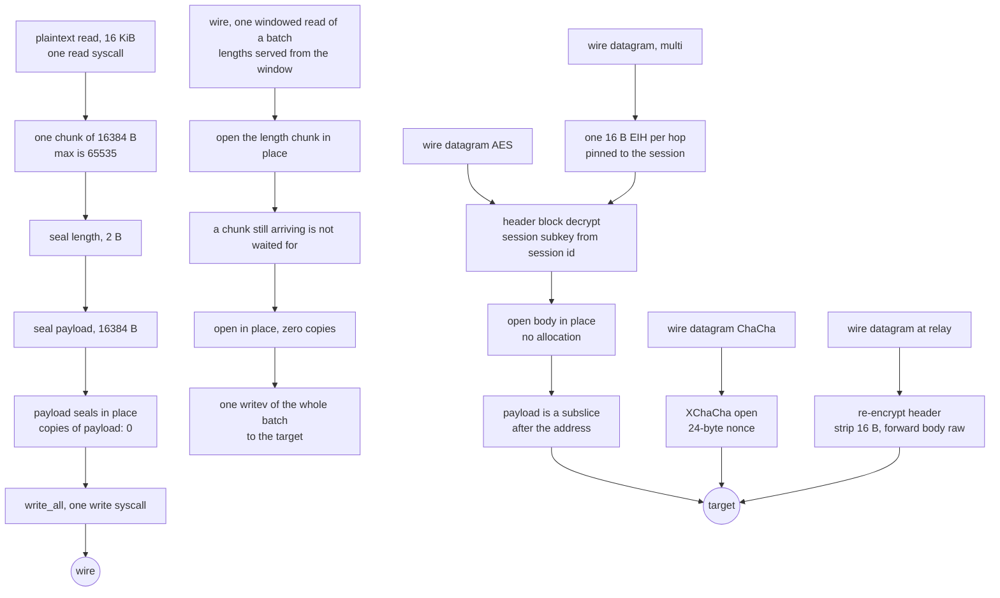

# Shadowsocks 2022

SIP022 (`2022-blake3-aes-128-gcm`, `2022-blake3-aes-256-gcm`, `2022-blake3-chacha20-poly1305`) on the same relay shape as the AEAD rung: one buffer per relay read, one write per read, seals and opens in place.

A TCP session is `salt || AEAD(fixed) || AEAD(variable) || data*` where `fixed` is `type(0) || timestamp(8) || var_len(2)` and `variable` is `address || padding_len(2) || padding || early*`. The response is `salt || AEAD(fixed) || AEAD(first payload)` with `type(1) || timestamp(8) || request_salt || first_len(2)`, and the first downlink read is folded into that head the way xray-core's `ServerStreamWriter` does; a target that closes without data gets `first_len 0` and no payload. Data chunks are `AEAD(len(2)) || AEAD(payload)` up to 65535 bytes, so a 16 KiB relay read is one chunk. UDP AES is `AES(header) || AEAD(body)` with the body nonce from the header and a per-session subkey; UDP ChaCha is `nonce(24) || XChaCha(body)` under the PSK. Server replies are server-typed (`type(1)` plus the client session id) with the server's own session and packet counters, so an Xray or sing-box peer accepts them and a foreign client session is refused. Multi-user (AES only) prefixes one 16-byte EIH per hop: the identity subkey from the master decrypts to the user hash on TCP, and the raw block plus an XOR does it on UDP. Relay (AES, TCP and UDP) strips that outer EIH and forwards the rest raw: `salt || rest` on TCP, re-encrypted header plus untouched body on UDP. That `address` is SOCKS-shaped, so a dial that was handed a name writes ATYP 3 with its own length and lets the edge answer the lookup.

The AEAD sits on the same ladder as the AEAD rung: AES-GCM through `aesgcm`, ChaCha through `aead`, XChaCha through `hchacha` plus the IETF AEAD. The KDF is `blake3::derive_key` (`shadowsocks 2022 session subkey`, `shadowsocks 2022 identity subkey`) and `blake3::hash` truncated for the user hash. Timestamps and the salt filter live in `ferrox-app`, so `ferrox-core` stays deterministic.

The carrier carries TLS as the other protocols' rows do: over KCP the session sits above the connection in both roles, so the listener reads the header from the terminated stream and the dial writes it there (`a_shadowsocks_kcp_inbound_that_declares_tls_answers_the_session`, `a_shadowsocks_kcp_dial_under_tls_wraps_the_header_in_the_session`). On every TCP carrier — raw, ws, httpUpgrade, gRPC, xhttp, http header — the listener terminates the session before the carrier accept and the dial writes the request inside it; `a_shadowsocks_inbound_that_declares_tls_answers_every_carrier` holds the pair for every carrier and `a_shadowsocks_outbound_keeps_tls_on_a_non_kcp_carrier` the parse.

The config arrives in the two spellings xray builds: the JSON dialect this tree reads directly, and the protobuf `xray.core.Config` the reference's scenario suite spawns over `-config=stdin: -format=pb`. `xray_pb.rs` decodes `xray.proxy.shadowsocks_2022.ServerConfig`, `MultiUserServerConfig`, `RelayServerConfig` and `ClientConfig` into the JSON shapes above — a single method and PSK, a master plus one client key per user joined into one colon list, a master plus per-destination keys, and the one server an outbound dials — and `a_shadowsocks_2022_scenario_decodes_both_roles`, `a_2022_multi_user_config_becomes_one_colon_password` and `a_2022_relay_config_carries_each_destination` hold each translation. That decode is what lets the pinned suite run the method unmodified: `TestShadowsocks2022Tcp` and `TestShadowsocks2022UdpAES128`/`AES256`/`Chacha` drive both roles through `scripts/xray-scenarios.sh` in `conformance.yml`, the checker for the drop-in claim on this row.

## Data path



## Measured

Every row is a claim with a checker that runs. `scripts/method-counts.txt` holds the same rows and `scripts/check-method-docs.sh` fails if this page and that file disagree.

<!-- counts:begin -->
| key | value | checked by |
| --- | --- | --- |
| ops-retired-instructions | UNBLESSED | scripts/count-ops.sh |
| aead-calls-per-chunk | 2 | ferrox-core-shadowsocks2022::tests::every_method_round_trips_a_chunk_and_refuses_a_forged_tag |
| maximum-payload-per-chunk | 65535 | ferrox-core-shadowsocks2022::tests::every_method_round_trips_a_chunk_and_refuses_a_forged_tag |
| write-syscalls-per-16KiB-relay-read | 1 | ferrox-app-shadowsocks2022::tests::one_relay_read_becomes_one_write_and_reads_back_whole |
| client-handshake-write-syscalls | 1 | ferrox-app-shadowsocks2022::tests::a_client_handshake_leaves_in_one_write |
| payload-chunks-per-16KiB-relay-read | 1 | ferrox-app-shadowsocks2022::tests::one_relay_read_becomes_one_write_and_reads_back_whole |
| user-space-copies-per-byte-written | 0 | ferrox-app-shadowsocks2022::tests::one_relay_read_becomes_one_write_and_reads_back_whole |
| user-space-copies-per-byte-read | 0 | ferrox-app-shadowsocks2022::tests::chunks_open_that_seal_sealed_and_reject_damage |
| zero-filled-bytes-per-chunk | 0 | ferrox-app-shadowsocks2022::tests::chunks_open_that_seal_sealed_and_reject_damage |
| chunk-buffer-allocations-per-connection | 1 | ferrox-app-shadowsocks2022::tests::chunks_open_that_seal_sealed_and_reject_damage |
| downlink-stage-bytes-per-connection | 0 | ferrox-app-shadowsocks2022::tests::the_carrier_and_the_window_ask_the_socket_as_one |
| downlink-chunks-per-opened-batch | 8 | ferrox-app-shadowsocks2022::tests::a_bulk_read_serves_every_buffered_chunk |
| target-write-syscalls-per-opened-batch | 1 | ferrox-app-shadowsocks2022::tests::a_bulk_read_serves_every_buffered_chunk |
| reads-spent-waiting-for-an-incomplete-chunk | 0 | ferrox-app-shadowsocks2022::tests::a_batch_never_waits_for_a_chunk_that_has_not_arrived |
| udp-payload-buffers-per-datagram | 0 | ferrox-app-shadowsocks2022::tests::an_opened_payload_is_the_datagrams_own_bytes |
| udp-multi-user-eih-bytes-per-packet | 16 | ferrox-app-shadowsocks2022::tests::udp_multi_user_packs_one_eih_and_opens_with_the_pinned_psk |
| udp-relay-header-bytes-stripped-per-packet | 16 | ferrox-app-shadowsocks2022::tests::udp_relay_strips_one_header_and_still_opens |
| udp-relay-forward-reallocations-after-the-first | 0 | ferrox-app-shadowsocks2022::tests::a_forwarded_datagram_is_written_into_a_buffer_that_stops_growing |
| udp-relay-reply-reallocations-after-the-first | 0 | ferrox-app-shadowsocks2022::tests::a_reply_body_is_opened_into_a_buffer_that_stops_growing |
| udp-server-reply-client-session-bytes | 8 | ferrox-app-shadowsocks2022::tests::udp_server_replies_are_server_typed_and_stay_with_their_session |
| subkey-heap-buffers-per-connection | 1 | ferrox-core-shadowsocks2022::tests::a_cipher_holds_one_heap_buffer_for_aes_and_none_for_chacha |
| subkey-heap-buffers-per-derivation | 0 | ferrox-core-shadowsocks2022::tests::deriving_a_session_subkey_costs_no_heap_buffer |

<!-- counts:end -->

## Ops

```bash
./scripts/count-ops.sh report \
  shadowsocks2022::tests::one_relay_read_becomes_one_write_and_reads_back_whole \
  'shadowsocks2022::seal_all'
```

The row above is `UNBLESSED`: nobody has read a measured number for this symbol out of a callgrind run, so this page does not state one. `scripts/expected-ops.txt` still blesses exactly one symbol, `der_to_pem`. Blessing a count means reading the diff that moved it, never copying a measurement to silence a gate. `scripts/method-ops.txt` now carries a `session_subkey` row pointed at `the_session_subkey_probe_costs_the_derive_and_nothing_else` — a repeated derive over one fixed input — so CI can price the KDF apart from the AEAD and turn that portion of the `UNBLESSED` row toward a number; blessing it still means reading the measured count against the pre-change run, which is CI-only where valgrind is absent.

## Time

**Not measured yet.** Wall clock for this method needs the same `ferrox-bench` cipher gate the AEAD rung uses, extended to the three 2022 methods at the same chunk lengths, run on a named CI runner. No CI artefact has been read, so this page quotes no duration. Timing needs a named runner; a number from a laptop behind a VPN measures the tunnel.

## What we removed

- **The client handshake's separate writes.** `client_send_handshake` wrote the salt on its own, one write per EIH hop, and the sealed fixed and variable chunks on another. SIP022 §3.1.4 and xray-core's `WriteTCPRequest` stage all of it in one buffer and write once. The handshake now builds the salt, EIH chain, fixed chunk and variable chunk in one staging buffer and seals the two chunks where they lie, so a single write carries the whole handshake. `a_client_handshake_leaves_in_one_write` counts the writer calls and parses the bytes back; `client-handshake-write-syscalls 1`. The named cost: the salt and EIH chain are copied into the staging buffer once, and the staging buffer is one allocation per handshake; the header vectors it replaces are gone.
- **A `host:port` string per datagram.** The datagram lane's target was re-serialised into a `host:port` string for the resolver, so every datagram that named a host paid a string the resolver then had to take apart again. The resolver is asked for a host and a port now, the way this tree already asks on the flow's own dial, and the `host:port` spelling is gone from the tree. Read against the pinned implementations, all of which are in `upstream/` for reading and never copied:

- **A second chunk per 16 KiB read.** The AEAD rung caps at 16383, so a relay read is two chunks and four AEAD calls. The 2022 cap is 65535, so the same read is one chunk and two calls. The wire bytes are the same stream in the same order, only fewer length headers.
- **The MD5 chain and HKDF-SHA1.** The AEAD rung derives the master from the password with one or two MD5s and the subkey with HKDF-SHA1 per direction. The 2022 PSK is base64 or raw at the key length, and the subkey is one `blake3::derive_key` over `PSK || salt`. No chain, no HMAC, one hash.
- **The read-side copy and the per-chunk allocation.** `open_chunk` decrypts the length and the payload inside the caller's `WIRE_MAX` buffer and returns a subslice, the same shape as the AEAD rung. UDP opens inside the caller's datagram and returns a subslice, both for client datagrams and server replies; `an_opened_payload_is_the_datagrams_own_bytes` asserts the pointer lies inside the datagram, so the `opened` buffer and its copy are gone (`udp-payload-buffers-per-datagram 0`).
- **The 2 KiB cap on the request's variable header.** The parser refused a request whose `var_len` exceeded 2048, but SIP022 bounds it only by its `u16` field, and every pinned client folds its first payload into that header after the padding — up to 8 KiB in xray-core-rust. A bulk upload from that client lost its handshake after the fixed chunk, so the peer saw a truncated upload. The header now accepts the full `u16` length, reads it once into a buffer sized by the wire, and drains the address and padding out of that same allocation; the fixed chunk reads through a stack array. `a_large_variable_header_is_a_request_not_a_refusal` drives an 8 KiB first write at an AES-128 request, recovers the destination and the early bytes, and measures exactly one allocation for the whole header; the server half is measured by `shadowsocks2022-raw-up-1` and `shadowsocks2022-raw-duplex-8` in the CI matrix.
- **An eager zero-length response head.** The server used to send `salt || AEAD(fixed)` with `first_len 0` before reading the target, then every downlink byte in a length-prefixed chunk. xray-core and ferrox clients accepted that shape, but xray-core-rust and zeronet did not: both parse the first payload from the head, and zeronet rejects a zero `first_len` outright. The head now leaves with the first downlink read in one write where the carrier has `writev`, `salt || AEAD(fixed) || AEAD(first payload)`, matching the pinned xray-core server; `the_response_head_folds_the_first_downlink_chunk` is the witness. The named cost: a target that sends nothing until the client writes still gets its head only when the first downlink byte arrives, which is the reference's lazy shape.

- **The 32 KiB stage in front of the codec on the xhttp downlink.** The dial used to wrap the carrier in a `BufReader` before `pump_relay_carried`, so the codec's asks were served from a stage: socket → stage → wire buffer, two user-space copies per byte across the whole downlink, because both of this rung's asks — the 18-byte sealed header and the length plus its tag — sit under the stage's capacity. The wrap is gone; `relay_downlink` is the downlink the dial runs and the witnesses drive, carrier straight into window. The stage's own cost was measured at that boundary rather than the socket's, because the carrier caps a read at its record: `xhttp::Reader` asks the socket for `min(record, buf.len())`, so a stage's capacity never reaches it. `downlink-stage-bytes-per-connection 0`.
- **Two carrier asks per chunk, and a write per chunk.** `open_chunk` drew the 18-byte sealed length from the carrier and then drew the payload it names, so every chunk of the downlink cost two carrier reads and left for the target as one `write_all` of its own. The relay loop now runs the classic rung's shape: `ChunkReader` asks the carrier for the whole 65808-byte window once and opens the chunks where they lie, `open_batch` takes every chunk already in the window while waiting only for the first, and `drain_window` hands the opened plaintexts to the target in one `writev` per batch. `the_carrier_and_the_window_ask_the_socket_as_one` seals two chunks into real carrier records and records every width the carrier is asked for: the first ask is the window, and 18 and 1016 are absent. How many asks a batch costs over a real carrier is not a gate there — `connect_split` hands the pipelined tail to the carrier reader's prefix, so a window ask is answered at that boundary first and the count is the carrier's, not the codec's. The count lives with a source that answers the whole window: `a_bulk_read_serves_every_buffered_chunk` opens eight 8 KiB chunks, the window filled to its last byte, from one bulk read and hands them on in one vectored write whose bases all lie inside the window, so no plaintext is gathered out of it (`downlink-chunks-per-opened-batch 8`, `target-write-syscalls-per-opened-batch 1`) — and `a_batch_never_waits_for_a_chunk_that_has_not_arrived` shows one read spent and no second (`reads-spent-waiting-for-an-incomplete-chunk 0`), which is also the gate for the held length: a chunk whose length is drawn is never drawn again against the next chunk's nonce when its payload lands in the next batch. The named costs: the window is 257 bytes wider than the 65551-byte chunk buffer it replaces, a chunk that straddles the window's end moves its own leftovers once per compaction, and against a peer that frames bodies wider than a chunk the bulk ask reads past a chunk boundary where the two-ask shape stopped at it. A carrier with no `writev` still sees one write per chunk. No duration is quoted — no CI cell runs Shadowsocks 2022 over xhttp.
- **The write-side staging copy.** The relay uplink first read into a plain buffer and then copied every payload byte into a `staging` `Vec` while it sealed (`Cipher::seal_into` did the `extend_from_slice`), so a 16 KiB read cost one user-space copy per byte. The seal now happens where the bytes already are: `seal_all` seals the 2-byte length into the headroom and the payload in place between the headroom and a tailroom tag, then `write_all`s the caller's buffer once. `one_relay_read_becomes_one_write_and_reads_back_whole` is the witness: it records the `write` base pointer and asserts it *is* the caller buffer's base, and that the buffer neither moves nor grows — pointer identity, not a byte comparison, since the bytes are identical either way.
- **A heap allocation in the KDF hot path.** `session_subkey` first built a `Vec` for `PSK || salt` plus a `Vec` for the output, so `Cipher::from_psk` cost three allocations. The material now lives in a 64-byte stack array and the 32-byte derive output is sliced, so the cipher costs what the AEAD rung costs: one heap buffer for AES, none for ChaCha.
- **The last heap buffer in the subkey derivation, and a dead twin.** `session_subkey` still returned a `Vec<u8>` of the key-length-truncated subkey, yet all seven call sites fed it straight to `Cipher::from_subkey`, which copies what it needs into its own 32-byte key field and never keeps the `Vec`. So every derivation — including the relay reply path, which rebuilds the cipher per datagram — allocated and freed a buffer for a value that dies in the same call. `derive32` already hands back a 32-byte stack array (and `blake3::derive_key` always yields 32, so nothing was truncated into a heap in the first place), so `session_subkey` now returns that array and the callers slice it: `subkey-heap-buffers-per-derivation 0`, witnessed by `deriving_a_session_subkey_costs_no_heap_buffer` at salt lengths 8, 16 and 32. `seals_match_the_crates_they_replace` still pins the derived bytes against `aes_gcm`, and the UDP echo suites (`udp_relay_carries_an_echo_end_to_end`, `udp_server_replies_are_server_typed_and_stay_with_their_session`) round-trip through every changed call site. The `identity_subkey` wrapper was removed outright: it returned the same `Vec` shape, nothing called it, and `encrypt_eih`/`decrypt_eih` derive the identity subkey through `derive32` directly.
- **A second vector path for UDP ChaCha.** The 24-byte nonce goes through `hchacha` once to a subkey plus the IETF AEAD, the same ladder the TCP ChaCha chunks use. No `XChaCha20Poly1305` crate on the hot path; the crate only appears in the differential test.
- **A staging allocation plus a copy per UDP packet.** Both seals first built the body in a fresh `Vec` and then copied it into the wire buffer; the header seal took the same shape. The fields are now written straight into the thread's `sealed` buffer and `seal_tail_with_nonce`/`x_seal_tail` encrypt the tail where it lies, so a seal costs no allocation and no second pass. `tail_seals_are_the_copies_they_replace` holds the two shapes byte-equal at every probed length.
- **A BLAKE3 plus an AES key schedule per UDP packet.** The server derived the body subkey and boxed the engine on every datagram, and the client did the same. The subkey and the engine now live in the session entry after the first packet of the session, so later packets pay the lookup and nothing else. The round-trip suites pass through the cached paths, and the cipher still costs what the manifest says per connection.
- **Two relay-loop copies per UDP datagram.** The serve loop cloned every payload and every reply into a fresh `Vec` to end a borrow. The borrows now end before the maps are touched — the session id travels by value — so both directions hand subslices to the sockets.
- **A fresh `Vec` per relayed datagram, both directions.** `relay_udp_forward` returned a `Vec::with_capacity` and `relay_udp_client_of` opened its body with `packet[16..].to_vec()`, so every datagram the relay carried allocated a buffer and freed it before the next arrived. Both now write into a caller-owned buffer the serve loop reuses. `a_forwarded_datagram_is_written_into_a_buffer_that_stops_growing` and `a_reply_body_is_opened_into_a_buffer_that_stops_growing` carry one size twice and assert the buffer's pointer is unmoved and its capacity did not grow — pointer identity, not a byte comparison, since the bytes are identical either way (`udp-relay-forward-reallocations-after-the-first 0`, `udp-relay-reply-reallocations-after-the-first 0`).
- **A `user_hash` per destination, per datagram, at the relay.** The forward path matched the decrypted EIH hash by re-deriving `user_hash(dest_psk)` inside the search — once per destination it might yet reach, once per datagram. The destinations are fixed for the relay's life, so their hashes are computed once into `relay_dests` and each forwarded datagram compares hashes it already holds: no derivation on the forward path. `blake3::hash` is not behind a counter a test can read, so this is prose and not a blessed row; the relay suites still witness the match is exact.
- **A thread per parked relay direction.** Both directions of the TCP relay ran as a spawned blocking copy: the sealing leg owned a thread that parked in `read`, and the accepting caller ran the opening leg until the carrier stopped, so a quiet session held two threads. `pump_relay_carried` now submits both legs to the lane pool as steps and returns: `Downlink` reads the server salt, the fixed header and the first chunk a read at a time, and `ChunkReader::try_fill` asks once and hands the worker back instead of waiting. `a_live_session_costs_no_thread` holds eight live sessions with no traffic and the task count does not move; the byte path is unchanged, so the framing tests and the echo suites stand as before.
- **The relay buffers' zero fill.** The uplink thread's seal staging, the EIHDR relay's three leg buffers and `wire_buffer` — the downlink's 64 KiB chunk — were per-flow `vec![0u8; n]` callocs; they now read through `RelayBuf`, which asks for the bytes without filling them. The uplink window is unchanged because `RelayBuf` gained a caller-chosen length — the 32 bytes of headroom and tailroom sit outside the read window rather than shrinking it. Nothing past a reported read escapes: the staging test seals through the uninitialised buffer, and the open-path tests refuse a short or damaged chunk without reading the unfilled rest. What retires is the memset per flow, witnessed by the CI RSS matrix, not by a count row. The UDP server's two receive slots and its reply slot join them on the same shape: each is a `recv_from` target whose reported prefix is all any path reads.

What is **not** removed, and is named rather than claimed: `rc4-md5`, `aes-192-gcm`, `none` and the stream ciphers (`aes-*-ctr`, `aes-*-cfb`, `chacha20-ietf`, `xchacha20`) still parse to `None` and are refused by name, because they are broken, deprecated or outside the ladder rather than missing; `simple-obfs` and `sip003` stay in their own carrier rows and are not carried here; ChaCha multi-user stays refused (`NewMultiService` in sing-box and `inbound_multi.go` in Xray both reject it), so a colon list with a ChaCha method is refused on TCP and UDP alike. The relay reply path also still derives the session subkey and the AES key schedule on every reply datagram: `relay_udp_client_of` rebuilds the cipher per packet rather than caching it per session, because a per-session cache would hold up to the relay's 4096-session ceiling alive and buy CPU with the very RAM this slice is meant to spend less of — a trade measured and left un-taken, not smuggled into a leaner commit.

## CI scope

What a change here owes, read by `scripts/ci-scope.py`; see [`docs/ci-scope.md`](../ci-scope.md).

<!-- scope:begin -->
- paths: crates/ferrox-core/src/shadowsocks2022.rs, crates/ferrox-app/src/shadowsocks2022.rs
- symbols: shadowsocks2022
- scenarios: shadowsocks2022-raw
- oracle: shadowsocks
- go: ./proxy/shadowsocks_2022/...
<!-- scope:end -->
