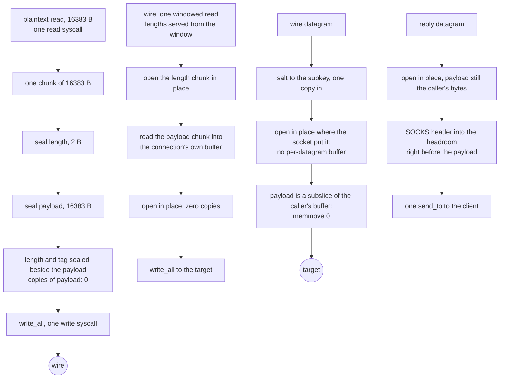
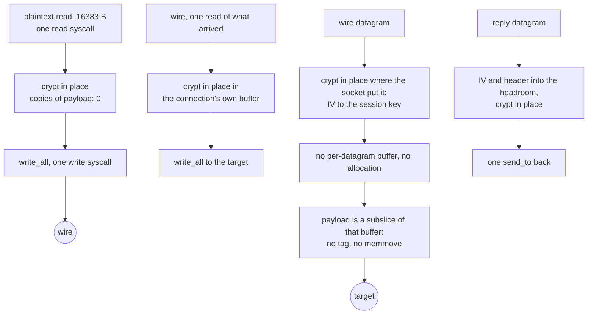

# Shadowsocks

The one method in this tree whose *whole* job is framing, so it is the rung
where the copies and the syscalls were easiest to remove.

A TCP chunk is `seal(2-byte length)` then `seal(payload)`, each with its own
16-byte tag, both under one per-direction nonce counter derived by HKDF-SHA1
from an MD5 chain over the password. That is SIP004, and the two seals per
chunk are not an implementation choice — a peer must not be able to tell which
chunk length we claim until after it has opened the length itself.

`rc4-md5` is the same rung as a stream: a 16-byte IV in the clear, then the
address header and every payload byte under RC4 with `MD5(master ++ IV)` as
the per-direction key. No chunks, no tags, no counters — the keystream position
*is* the state, so crypting writes into the buffer it read and the relay keeps
no staging buffer at all. sing-box carries it as an outbound method
(`option/shadowsocks.go`); the cipher itself lives out of tree in
`sagernet/sing-shadowsocks2`, so the wire shape here is written off the public
stream-cipher spec and the checked part is the RC4 core against its published
vectors, stated plainly below.

The AEAD sits on [`ferrox-core`'s own ChaCha20-Poly1305](../../crates/ferrox-core/src/aead.rs)
and, for `aes-128-gcm`/`aes-256-gcm`, on [our AES-GCM ladder](../../crates/ferrox-core/src/aesgcm/mod.rs).
`xchacha20-ietf-poly1305` derives a per-chunk subkey with HChaCha from the first
sixteen extended-nonce bytes and seals with the same IETF AEAD over an inner
nonce of four zero bytes plus the last eight. Neither takes a pointer to a scratch buffer: `seal_into` writes the plaintext
into the caller's buffer and encrypts it where it lies.

## Data path



A stream datagram is `IV` then the header and payload under that datagram's
key, and a stream relay read is crypt-then-write of the same buffer:



## Measured

Every row is a claim with a checker that runs. `scripts/method-counts.txt`
holds the same rows and `scripts/check-method-docs.sh` fails if this page and
that file disagree.

<!-- counts:begin -->
| key | value | checked by |
| --- | --- | --- |
| ops-retired-instructions | UNBLESSED | scripts/count-ops.sh |
| aead-calls-per-chunk | 2 | ferrox-core-shadowsocks::tests::every_method_round_trips_a_chunk_and_refuses_a_forged_tag |
| maximum-payload-per-chunk | 16383 | ferrox-core-shadowsocks::tests::every_method_round_trips_a_chunk_and_refuses_a_forged_tag |
| write-syscalls-per-relay-read | 1 | ferrox-app-shadowsocks::tests::one_relay_read_becomes_one_write_and_reads_back_whole |
| payload-chunks-per-relay-read | 1 | ferrox-app-shadowsocks::tests::one_relay_read_becomes_one_write_and_reads_back_whole |
| user-space-copies-per-byte-written | 0 | ferrox-app-shadowsocks::tests::one_relay_read_becomes_one_write_and_reads_back_whole |
| user-space-copies-per-byte-read | 0 | ferrox-app-shadowsocks::tests::chunks_open_that_seal_sealed_and_reject_damage |
| chunk-buffer-allocations-per-connection | 1 | ferrox-app-shadowsocks::tests::a_bulk_read_serves_every_buffered_chunk |
| udp-payload-buffers-per-datagram | 1 | ferrox-app-shadowsocks::tests::an_opened_payload_is_the_callers_own_bytes |
| udp-datagram-reallocations-after-the-first | 0 | ferrox-app-shadowsocks::tests::an_opened_payload_is_the_callers_own_bytes |
| subkey-heap-buffers-per-connection | 1 | ferrox-core-shadowsocks::tests::a_cipher_is_one_heap_buffer |
| stream-iv-bytes-per-handshake | 16 | ferrox-app-shadowsocks::tests::stream_relays_an_echo |
| stream-write-syscalls-per-relay-read | 1 | ferrox-app-shadowsocks::tests::stream_relay_read_becomes_one_write |
| stream-crypt-allocations-per-call | 0 | ferrox-core-shadowsocks::tests::rc4_crypt_is_in_place_and_allocates_nothing |
| stream-crypt-copies-per-byte | 0 | ferrox-core-shadowsocks::tests::rc4_crypt_is_in_place_and_allocates_nothing |
| stream-udp-payload-buffers-per-datagram | 1 | ferrox-app-shadowsocks::tests::an_opened_payload_is_the_callers_own_bytes |
| stream-udp-datagram-reallocations-after-the-first | 0 | ferrox-app-shadowsocks::tests::an_opened_payload_is_the_callers_own_bytes |

<!-- counts:end -->

## Ops

```bash
./scripts/count-ops.sh report \
  shadowsocks::tests::the_stream_cipher_costs_the_prga_loop_and_nothing_else \
  'ferrox_core::shadowsocks::tests::the_stream_cipher_costs_the_prga_loop_and_nothing_else'
```

The row above stays `UNBLESSED` on purpose: `scripts/expected-ops.txt` blesses
exactly one symbol, `der_to_pem`, and blessing means reading the diff that moved
a count, never copying a measurement to silence a gate.

`Rc4::crypt` cannot be charged at all: the release profile inlines it into its
caller, so its own frame does not exist and `Ir=inlined-not-a-frame` is the
honest report. What is measurable is the probe `scripts/method-ops.txt` points
this method's row at —
`shadowsocks::tests::the_stream_cipher_costs_the_prga_loop_and_nothing_else`,
64 in-place `crypt` calls over one 1 KiB stack buffer with one fold as the
witness. Three CI runs of that row read `1297641`, `1297641` and `1297577`; the
first two are the same code on two different bases, which is what makes this row
a usable delta instead of a duration.

The third is the delta, and it says there is nothing to win. A hoist of `i` and
`j` out of `&mut self` into registers, replacing the swap and the post-swap reload
pair with the identity the swap leaves behind (`table[i] == sj`, `table[j] == si`,
so the key byte is `table[si + sj]`), takes the state traffic from six table reads
and two writes to three reads and two writes and deletes the four accesses the
counters made per byte — seven of the twelve memory ops the loop performs on the
table and the state. Over 65,536 keystream bytes that predicted hundreds of
thousands of counts; the artefact moved **64**, 0.005% of the frame. The store
of `self.i` and the reload of `self.s[i]` were already gone: the loop's own
memory-to-register promotion removes the counter traffic, and store-to-load
forwarding answers `self.s[i]`/`self.s[j]` right after the swap wrote them. The
hand-written version spells out work the codegen was already doing, at eight
lines and a reborrow, so the shorter body ships and the hoist is closed with both
numbers.

The absolute stays in prose rather than in the row, because the checker charges
the fold and 64 frame entries with the kernel and cannot separate them; per the
rule that a row's value must be what its named checker actually observes, `1297641`
is a baseline to difference against, not this method's cost. What was **not**
removed: the six per-byte table reads and two writes. RC4's keystream is one
serial state machine, so a gather-free vector form has nothing to widen — the
floor of this loop is the table traffic, and this is it.

## Time

**Not measured on this branch.** Wall clock for this method comes from
`ferrox-bench` gate 9 (`crates/ferrox-bench/src/ciphers.rs`), which seals the
same chunk lengths with the same AEAD methods and compares bytes and
allocation counts against the pinned reference. The stream makes no
wall-clock claim: its rows are counts (one write, zero copies, zero allocs),
not durations. `.github/workflows/bench.yml`
runs it on `linux x86_64`, `linux aarch64`, `macos aarch64` and
`windows x86_64` and publishes `target/bench-report.md` as an artefact. No
artefact from a run of this branch has been read, so this page quotes no
duration. Timing needs a named runner; a number from a laptop behind a VPN
measures the tunnel.

## What we removed

Read against the three pinned implementations, all of which are in
`upstream/` for reading and never copied:

- **Write syscalls, 4 to 1 per relay read.** Xray-core's
  `common/crypto/auth.go` seals each chunk into its own pooled 8 KiB buffer and
  hands the batch to `WriteMultiBuffer`, which coalesces with `writev`; but its
  *stream* path is entered once per `WriteMultiBuffer` call and takes a fresh
  `temp := buf.New()` scratch each time, so the batch size is the pipe's read
  granularity rather than a number chosen for syscalls. sing-box delegates the
  whole cipher to the out-of-tree `sagernet/sing-shadowsocks2`
  (`protocol/shadowsocks/outbound.go:15`), so what it batches is not readable in
  this pin and no threshold is claimed here. Zray sets
  `MAX_WRITE_BATCH = 4 × 16383` and
  drains once per batch. This tree seals the whole relay read around the
  payload where it lies — the length seals into 18 B of headroom, the tag
  lands in 16 B of tailroom — and issues one `write_all` over all three. The
  wire bytes are the same stream in the same order.
- **A zero-fill before every read.** The chunk reader used to do
  `chunk.resize(size + TAG_LEN, 0)` and then overwrite every byte of that range
  from the socket, and the same shape sat under the other six read targets in
  this file. They are now all built by `unfilled`, which reserves and hands out
  unwritten bytes: `wire_buffer`, the two-chunk window in `ChunkReader::new`,
  the handshake's seal buffer, the relay's uplink buffer and stream-downlink
  buffer, and the two datagram buffers in `serve_udp_on`. Every read writes the
  range it reports before any code reads it. `zero-filled-bytes-per-chunk` was
  a row on this page; no checker in `ferrox-app`'s test binary can observe a
  fill that does not happen, so it is named here and counted nowhere.
- **The read-side copy.** `Cipher::open_in_place` decrypts inside the caller's
  buffer and returns a subslice of it, so the read path moves a payload byte
  zero times in user space. Zray also decrypts in place, inside one reusable
  `ReadBuffer`; Xray's `readBuffer` path allocates a fresh `buf.Buffer` per
  chunk (`auth.go:137`) and, above the chunk padding, merges into a whole new
  `MultiBuffer` with `buf.MergeBytes` (`auth.go:202`), which is a second copy
  and a whole new `MultiBuffer` per chunk.
- **A branch per chunk length.** `open_length` refuses sizes past `MAX_CHUNK`,
  the one bound every buffer in this method is sized for, without needing a
  second constant to stay honest. Both chunk readers share it, so the framing
  check lives in one place no matter how the bytes arrived.
- **A second vector path for the extended nonce.** HChaCha runs once per chunk
  as scalar integer math in `chacha::hchacha`; the payload still goes through
  the same AVX2/NEON/portable `Lanes` ladder as every other ChaCha chunk, so
  no second transpose and no second store exist. The subkey and the inner nonce
  live on the stack, and the method dispatch is one `match` on `Aead`, hoisted
  out of the per-byte loop rather than a string compare per chunk.
- **Two of the three copies every UDP payload made.** The old open path took
  the sealed datagram with `to_vec` — a `malloc` plus a full `memcpy` — opened
  the AEAD in place, then `copy_within(used..len, 0)` moved the whole payload
  down to offset zero so the caller could hand it on, and the old seal path
  built each datagram in a fresh `Vec` too. The salt and the address header both
  precede the payload, so one copy in is unavoidable; the `memmove` and the
  per-datagram allocations were not. `open_datagram` opens the packet where the
  socket put it and returns a subslice; `seal_datagram` writes the salt or IV
  and the header into the headroom of the caller's buffer and the tag right
  after the payload, and returns a subslice too. Nothing in between needed
  state, so the `Datagrams` struct is gone and the two free functions are the
  API. `an_opened_payload_is_the_callers_own_bytes` is the gate, over
  `Aes256Gcm` and `Rc4Md5` both: eight rounds assert that the sealed packet and
  the opened payload each lie inside the caller's buffer
  (`udp-payload-buffers-per-datagram 1`,
  `stream-udp-payload-buffers-per-datagram 1`) and that the buffer neither
  moves nor grows (`udp-datagram-reallocations-after-the-first 0`,
  `stream-udp-datagram-reallocations-after-the-first 0`). Same pointer-identity
  idiom as `frames_reuse_the_callers_buffers`. The 16-byte tag copy and the
  `memmove` are named rather than counted: no test observes a copy that does
  not happen, so they are not in the table.
- **The reply's third buffer.** `spawn_ss_udp_reader` used to hand the opened
  payload to a fresh `Vec` holding the three SOCKS reply bytes, the address and
  the payload. It now opens in place, writes `[0, 0, 0]` and the address header
  into the headroom that lies immediately before the opened payload, and sends
  `&buf[start..at + len]` in one `send_to`: the reply is the caller's read
  buffer, with the reply header composed in front and the trailing tag left
  out. Named, not counted, for the same reason as the bullet above.
- **A 16-byte tag copy per chunk.** `Cipher::open_in_place` split the tag off
  with `split_at_mut` and then built a `[u8; TAG_LEN]` on the stack to pass by
  reference. It now borrows the sixteen bytes that are already there, which is
  the shape `vmess.rs` already used. Small next to the AEAD, but it is one
  `memcpy` per chunk and it is gone.
- **A second 16 KiB buffer alive for the whole connection.** The server's first
  chunk buffer was shadowed by the slice borrowed out of it, so it stayed live
  until the function returned while `pump_relay_carried` allocated its own;
  every Shadowsocks connection held 32 KiB where it needed 16. Both handoff
  paths now drop the head buffer once the address has been forwarded.
- **The staging buffer on either path.** An AEAD relay read used to copy
  every chunk into staging because two seals shared one write; now both seals
  land beside the payload in the read buffer, which carries 34 B of
  headroom and tailroom sized once per connection. A stream crypt needs no
  staging either, and `seal_all` crypts the read buffer where it lies on both
  paths. `stream_relay_read_becomes_one_write` is the gate for the stream
  path; the pointer-identity asserts in
  `one_relay_read_becomes_one_write_and_reads_back_whole` are the gate for
  the AEAD path: the write leaves from the caller's buffer, which never moves
  or grows.
- **A per-chunk dispatch for the stream.** The AEAD seal matches on the cipher
  per chunk because the ladder differs per method. The stream matches once per
  read in `seal_all` — one `match` on `Uplink` outside any per-byte loop — and
  the per-byte loop itself is three wrapping adds, two swaps and one xor with
  no branches at all.
- **The UDP tag and the third copy on the stream path.** A stream datagram is
  `IV` plus header plus payload with no tag: sealing writes the IV and header
  into the caller's headroom and crypts header and payload where they lie, and
  opening crypts the packet in place and returns a subslice — the same
  one-copy-in shape as the AEAD path minus the tag bytes.
- **A read syscall per 18 B length.** The relay loop used to read each sealed
  length with its own `read_exact` before reading the payload it named. It now
  keeps a two-chunk window over the downlink: lengths open out of buffered
  bytes while payloads still land straight in the caller's buffer, so a bulk
  read serves the length, the payload and usually the next length in one
  syscall. `a_bulk_read_serves_every_buffered_chunk` is the gate: one
  underlying read for two chunks from a source that answers the whole window.

What is **not** removed, and is named rather than claimed: `aes-192-gcm`,
`none` and the remaining stream ciphers (`aes-128-ctr`, `aes-192-ctr`,
`aes-256-ctr`, `aes-128-cfb`, `aes-192-cfb`, `aes-256-cfb`, `chacha20-ietf`,
`xchacha20`) still parse to `None` and are refused by name
(`a_method_outside_the_rung_is_refused` is the gate) because they are broken,
deprecated or outside the ladder rather than missing; the 2022 family lives in
[shadowsocks-2022](shadowsocks-2022.md) and is no longer refused here. The RC4
core itself is checked against its published vectors
(`rc4_matches_the_published_vectors`); the `MD5(key ++ IV)` composition follows
the public stream-cipher spec text and has no pinned oracle in this tree to
answer to, which is stated here rather than counted. The UDP path also builds
one AES key schedule per datagram: the salt is fresh every datagram, so the
subkey is new and there is nothing to hoist, but a per-thread cipher rebuilt in
place would save the `Box` the `Aes` engine pays per datagram. Reaching it means
a rekey surface on `ferrox-core/src/aesgcm`, whose scope covers the record
layer, so it is a P3 add-on recorded in `crates/ferrox-prompt/prompts.md`
rather than part of this slice.

## Pins

| what | where |
| --- | --- |
| AEAD chunking | `upstream/xray-core/common/crypto/auth.go`, `chunk.go` |
| AEAD chunking, delegated out of tree | `upstream/sing-box/protocol/shadowsocks/outbound.go` |
| AEAD chunking | `upstream/zeronet/crates/zero-protocol/src/shadowsocks.rs` |
| XChaCha AEAD, 32-byte salt | `upstream/xray-core/proxy/shadowsocks/config.go` |
| XChaCha spellings | `upstream/sing-box/option/shadowsocks.go` |
| `rc4-md5` outbound spelling, stream cipher table | `upstream/sing-box/option/shadowsocks.go` |
| method spellings, MD5 chain, HKDF info string | `ferrox-core-shadowsocks` |

## CI scope

What a change here owes, read by `scripts/ci-scope.py`; see [`docs/ci-scope.md`](../ci-scope.md).

<!-- scope:begin -->
- paths: crates/ferrox-core/src/shadowsocks.rs, crates/ferrox-app/src/shadowsocks.rs
- symbols: shadowsocks, ss
- scenarios: shadowsocks-raw
- oracle: shadowsocks
- go: ./proxy/shadowsocks/...
<!-- scope:end -->
