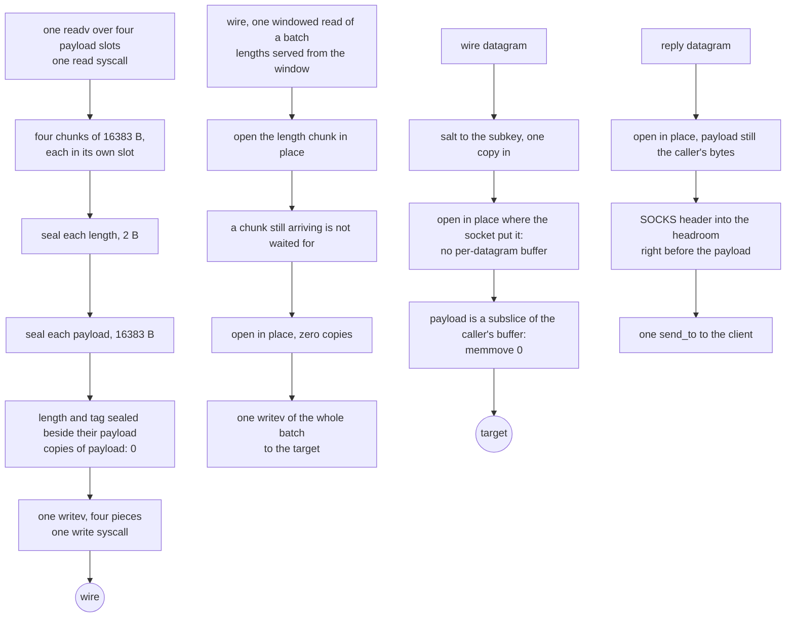
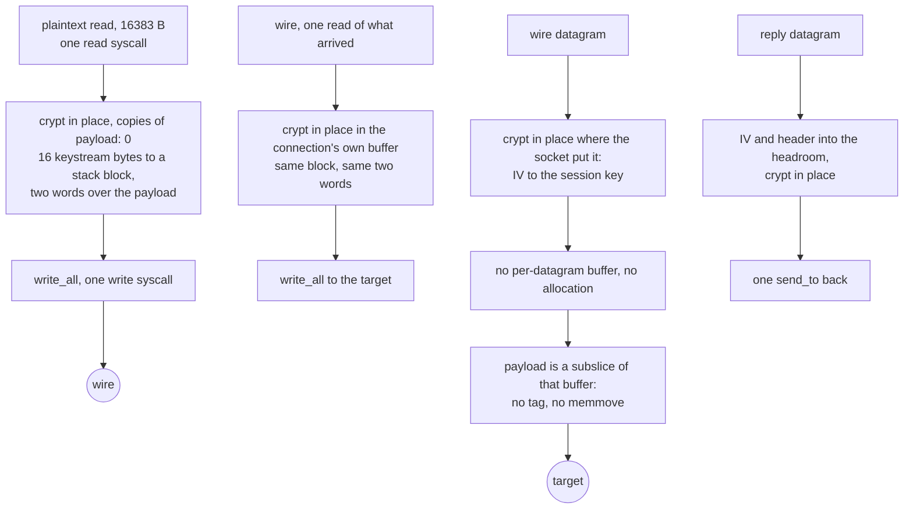

# Shadowsocks

The one method in this tree whose *whole* job is framing, so it is the rung where the copies and the syscalls were easiest to remove.

A TCP chunk is `seal(2-byte length)` then `seal(payload)`, each with its own 16-byte tag, both under one per-direction nonce counter derived by HKDF-SHA1 from an MD5 chain over the password. That is SIP004, and the two seals per chunk are not an implementation choice — a peer must not be able to tell which chunk length we claim until after it has opened the length itself.

The handshake's address header is SOCKS-shaped, so a dial that was handed a name writes it as ATYP 3 with its own length and the edge resolves it; a stream cipher puts the IV before it and an AEAD method salts around the whole thing, neither of which changes that byte.

A `settings.users` list is one account per entry, each with its own `method` — an entry that names none uses the inbound's — and `clients` replaces `users` whenever the key is present, an empty list serving nobody, which is how xray's own parser reads it (`upstream/xray-core/infra/conf/shadowsocks.go`). An AEAD listener cannot know which client a salt belongs to, so the probe tries the two salt lengths a method uses, smallest first, and reads only that salt plus one sealed length per step: a match never reads past its own salt, and a candidate that fails leaves the buffer untouched because the tag is checked before the body opens. UDP probes the same way per datagram and seals every reply with the salt length of the client that opened the flow; a stream cipher has no salt to probe, so the first stream client owns the listener the way it owns the TCP side. A client this tree cannot serve is named once and skipped so the rest of the list still serves; 2022 multi-user (one PSK per user, EIH) is not carried. `a_shadowsocks_inbound_serves_every_client_in_its_users_list` dials with the second client's password and refuses a stranger, and `a_datagram_opens_under_each_clients_own_cipher` holds the UDP half.

That chunk shape is not ours to change: `MAX_CHUNK = 0x3FFF` is the largest payload the pinned implementations will read, so a wider chunk is an interop break and the only thing left to buy is **chunks per syscall**. The relay now takes and hands on `CHUNKS_PER_BATCH = 4` of them at a time — one `readv` over four payload slots, four seals in place, one `writev` — and the bytes on the wire are the same stream at the same boundaries: tiling a plaintext run into chunks is a function of the run and `MAX_CHUNK` alone, `readv` fills iovecs in order so only the last slot can be short, and a batch read of four whole chunks can never leave a one-byte tail chunk. A carrier that has no `writev` gets std's default, one `write` per slice, which is exactly the per-chunk write it saw before — no WebSocket frame, gRPC message or xHTTP chunk changes size. The price is buffers, and it is an AEAD connection's price: its relay read buffer and downlink window are both sized for a batch, so it carries 80 KiB more than it did (`+82 121 B`, 16 417 → 65 668 uplink, 32 798 → 65 668 downlink), still one allocation per leg, and it buys 3.5× fewer syscalls per GiB (see Measured). `rc4-md5` pays none of it — its uplink keeps the one slot it had (`uplink_buffer_len`, gated by `a_stream_uplink_buffers_one_slot_and_an_aead_uplink_a_batch`), because a rung whose read fills one chunk has no batch to hold and four slots would be memory it never touches. `CHUNKS_PER_BATCH` is not tuned past that: the buffer cost is linear in it and 4 is the batch the pinned reference itself drains, so a wider batch is a larger trade rather than a cheaper one, and no CI run has yet priced one.

`rc4-md5` is the same rung as a stream: a 16-byte IV in the clear, then the address header and every payload byte under RC4 with `MD5(master ++ IV)` as the per-direction key. No chunks, no tags, no counters — the keystream position *is* the state, so crypting writes into the buffer it read and the relay keeps no staging buffer at all. sing-box carries it as an outbound method (`option/shadowsocks.go`); the cipher itself lives out of tree in `sagernet/sing-shadowsocks2`, so the wire shape here is written off the public stream-cipher spec and the checked part is the RC4 core against its published vectors, stated plainly below.

The AEAD sits on [`ferrox-core`'s own ChaCha20-Poly1305](../../crates/ferrox-core/src/aead.rs) and, for `aes-128-gcm`/`aes-256-gcm`, on [our AES-GCM ladder](../../crates/ferrox-core/src/aesgcm/mod.rs). `xchacha20-ietf-poly1305` derives a per-chunk subkey with HChaCha from the first sixteen extended-nonce bytes and seals with the same IETF AEAD over an inner nonce of four zero bytes plus the last eight. Neither takes a pointer to a scratch buffer: `seal_into` writes the plaintext into the caller's buffer and encrypts it where it lies.

The carrier carries TLS as the other protocols' rows do: over KCP the session sits above the connection in both roles, so the listener reads the header from the terminated stream and the dial writes it there (`a_shadowsocks_kcp_inbound_that_declares_tls_answers_the_session`, `a_shadowsocks_kcp_dial_under_tls_wraps_the_header_in_the_session`). On every TCP carrier — raw, ws, httpUpgrade, gRPC, xhttp, http header — the listener terminates the session before the carrier accept and the dial writes the request inside it; `a_shadowsocks_inbound_that_declares_tls_answers_every_carrier` holds the pair for every carrier and `a_shadowsocks_outbound_keeps_tls_on_a_non_kcp_carrier` the parse.

## Data path



A stream datagram is `IV` then the header and payload under that datagram's key, and a stream relay read is crypt-then-write of the same buffer:



## Measured

Every row is a claim with a checker that runs. `scripts/method-counts.txt` holds the same rows and `scripts/check-method-docs.sh` fails if this page and that file disagree.

<!-- counts:begin -->
| key | value | checked by |
| --- | --- | --- |
| ops-retired-instructions | UNBLESSED | scripts/count-ops.sh |
| aead-calls-per-chunk | 2 | ferrox-core-shadowsocks::tests::every_method_round_trips_a_chunk_and_refuses_a_forged_tag |
| maximum-payload-per-chunk | 16383 | ferrox-core-shadowsocks::tests::every_method_round_trips_a_chunk_and_refuses_a_forged_tag |
| write-syscalls-per-64KiB-relay-read | 1 | ferrox-app-shadowsocks::tests::one_relay_read_becomes_one_write_and_reads_back_whole |
| payload-chunks-per-64KiB-relay-read | 4 | ferrox-app-shadowsocks::tests::one_relay_read_becomes_one_write_and_reads_back_whole |
| read-syscalls-per-64KiB-relay-read | 1 | ferrox-app-shadowsocks::tests::one_relay_read_asks_for_every_slot_of_a_batch |
| target-write-syscalls-per-opened-batch | 1 | ferrox-app-shadowsocks::tests::a_bulk_read_serves_every_buffered_chunk |
| reads-spent-waiting-for-an-incomplete-chunk | 0 | ferrox-app-shadowsocks::tests::a_batch_never_waits_for_a_chunk_that_has_not_arrived |
| user-space-copies-per-byte-written | 0 | ferrox-app-shadowsocks::tests::one_relay_read_becomes_one_write_and_reads_back_whole |
| user-space-copies-per-byte-read | 0 | ferrox-app-shadowsocks::tests::chunks_open_that_seal_sealed_and_reject_damage |
| chunk-buffer-allocations-per-connection | 1 | ferrox-app-shadowsocks::tests::a_bulk_read_serves_every_buffered_chunk |
| udp-payload-buffers-per-datagram | 1 | ferrox-app-shadowsocks::tests::an_opened_payload_is_the_callers_own_bytes |
| host-port-strings-per-datagram | 0 | ferrox-app-shadowsocks::tests::a_datagram_target_is_resolved_without_a_host_port_string |
| udp-datagram-reallocations-after-the-first | 0 | ferrox-app-shadowsocks::tests::an_opened_payload_is_the_callers_own_bytes |
| subkey-heap-buffers-per-connection | 1 | ferrox-core-shadowsocks::tests::a_cipher_is_one_heap_buffer |
| udp-datagram-heap-buffers-per-datagram | 0 | ferrox-core-shadowsocks::tests::a_rekeyed_cipher_streams_datagrams_without_heap_traffic |
| stream-iv-bytes-per-handshake | 16 | ferrox-app-shadowsocks::tests::stream_relays_an_echo |
| stream-write-syscalls-per-relay-read | 1 | ferrox-app-shadowsocks::tests::stream_relay_read_becomes_one_write |
| stream-crypt-allocations-per-call | 0 | ferrox-core-shadowsocks::tests::rc4_crypt_is_in_place_and_allocates_nothing |
| stream-crypt-copies-per-byte | 0 | ferrox-core-shadowsocks::tests::rc4_crypt_is_in_place_and_allocates_nothing |
| downlink-stage-bytes-per-connection | 0 | ferrox-app-shadowsocks::tests::the_carrier_and_the_window_ask_the_socket_as_one |
| stream-downlink-stage-bytes-per-connection | 0 | ferrox-app-shadowsocks::tests::the_stream_downlink_asks_its_own_chunk_of_the_socket |
| stream-udp-payload-buffers-per-datagram | 1 | ferrox-app-shadowsocks::tests::an_opened_payload_is_the_callers_own_bytes |
| stream-udp-datagram-reallocations-after-the-first | 0 | ferrox-app-shadowsocks::tests::an_opened_payload_is_the_callers_own_bytes |

<!-- counts:end -->

What those per-batch rows add up to, as arithmetic on the rows and not as a measurement: one GiB in each direction is 65 540 chunks of 16 383 B. The uplink used to pay a read and a write for every one of them (131 080) and the downlink a read per 32 798 B window and a write per chunk (98 345), which is 229 425 syscalls per GiB both legs together. A batch is four chunks, so the uplink is 32 770 and the downlink 32 790: **65 560**, 3.5× fewer. No strace has counted this on a live relay — `scripts/count-ops.sh` counts retired instructions in a unit test, not syscalls on a socket, and every loopback test in this tree is told not to gate a syscall count — so the figure is what the gated rows imply, named here rather than blessed anywhere. What is measured is what the kernel work costs: the Time section's matched pair of `shadowsocks-raw-down-8` cells puts throughput against the reference at 1.162× before and 1.394× after, with disjoint intervals.

## Ops

```bash
./scripts/count-ops.sh report \
  shadowsocks::tests::the_stream_cipher_costs_the_prga_loop_and_nothing_else \
  'ferrox_core::shadowsocks::tests::the_stream_cipher_costs_the_prga_loop_and_nothing_else'
```

The row above stays `UNBLESSED` on purpose: `scripts/expected-ops.txt` blesses exactly one symbol, `der_to_pem`, and blessing means reading the diff that moved a count, never copying a measurement to silence a gate.

`Rc4::crypt` cannot be charged at all: the release profile inlines it into its caller, so its own frame does not exist and `Ir=inlined-not-a-frame` is the honest report. What is measurable is the probe `scripts/method-ops.txt` points this method's row at — `shadowsocks::tests::the_stream_cipher_costs_the_prga_loop_and_nothing_else`, 64 in-place `crypt` calls over one 1 KiB stack buffer with one fold as the witness. Repeated CI runs of that row read `1297641` (and once `1297577`), the same code on different bases landing on the same number — which is what makes this row a usable delta instead of a duration. The batch does not reach this probe's loop at all, the only instruction-level check it has, since `Cipher::seal_into` and `Cipher::open_in_place` both report `inlined-not-a-frame`.

The third is the delta, and it says there is nothing to win. A hoist of `i` and `j` out of `&mut self` into registers, replacing the swap and the post-swap reload pair with the identity the swap leaves behind (`table[i] == sj`, `table[j] == si`, so the key byte is `table[si + sj]`), takes the state traffic from six table reads and two writes to three reads and two writes and deletes the four accesses the counters made per byte — seven of the twelve memory ops the loop performs on the table and the state. Over 65,536 keystream bytes that predicted hundreds of thousands of counts; the artefact moved **64**, 0.005% of the frame. The store of `self.i` and the reload of `self.s[i]` were already gone: the loop's own memory-to-register promotion removes the counter traffic, and store-to-load forwarding answers `self.s[i]`/`self.s[j]` right after the swap wrote them. The hand-written version spells out work the codegen was already doing, at eight lines and a reborrow, so the shorter body ships and the hoist is closed with both numbers.

The absolute stays in prose rather than in the row, because the checker charges the fold and 64 frame entries with the kernel and cannot separate them; per the rule that a row's value must be what its named checker actually observes, `1297641` is a baseline to difference against, not this method's cost. What was **not** removed: the six per-byte table reads and two writes. RC4's keystream is one serial state machine, so a gather-free vector form has nothing to widen — the floor of this loop is the table traffic, and this is it.

The traffic that is *not* table traffic can still move, though. `crypt` used to read, xor and write one payload byte inside the same loop that walks the state, so three memory ops per byte sat on the critical path of a stream that needs them only at its end. The loop now walks sixteen keystream bytes into a block on its own frame and the block goes over the payload as two `u64` words; a call that ends mid-block fills the block short and folds it short, so the state advances by exactly the bytes crypted and no keystream byte is generated twice or skipped. The gate is new because the old ones could not see this: a wrong keystream round-trips against itself, so `rc4_md5_round_trips_every_length_and_turns_on_its_key`, `rc4_matches_the_published_vectors` and the fold's own 64 KiB checksum all pass a tail that over-consumes a block. `the_keystream_is_the_prga_bytes_at_every_block_edge` compares `crypt` with a second PRGA written in the test over its own table — at every length from 0 to 40, at 63, 64, 65, 127, 128, 129, 255, 256, 257, 4095, 4096, 8191 and 16 383, and across twelve carried calls of 1, 7, 8, 9, 15, 16, 17, 63, 64, 65, 3 and 100 bytes — and it is the only one of the four that fails that mutation. What the move costs and does not remove, both named: each keystream byte is now stored once and reloaded as part of a word, sixteen stores and two loads per block, and the table traffic stays exactly the six reads and two writes above.

Two CI reads of the probe's row, from `ops.yml`'s `method-ops` artefact against the page's 1297641: the shipped fold is **1258346**, read twice on separate rebuilds — 39 295 counts below the baseline, which over the probe's 65 536 bytes is 0.6 instructions per byte, the payload's read, xor and write paid back by the block's store and reload. A second shape put the step count in the type (`next_byte` plus a `keystream::<N>(&mut [u8; N])` fill) and let the sixteen steps be straight-line code instead of a slice loop: that read **1258730**, 384 counts *above* the shipped fold and six times the run-to-run noise band. The loop control an unroll would delete is already not there, so the shorter body ships and the second shape is reverted with both numbers.

No matrix scenario dials `rc4-md5` — `scripts/lib-matrix.sh` configures the `shadowsocks-raw-*` pair with `aes-256-gcm` — so this rung carries no duration, and the `shadowsocks-raw-down-8` cell measures the AEAD ladder.

## Time

Read from two CI runs of one `benchmark-matrix.yml` cell, `shadowsocks-raw-down-8` (download, 8 connections, 16 384 × 65 536 B, full tier, 5 paired repeats, ubuntu-24.04, 4 logical CPUs, `xray-core` as the reference): one run carrying the batch and one baseline run without it. Both cells pass their gates.

The two runs are not on the same machine. The harness's own raw-pipe ceiling — its measurement of the pipe with no cipher in it — read a median of 1260 MiB/s in the baseline run and 2703 MiB/s in the batched run, so absolute MiB/s across the two runs says nothing. What does compare is the ratio each repeat measures against the reference on the same machine at the same moment, and those intervals do not touch:

| row, vs `xray-core` in the same repeat | before | after |
| --- | --- | --- |
| throughput (higher better) | 1.162× [1.125, 1.219] | **1.394× [1.360, 1.434]** |
| CPU per GiB (lower better) | 1.125× [1.114, 1.136] | **1.345× [1.333, 1.358]** |
| peak RSS (lower better) | 7.69× [7.580, 7.858] | 6.61× [6.502, 6.719] |

So the batch buys about 20% more throughput and about 16% less CPU per byte relative to the same reference, and the two intervals being disjoint is what makes that a resolved difference rather than a duration that suggests. The price is the one the page names: peak RSS went 8.01 → 9.38 MiB over 8 connections, and the two buffers this change sizes account for +82 121 B per AEAD connection (an rc4-md5 connection pays none of it, since its uplink stays at one slot), which predicts +0.63 MiB over the eight. The remaining 0.74 MiB is allocator rounding and buffers this diff does not size; no run here attributes it, so the measured number is what this page carries rather than the predicted one. The thread count did not move at all (36 before, 36 after), and RSS is still 6.6× under the reference. That is the point: the batch is a syscall-per-byte win and touches nothing on the thread-per-concurrency axis. That axis has its own answer, landed after this measurement: `pump_relay_carried` submits the sealing leg and the opening leg to the lane pool and returns, `Downlink` steps the salt or stream IV and the window without waiting inside a read, and `a_live_session_costs_no_thread` holds eight live sessions without the task count moving; [`docs/concurrency.md`](../concurrency.md) carries the design and the status.

The relay harness (`parity.yml` gate 5: 1 flow × 131 072 × 65 536 B, 4 engines × 5 paired repeats, `linux x86_64`) agrees, more quietly: before, throughput vs `xray-core` median 0.923× [0.858, 0.978] and CPU per GiB 0.888× [0.787, 0.989] (under the reference on both); after, 1.026× [0.952, 1.083] and 1.082× [1.003, 1.138] (over it on both). Every interval includes 1.0, so this harness resolves direction, not 5% — and the direction matches what the matrix cell proves.

The byte-differential is re-measured, not assumed: the run passes `gate 1: bit-identical at 7200 shapes`, `gate 7: 7 seal rows, ciphertext and tag identical`, and `gate 9: 10 cipher rows, byte-identical and zero allocations per chunk` on all four runners. Gate 9's self-timed seal rows are printed, not gated; the batch moves no byte of the cipher, so any difference there is a machine difference, reported as that.

## What we removed

- **A `host:port` string per datagram.** A datagram's target was re-serialised into a `host:port` string and handed to the resolver as one name, so every datagram that named a host paid a string, and the name it built was a name the resolver had to take apart again. The resolver is asked for a host and a port now, which is what this tree already did on the flow's own dial, and the counting allocator is the witness: `a_datagram_target_is_resolved_without_a_host_port_string` holds the datagram lane's own cost at the resolver's own cost and no more. The Shadowsocks-2022 and VMess datagram lanes ask the same way, and the `host:port` spelling is gone from the tree. Read against the three pinned implementations, all of which are in `upstream/` for reading and never copied:

- **Write syscalls, 4 to 1 per relay read.** Xray-core's `common/crypto/auth.go` seals each chunk into its own pooled 8 KiB buffer and hands the batch to `WriteMultiBuffer`, which coalesces with `writev`; but its *stream* path is entered once per `WriteMultiBuffer` call and takes a fresh `temp := buf.New()` scratch each time, so the batch size is the pipe's read granularity rather than a number chosen for syscalls. sing-box delegates the whole cipher to the out-of-tree `sagernet/sing-shadowsocks2` (`protocol/shadowsocks/outbound.go:15`), so what it batches is not readable in this pin and no threshold is claimed here. Zray sets `MAX_WRITE_BATCH = 4 × 16383` and drains once per batch — the same number this tree now uses for the same arithmetic, and one this tree used to pay a syscall per chunk for. Each chunk of a relay read seals inside its own slot: length into that slot's 18 B of headroom, tag into its 16 B of tailroom — and the batch leaves as one `writev` over those slots, which are exactly the four wire buffers a chunk at a time handed over. `one_relay_read_becomes_one_write_and_reads_back_whole` is the gate and it has two halves: the four piece bases all lie inside the caller's buffer, which neither moves nor grows, and the batch's bytes equal the same chunks sealed one at a time by a fresh cipher from the same salt. The wire bytes are the same stream in the same order.
- **A read syscall per chunk.** The uplink used to ask the socket for one chunk at a time; it now issues one `readv` over four payload slots. The gate is `one_relay_read_asks_for_every_slot_of_a_batch`, which counts the calls on an in-memory reader, asserts every offered iovec is `MAX_CHUNK` of its own slot, and asserts each byte of the fill lands where `seal_all` reads it from. The strided slot is what makes a batch read legal at all: `readv` fills iovecs in order, so a short fill only ever lands in the last slot, and a chunk's tag has tailroom of its own instead of standing on the next chunk's plaintext. One contiguous 64 KiB run could do neither without a `memmove`, which is why a batch is four slots rather than a wider buffer. The downlink gets the same shape from the other side: `open_batch` opens every chunk the window already holds, waiting only for the first — a peer that stops to hear back from its own target must never find its answer held for a batch that has not arrived — and `drain_window` hands the opened plaintexts to the target in one `writev`. `a_batch_never_waits_for_a_chunk_that_has_not_arrived` is the gate for the no-stall rule and for the nonce it protects: a chunk whose length has been drawn is *held*, so the length is never drawn a second time against the next chunk's nonce when the payload arrives in the following batch.
- **A zero-fill before every read.** The chunk reader used to do `chunk.resize(size + TAG_LEN, 0)` and then overwrite every byte of that range from the socket, and the same shape sat under the other six read targets in this file. They are now all built by `unfilled`, which reserves and hands out unwritten bytes: `wire_buffer`, the batch-sized window in `ChunkReader::new`, the handshake's seal buffer, the relay's uplink buffer and stream-downlink buffer, and the two datagram buffers in `serve_udp_on`. Every read writes the range it reports before any code reads it. `zero-filled-bytes-per-chunk` was a row on this page; no checker in `ferrox-app`'s test binary can observe a fill that does not happen, so it is named here and counted nowhere.
- **The read-side copy.** `Cipher::open_in_place` decrypts inside the caller's buffer and returns a subslice of it, so the read path moves a payload byte zero times in user space. Zray also decrypts in place, inside one reusable `ReadBuffer`; Xray's `readBuffer` path allocates a fresh `buf.Buffer` per chunk (`auth.go:137`) and, above the chunk padding, merges into a whole new `MultiBuffer` with `buf.MergeBytes` (`auth.go:202`), which is a second copy and a whole new `MultiBuffer` per chunk.
- **A branch per chunk length.** `open_length` refuses sizes past `MAX_CHUNK`, the one bound every buffer in this method is sized for, without needing a second constant to stay honest. Both chunk readers share it, so the framing check lives in one place no matter how the bytes arrived.
- **A second vector path for the extended nonce.** HChaCha runs once per chunk as scalar integer math in `chacha::hchacha`; the payload still goes through the same AVX2/NEON/portable `Lanes` ladder as every other ChaCha chunk, so no second transpose and no second store exist. The subkey and the inner nonce live on the stack, and the method dispatch is one `match` on `Aead`, hoisted out of the per-byte loop rather than a string compare per chunk.
- **Two of the three copies every UDP payload made.** The old open path took the sealed datagram with `to_vec` — a `malloc` plus a full `memcpy` — opened the AEAD in place, then `copy_within(used..len, 0)` moved the whole payload down to offset zero so the caller could hand it on, and the old seal path built each datagram in a fresh `Vec` too. The salt and the address header both precede the payload, so one copy in is unavoidable; the `memmove` and the per-datagram allocations were not. `open_datagram` opens the packet where the socket put it and returns a subslice; `seal_datagram` writes the salt or IV and the header into the headroom of the caller's buffer and the tag right after the payload, and returns a subslice too. Nothing in between needed state, so the `Datagrams` struct is gone and the two free functions are the API. `an_opened_payload_is_the_callers_own_bytes` is the gate, over `Aes256Gcm` and `Rc4Md5` both: eight rounds assert that the sealed packet and the opened payload each lie inside the caller's buffer (`udp-payload-buffers-per-datagram 1`, `stream-udp-payload-buffers-per-datagram 1`) and that the buffer neither moves nor grows (`udp-datagram-reallocations-after-the-first 0`, `stream-udp-datagram-reallocations-after-the-first 0`). Same pointer-identity idiom as `frames_reuse_the_callers_buffers`. The 16-byte tag copy and the `memmove` are named rather than counted: no test observes a copy that does not happen, so they are not in the table.
- **The cipher rebuilt for every datagram.** `open_datagram` and `seal_datagram` built a whole `Cipher` per datagram: the HKDF, the key schedule and the GHASH powers must run again because the salt *is* the key, but the build also bought a new engine `Box` per datagram, re-ran the six feature probes and threw away the enum the loop's slot already held. The wire loops now hold one `Cipher` across their stream and rekey it per datagram — the subkey and the counter restart with the rekey, so the nonce is counter zero again and the datagram bytes are unchanged (`a_rekeyed_datagram_seals_like_a_fresh_built_one` seals a rekeyed datagram and a freshly built one sidelong and compares), the engine rekeys in place over its own inline storage (`*self = Self::new(key)`; the box never moves), and the per-datagram allocation is gone (`udp-datagram-heap-buffers-per-datagram 0`, driven over all four methods). `a_cipher_is_one_heap_buffer` keeps its claim for the builds that remain: the cold first datagram in each slot is one buffer. The HKDF, the schedule and the power table are named rather than counted: they depend on the salt, so no test can observe them going away — they do not.
- **The reply's third buffer.** `spawn_ss_udp_reader` used to hand the opened payload to a fresh `Vec` holding the three SOCKS reply bytes, the address and the payload. It now opens in place, writes `[0, 0, 0]` and the address header into the headroom that lies immediately before the opened payload, and sends `&buf[start..at + len]` in one `send_to`: the reply is the caller's read buffer, with the reply header composed in front and the trailing tag left out. Named, not counted, for the same reason as the tag-copy bullet below.
- **A 16-byte tag copy per chunk.** `Cipher::open_in_place` split the tag off with `split_at_mut` and then built a `[u8; TAG_LEN]` on the stack to pass by reference. It now borrows the sixteen bytes that are already there, which is the shape `vmess.rs` already used. Small next to the AEAD, but it is one `memcpy` per chunk and it is gone.
- **A second 16 KiB buffer alive for the whole connection.** The server's first chunk buffer was shadowed by the slice borrowed out of it, so it stayed live until the function returned while `pump_relay_carried` allocated its own; every Shadowsocks connection held 32 KiB where it needed 16. Both handoff paths now drop the head buffer once the address has been forwarded.
- **The 32 KiB stage in front of the codec on the xhttp downlink.** `dial_ss_xhttp` put a `BufReader` between the carrier and the pump. The window's full-batch asks bypassed it, so it bit where an ask fell below its capacity — which a 65668-byte window and the 16384-byte records this tree's writer frames hit twice per batch — and on the stream rung, whose read is one 16383-byte chunk, on every byte of the downlink: socket → stage → window where the batch path crosses once. The wrap is gone; `relay_downlink` is the downlink the dial runs and the witnesses drive, carrier straight into window. `the_carrier_and_the_window_ask_the_socket_as_one` frames eight sealed chunks into real carrier records and records every width the codec reaches the carrier with: a batch's 132-byte remainder arrives as 132, which a stage would have answered from bytes it had already pulled and never passed down (`downlink-stage-bytes-per-connection 0`). `the_stream_downlink_asks_its_own_chunk_of_the_socket` holds the stream rung to the same shape — one 16383-byte ask, never a 32768 one (`stream-downlink-stage-bytes-per-connection 0`). The named cost is read granularity against a peer that frames a response body wider than a chunk: the stage answered a second ask from bytes it had already pulled, so without it the carrier hears one ask per 16 KiB rather than one per 32. Our own writer frames at `xhttp::CHUNK`, where the two shapes read the same number of times and only the copy differs. No duration is quoted — no CI cell runs Shadowsocks over xhttp.
- **The staging buffer on either path.** An AEAD relay read used to copy every chunk into staging because two seals shared one write; now both seals land beside the payload in the read buffer, which carries 34 B of headroom and tailroom per chunk of the batch, sized once per leg. A stream crypt needs no staging either, and `seal_all` crypts the read buffer where it lies on both paths. `stream_relay_read_becomes_one_write` is the gate for the stream path; the pointer-identity asserts in `one_relay_read_becomes_one_write_and_reads_back_whole` are the gate for the AEAD path: every piece of the batch leaves from the caller's buffer, which never moves or grows.
- **A per-chunk dispatch for the stream.** The AEAD seal matches on the cipher per chunk because the ladder differs per method. The stream matches once per read in `seal_all` — one `match` on `Uplink` outside any per-byte loop — and the per-byte loop itself is three wrapping adds, two swaps and one store with no branches at all.
- **The payload's three byte ops inside the keystream loop.** `crypt` used to read, xor and write one payload byte from the same loop body that walks the state, so the fold's traffic sat on the critical path of a machine that only needs it at the end. Sixteen keystream bytes now fill a block on the frame and the block goes over the payload as two words (`fold_keystream`); a call that ends mid-block fills it short and folds it short, so the state advances by exactly the bytes crypted. `the_keystream_is_the_prga_bytes_at_every_block_edge` is the gate, and it is the only one that fails a tail that over-consumes a block — see Ops.
- **The UDP tag and the third copy on the stream path.** A stream datagram is `IV` plus header plus payload with no tag: sealing writes the IV and header into the caller's headroom and crypts header and payload where they lie, and opening crypts the packet in place and returns a subslice — the same one-copy-in shape as the AEAD path minus the tag bytes.
- **A read syscall per 18 B length.** The relay loop used to read each sealed length with its own `read_exact` before reading the payload it named. It now keeps a batch-sized window over the downlink: lengths open out of buffered bytes while payloads still land straight in the window, so one bulk read serves the length, the payload and usually the next length too. `a_bulk_read_serves_every_buffered_chunk` is the gate, and it drives the downlink's whole path — `drain_window` over a source that answers the window in one read and a target that counts vectored writes: two chunks opened, one bulk read plus the read that finds the end, one write to the target, and each opened plaintext's base inside the window's own buffer.

What is **not** removed, and is named rather than claimed: `aes-192-gcm`, `none` and the remaining stream ciphers (`aes-128-ctr`, `aes-192-ctr`, `aes-256-ctr`, `aes-128-cfb`, `aes-192-cfb`, `aes-256-cfb`, `chacha20-ietf`, `xchacha20`) still parse to `None` and are refused by name (`a_method_outside_the_rung_is_refused` is the gate) because they are broken, deprecated or outside the ladder rather than missing; the 2022 family lives in [shadowsocks-2022](shadowsocks-2022.md) and is no longer refused here. The RC4 core itself is checked against its published vectors (`rc4_matches_the_published_vectors`); the `MD5(key ++ IV)` composition follows the public stream-cipher spec text and has no pinned oracle in this tree to answer to, which is stated here rather than counted. The UDP path also builds one AES key schedule per datagram: the salt is fresh every datagram, so the subkey is new and there is nothing to hoist, but a per-thread cipher rebuilt in place would save the `Box` the `Aes` engine pays per datagram. Reaching it means a rekey surface on `ferrox-core/src/aesgcm`, whose scope covers the record layer, so it is a P3 add-on recorded in `crates/ferrox-prompt/prompts.md` rather than part of this slice.

Of what is *not* batched either, in the same breath as its cost: the `rc4-md5` rung keeps its one-chunk relay read (`READ_CHUNK = MAX_CHUNK`), because a stream has no chunk boundaries to preserve and every carrier frame the relay writes would change size with the read — a 64 KiB WebSocket frame where a peer saw 16 KiB frames is a wire change, not a win. Nor does the UDP leg batch: `recvmmsg`/`sendmmsg` over a datagram socket is the same class of win on the other transport, and the matrix has no shadowsocks-udp cell to price it in — `scripts/lib-matrix.sh` builds this method's engine with `"network": "tcp"` and its one scenario is `shadowsocks-raw-down-8`, so a datagram batch would ship with no gate that observes it. That is the reason it is not here, and it is the row `udp-datagram-reallocations-after-the-first 0` does not claim. And the batch is not free: 80 KiB of buffer per AEAD connection more than before, one allocation per leg either way, and none of that price on the stream rung, whose uplink stays at one slot. The matched pair of runs read that price rather than leaving it prose alone — peak RSS 8.01 → 9.38 MiB over 8 connections, where the 82 121 B per connection accounts for 0.63 MiB of the 1.37 measured and the rest is allocator rounding no run here attributes — and nothing on this page claims it is free; no memory row here has a checker that observes bytes, so the row stays out of the table even though the number has been read.

## Pins

| what | where |
| --- | --- |
| AEAD chunking | `upstream/xray-core/common/crypto/auth.go`, `chunk.go` |
| AEAD chunking, delegated out of tree | `upstream/sing-box/protocol/shadowsocks/outbound.go` |
| AEAD chunking | `upstream/zeronet/crates/zero-protocol/src/shadowsocks.rs` |
| XChaCha AEAD, 32-byte salt | `upstream/xray-core/proxy/shadowsocks/config.go` |
| XChaCha spellings | `upstream/sing-box/option/shadowsocks.go` |
| `rc4-md5` outbound spelling, stream cipher table | `upstream/sing-box/option/shadowsocks.go` |
| method spellings, MD5 chain, HKDF info string | `ferrox-core-shadowsocks` |

## CI scope

What a change here owes, read by `scripts/ci-scope.py`; see [`docs/ci-scope.md`](../ci-scope.md).

<!-- scope:begin -->
- paths: crates/ferrox-core/src/shadowsocks.rs, crates/ferrox-app/src/shadowsocks.rs
- symbols: shadowsocks, ss
- scenarios: shadowsocks-raw
- oracle: shadowsocks
- go: ./proxy/shadowsocks/...
<!-- scope:end -->
