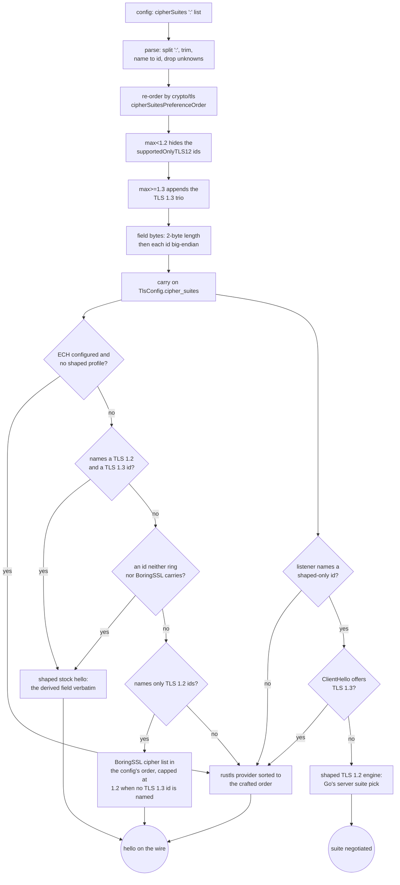

# The `cipherSuites` field of a TLS ClientHello

xray-core reads `streamSettings.tlsSettings.cipherSuites`, a `:`-joined list of TLS suite names, into `Config.CipherSuites` (`transport/internet/tls/config.go`), and Go `crypto/tls` turns that list into the `cipher_suites` field of the ClientHello: it re-orders the ids by `cipherSuitesPreferenceOrder` — so the config's order is *not* the wire order — drops every id it does not recognise, skips the TLS 1.2-only suites when the max version is below TLS 1.2, and appends its TLS 1.3 trio whenever TLS 1.3 is offered. This is the reference the PattNG "unsafe" fingerprint path runs, because only that path builds the hello from `crypto/tls` rather than from a fixed uTLS template.

`crates/ferrox-core/src/tls/cipher_suites.rs` reproduces that whole derivation as a pure function and is gated byte-for-byte against a Go oracle (`scripts/hello-oracle`) that drives real `crypto/tls` over an in-memory `net.Pipe` and dumps the field.

## Data path



## Measured

<!-- counts:begin -->
| key | value | checked by |
| --- | --- | --- |
| ops-retired-instructions | UNBLESSED | scripts/count-ops.sh |
| oracle-cases-replayed-byte-identical | 10 | ferrox-core-tls::cipher_suites::tests::oracle_replay_matches_go |
| cipher-suite-ids-reachable-by-rustls | 9 | ferrox-core-tls::rustls_backend::tests::the_reachable_set_is_the_tls13_trio_and_ring_s_six_tls12_aead_suites |
| cipher-suite-ids-reachable-by-boring | 11 | ferrox-core-tls::rustls_backend::tests::the_legacy_lane_covers_the_cbc_and_static_rsa_ids_ring_has_not |
| cipher-suite-ids-reachable-by-neither | 5 | ferrox-core-tls::rustls_backend::tests::the_legacy_lane_covers_the_cbc_and_static_rsa_ids_ring_has_not |
| dialer-hello-cipher-field-equals-reference | 1 | ferrox-core-tls::rustls_backend::tests::a_crafted_list_reorders_the_dialer_hello_to_the_reference |
| tls12-list-ids-equal-reference-in-order | 1 | ferrox-core-tls::rustls_backend::tests::a_tls12_list_keeps_the_reference_ids_and_order_on_the_wire |
| tls12-suite-negotiated-by-the-dialer | 1 | ferrox-core-tls::rustls_backend::tests::a_tls12_dial_negotiates_the_configured_suite |
| mixed-list-dialer-field-equals-reference | 1 | ferrox-core-tls::rustls_backend::tests::a_mixed_list_keeps_the_reference_order_on_the_wire |
| mixed-list-negotiated-by-the-dialer | 1 | ferrox-core-tls::rustls_backend::tests::a_mixed_list_negotiates_a_tls12_suite |
| tls12-suite-negotiated-by-the-listener | 1 | ferrox-core-tls::rustls_backend::tests::a_tls_floor_and_suite_reach_the_negotiation |
| shaped-listener-negotiates-the-five-unreachable-ids | 5 | ferrox-core-tls::rustls_backend::tests::a_shaped_listener_serves_the_five_ids_neither_backend_has |
| mixed-max-hellos-routed-by-the-peek | 2 | ferrox-core-tls::rustls_backend::tests::a_mixed_max_listener_peeks_the_hello_before_choosing_an_engine |
| legacy-dial-tls12-ids-equal-reference-in-order | 1 | ferrox-core-tls::rustls_backend::tests::a_legacy_dial_offers_the_reference_cipher_ids_in_order |
| legacy-cbc-suite-negotiated-by-the-dialer | 1 | ferrox-core-tls::rustls_backend::tests::a_legacy_dial_negotiates_a_cbc_suite |
| legacy-static-rsa-suite-negotiated-by-the-listener | 1 | ferrox-core-tls::rustls_backend::tests::a_legacy_listener_negotiates_static_rsa |
| legacy-tls12-session-resumed | 1 | ferrox-core-tls::rustls_backend::tests::a_legacy_dial_resumes_a_tls12_session |
| config-key-heap-buffers-per-dial | 0 | ferrox-core-tls::rustls_backend::tests::a_repeat_dial_keys_the_config_without_copying_the_suite_order |
<!-- counts:end -->

## Ops

```bash
./scripts/count-ops.sh report \
  cipher_suites::tests::oracle_replay_matches_go 'tls::cipher_suites::hello_ids'
```

`UNBLESSED`. The parse runs once per dial at config time, not per byte relayed; its cost is a config-load cost, and no row here quotes it as a figure until `ops.yml` measures it.

## Time

**Not measured yet.** This is a handshake-field builder, not a relay hot path; the `benchmark-matrix.yml` and `parity.yml` cells that would exercise a dialer TLS handshake run in CI, and no CI artefact has been read.

## The reachable-set ceiling, and what was not removed

The derivation is byte-identical to `crypto/tls` for every case the oracle reaches. Three lanes
now carry the result: `rustls` for a TLS 1.3-only list, BoringSSL (already linked for ECH) for
a TLS 1.2-only list, and the stock shaped hello for a mixed list or one naming an id neither
backend carries. Twenty of the reference's twenty-five ids are reachable.

- **Nine ids by ring.** `rustls` is built with `tls12`, so the provider is the TLS 1.3 trio
  `0x1301`/`0x1302`/`0x1303` plus ring's six TLS 1.2 AEAD suites `0xc02b`, `0xc02c`, `0xcca9`,
  `0xc02f`, `0xc030`, `0xcca8`. `the_reachable_set_is_the_tls13_trio_and_ring_s_six_tls12_aead_suites`
  reads the provider and asserts both the nine ids and the absence of every CBC and static-RSA
  one. A dial that names only TLS 1.2 ids, without an ECH config, rides the legacy lane, whose
  field is the reference's and carries no SCSV
  (`a_tls12_list_keeps_the_reference_ids_and_order_on_the_wire`); a dial to a
  TLS 1.2 listener still negotiates `0xc02b` (`a_tls12_dial_negotiates_the_configured_suite`),
  and the listener role is pinned by `a_tls_floor_and_suite_reach_the_negotiation`; the other
  five are wired through the same provider and are not each dialled by a test.
- **Eleven ids by BoringSSL.** ECDHE CBC (`0xc009`, `0xc00a`, `0xc013`, `0xc014`, `0xc023`,
  `0xc027`), static-RSA AES-CBC and AES-GCM (`0x002f`, `0x0035`, `0x009c`, `0x009d`) and
  RSA-3DES (`0x000a`). `legacy.rs` is selected when the list names an id ring has not, or when it
  names only TLS 1.2 ids and no ECH config, so the field carries no SCSV and resumption has one
  lane; it caches one
  context per material and host name: the verify callback captures the name, so two
  hosts cannot share a context that checks the first one's certificate
  (`a_legacy_context_is_not_shared_across_server_names`). The dial's TLS 1.2 ids
  keep the config's order (`a_legacy_dial_offers_the_reference_cipher_ids_in_order`), a CBC
  suite is negotiated by the dial (`a_legacy_dial_negotiates_a_cbc_suite`) and a static-RSA
  suite by the listener (`a_legacy_listener_negotiates_static_rsa`).
- **Five ids by neither, served by the shaped lane.** RC4 (`0x0005`, `0xc007`, `0xc011`),
  ECDHE-3DES (`0xc012`) and static-RSA AES-128-CBC-SHA256 (`0x003c`): BoringSSL 5.4 no longer
  compiles them, and ring never had them. `set_cipher_list` silently drops such a name, so
  `needed` refuses to route a list of only those ids; without ECH and without a fingerprint
  profile, `shaped::needs_stock_hello` sends it to the stock-shaped client, whose hello carries
  the configured ids.
  A listener whose `minVersion` leaves TLS 1.2 reachable and whose list names one of the five now
  runs the shaped engine on the server side too: it reads the hello in place, picks the suite in
  `crypto/tls`'s global preference order restricted to the configured list, gates it on the
  certificate's key kind, and builds the flight, ChangeCipherSpec and Finished itself.
  `a_shaped_listener_serves_the_five_ids_neither_backend_has` dials each id through the same
  shaped client and asserts the negotiated suite and a payload round trip; `0xc007` needs an
  ECDSA leaf, the other four a RSA one. When the listener also offers TLS 1.3, `tls::accept`
  peeks the ClientHello through the record limiter: a hello that offers `0x0304` is replayed to
  the engine that carries TLS 1.3, and a TLS 1.2-only hello is replayed to the shaped engine.
  A listener that sets `echServerKeys` is the exception: `accept_decided` selects BoringSSL
  before this path, and that context pins its floor at TLS 1.3 and honors `maxVersion`, so a
  listener whose maximum is below TLS 1.3 is refused instead of silently negotiating TLS 1.3.
  `a_mixed_max_listener_peeks_the_hello_before_choosing_an_engine` pins both verdicts,
  the five on the 1.2 side and `suite()` absent on the delegated 1.3 side. A Go client against this
  listener is a CI/conformance question, not a local gate.
- **One id rustls adds that `crypto/tls` never sends: `0x00ff`.** rustls appends
  `TLS_EMPTY_RENEGOTIATION_INFO_SCSV` to every hello that offers TLS 1.2; Go only ever *reads*
  that id on a server. BoringSSL appends no SCSV, so a TLS 1.2-only dial without an ECH config
  now rides the legacy lane; `a_tls12_list_keeps_the_reference_ids_and_order_on_the_wire`
  captures that hello and asserts the exact field, with no SCSV. An ECH config keeps the rustls
  lane, where the SCSV remains and a CBC id it cannot carry is dropped; that is the named ECH
  limit. Only a TLS 1.3-only list matches id-for-id on the rustls lane.
- **Mixed lists ride the stock shaped hello.** A list that names a TLS 1.3 and a TLS 1.2 id
  cannot use either stock lane: BoringSSL writes its trio first and rustls appends SCSV, so
  neither writes the reference's field. The stock shaped hello writes the derived field
  verbatim (`a_mixed_list_keeps_the_reference_order_on_the_wire`) and still finishes a TLS 1.2
  handshake on the CBC id the list carries (`a_mixed_list_negotiates_a_tls12_suite`). A server
  pick is checked against that field, so a suite this tree implements but the list omits is
  refused (`a_server_may_not_select_an_unoffered_suite`). The legacy
  lane is selected only for a list whose max is below 1.3, so its cap makes that field exact
  (`a_legacy_dial_offers_the_reference_cipher_ids_in_order`).
- **Two named limits on the legacy/shaped split.** An ECH config keeps the rustls lane (ECH is
  stronger than the suite list), so a config naming both does not advertise its CBC ids; and a
  mixed list rides the shaped lane, which keeps no session cache, so `enableSessionResumption`
  does not carry there. Neither is a refusal: the handshake completes, and both are named rather
  than silent.
- **Curves carry over.** The three stock groups a `curvePreferences` list can name here map to
  BoringSSL's `P-256`/`P-384`/`X25519`, so the legacy hello keeps the named group order; the
  ML-KEM hybrid is shaped-lane only, so the stock lane never names it.

Not done, deliberately and with the cost named: the five ids on the *dialer's* negotiated path
when the peer offers TLS 1.3, ECH together with CBC, and resumption on the shaped lane. Each is
a ceiling of the dispatch rule or a linked backend rather than a rewrite of this derivation.

## What we removed

- **The mixed-list ceiling.** A list naming both versions no longer reaches BoringSSL, whose
  fixed trio led the field; it rides the stock shaped hello and keeps the reference's order.
  The cost that was *not* removed: that dial now runs the hand-written shaped handshake instead
  of rustls's, so it gives up rustls's session cache on a mixed list until resumption lands on
  the shaped lane.
- **The "CBC is unreachable" ceiling, without a new dependency.** The legacy lane adds no
  crate: `boring` was already linked for ECH, so the eleven CBC/static-RSA ids cost one context
  cache and one session wrapper rather than a second TLS implementation baked into the binary.
  The cost that was *not* removed: a config naming only TLS 1.2 ids and no ECH config now runs
  BoringSSL's handshake instead of rustls's, so that lane has its own read/write path and its
  own named limits above.
- **The SCSV and no-resumption ceilings on a TLS 1.2-only dial.** Routing that list without ECH
  to BoringSSL drops rustls's appended `0x00ff` and lets `enableSessionResumption` carry: the
  lane keeps a 32-entry LRU of `SslSession`s keyed by the same inputs as the context, and
  `a_legacy_dial_resumes_a_tls12_session` dials twice, asserting the first is fresh and the
  second reused. The costs that were *not* removed: an ECH config keeps rustls and its SCSV,
  and the cache is process-global and bounded, so a session older than the 32 most recently used
  is dropped rather than kept forever.
- **A copy of the suite order on every dial.** The config cache keys on the anchors, pins, `ALPN` and suite order, and building that key cloned the `Vec<u16>` order on every lookup — a heap buffer and a six-byte copy on each repeat handshake for a list the config named once. The order now lives behind one `Arc<[u16]>`, so a repeat dial's key is a reference-count bump. `a_repeat_dial_keys_the_config_without_copying_the_suite_order` measures the cached lookup at 0 allocations (it was 1 allocation / 6 bytes), and `a_crafted_list_reorders_the_dialer_hello_to_the_reference` still holds the field byte-identical.
- The two-pass shape a naive re-order would use. Rather than copy the config list and then sort it with a comparator that recomputes membership, `hello_ids` walks the fixed `crypto/tls` preference array once and takes the intersection — one `contains` per preference entry, no second pass, and the TLS 1.3 append is a `extend_from_slice`, not a per-element compare. Byte-identity across the whole input the reference sees is the gate.

## Pins

| what | where |
| --- | --- |
| `:`-split, name→id, drop unknown | `upstream/xray-core/transport/internet/tls/config.go` |
| preference re-order, TLS 1.3 append, `suiteTLS12` gate | Go `crypto/tls` `handshake_client.go`, `cipher_suites.go`, `defaults.go` (via `scripts/hello-oracle`) |
| presets `real-firefox` / `semi-python` | `upstream/pattng/.../res/values/arrays.xml` |

## CI scope

What a change here owes, read by `scripts/ci-scope.py`; see [`docs/ci-scope.md`](../ci-scope.md).
The pinned xray-rust conformance suite has no `cipherSuites` row (its TLS cases pin selected
fingerprints only), so a `conformance.yml` leg cannot observe this field: the checkers above are
the local capture and handshake tests, and the page names them rather than implying an external
suite proves them.

<!-- scope:begin -->
- paths: -
<!-- scope:end -->
