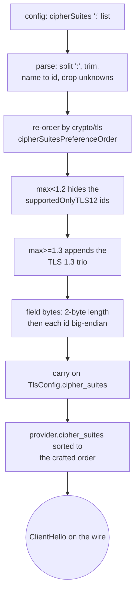

# The `cipherSuites` field of a TLS ClientHello

xray-core reads `streamSettings.tlsSettings.cipherSuites`, a `:`-joined list of TLS
suite names, into `Config.CipherSuites` (`transport/internet/tls/config.go`), and Go
`crypto/tls` turns that list into the `cipher_suites` field of the ClientHello: it
re-orders the ids by `cipherSuitesPreferenceOrder` — so the config's order is *not* the
wire order — drops every id it does not recognise, skips the TLS 1.2-only suites when the
max version is below TLS 1.2, and appends its TLS 1.3 trio whenever TLS 1.3 is offered.
This is the reference the PattNG "unsafe" fingerprint path runs, because only that path
builds the hello from `crypto/tls` rather than from a fixed uTLS template.

`crates/ferrox-core/src/tls/cipher_suites.rs` reproduces that whole derivation as a pure
function and is gated byte-for-byte against a Go oracle (`scripts/hello-oracle`) that
drives real `crypto/tls` over an in-memory `net.Pipe` and dumps the field.

## Data path



## Measured

<!-- counts:begin -->
| key | value | checked by |
| --- | --- | --- |
| ops-retired-instructions | UNBLESSED | scripts/count-ops.sh |
| oracle-cases-replayed-byte-identical | 10 | ferrox-core-tls::cipher_suites::tests::oracle_replay_matches_go |
| cipher-suite-ids-reachable-by-the-backend | 3 | ferrox-core-tls::rustls_backend::tests::a_crafted_list_reorders_the_dialer_hello_to_the_reference |
| dialer-hello-cipher-field-equals-reference | 1 | ferrox-core-tls::rustls_backend::tests::a_crafted_list_reorders_the_dialer_hello_to_the_reference |
<!-- counts:end -->

## Ops

```bash
./scripts/count-ops.sh report \
  cipher_suites::tests::oracle_replay_matches_go 'tls::cipher_suites::hello_ids'
```

`UNBLESSED`. The parse runs once per dial at config time, not per byte relayed; its cost is
a config-load cost, and no row here quotes it as a figure until `ops.yml` measures it.

## Time

**Not measured yet.** This is a handshake-field builder, not a relay hot path;
the `benchmark-matrix.yml` and `parity.yml` cells that would exercise a dialer TLS handshake
run in CI, and no CI artefact has been read.

## The reachable-set ceiling, and what was not removed

The derivation is byte-identical to `crypto/tls` for every case the oracle reaches, but what
*this* backend can put on its own wire is narrower than the reference, and that is the honest
limit rather than a win:

- The dialer's TLS is `rustls` with the `ring` provider, built with
  `features = ["std", "ring"]` and no `tls12` — `cargo tree -e features -i -p rustls` shows
  only `ring` and `std` enabled. `rustls::crypto::ring::ALL_CIPHER_SUITES` is therefore the
  three TLS 1.3 suites `0x1301`/`0x1302`/`0x1303` and nothing else. So every TLS 1.2 id the
  reference advertises — the CBC, static-RSA and CHACHA suites in the PattNG presets — is
  parsed and proved here but is **not removed from the wire path because it was never on it**:
  the backend never offers it, so a real handshake through this tree cannot carry it. Only the
  TLS 1.3 trio is reachable, and its count (3) is the ceiling, gated by the same capture test.
- What *is* landed: a `cipherSuites` config re-orders the reachable suites to `crypto/tls`'
  order, so the dialer's actual ClientHello field equals the reference's. `rustls` writes the
  hello's `cipher_suites` in provider-config order (`client/hs.rs`, and the provider list this
  sort re-orders), so sorting `provider.cipher_suites` by the crafted id list moves the bytes.
  The stock provider offers `0x1302,0x1301,0x1303`; `crypto/tls` emits `0x1301,0x1302,0x1303`;
  `a_crafted_list_reorders_the_dialer_hello_to_the_reference` captures the real hello over
  `write_tls` and asserts the field equals the reference bytes. This fires only when the
  config names a suite — an unset `cipherSuites` leaves the stock ordering untouched.
- Not done, deliberately: advertising and *negotiating* the TLS 1.2 ids the reference carries.
  That needs `rustls` built with `tls12` plus a provider that implements CBC and static-RSA —
  a crypto-subsystem and downgrade-posture change well outside this slice, recorded as an
  add-on in `prompts.md` rather than folded in here. A change that only reorders bytes to look
  like the reference is legitimate byte-identity; a change that lowers the floor to reach the
  reference's CBC suites is not, and it is named rather than half-done.

## What we removed

- The two-pass shape a naive re-order would use. Rather than copy the config list and then
  sort it with a comparator that recomputes membership, `hello_ids` walks the fixed
  `crypto/tls` preference array once and takes the intersection — one `contains` per
  preference entry, no second pass, and the TLS 1.3 append is a `extend_from_slice`, not a
  per-element compare. Byte-identity across the whole input the reference sees is the gate.

## Pins

| what | where |
| --- | --- |
| `:`-split, name→id, drop unknown | `upstream/xray-core/transport/internet/tls/config.go` |
| preference re-order, TLS 1.3 append, `suiteTLS12` gate | Go `crypto/tls` `handshake_client.go`, `cipher_suites.go`, `defaults.go` (via `scripts/hello-oracle`) |
| presets `real-firefox` / `semi-python` | `upstream/pattng/.../res/values/arrays.xml` |

## CI scope

What a change here owes, read by `scripts/ci-scope.py`; see [`docs/ci-scope.md`](../ci-scope.md).

<!-- scope:begin -->
- paths: -
<!-- scope:end -->
