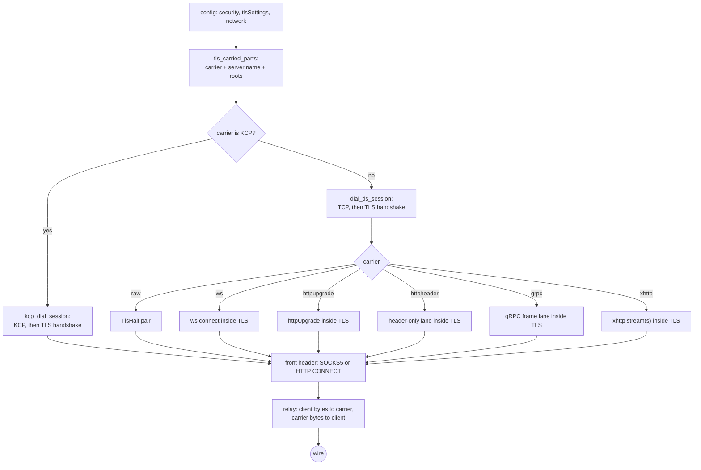

# TLS client from config

One dial owns the session: the transport is opened (TCP for the stream carriers, KCP
over UDP for KCP), the configured TLS handshake runs inside it, and the protocol
header then travels inside that session.  The same shape serves every stream front
that reads `tlsSettings`; the SOCKS and HTTP outbounds now join VLESS, VMess, Trojan
and Shadowsocks instead of dialling their configured transport as a bare TCP socket.

`tls_carried_parts` reads `streamSettings.security = "tls"` into
`(Carrier, server name, TlsConfig)`.  The carrier set is raw TCP, `ws`,
`httpupgrade`, `grpc`, `xhttp`, the TCP `http` header and KCP; the SOCKS and HTTP
outbound parsers refuse `quic`, `hysteria`, `masque`, `xdrive` and unknown networks
rather than silently dialling them raw.  KCP carries the session over UDP, so its
TLS handshake runs inside the KCP connection and the front's header travels inside
that session.  VLESS, VMess and Trojan keep the same `tls_carried_parts` path, and
Shadowsocks its own KCP TLS lane.  The client loads named roots from `caCertFile`
and `certificates`.
It also loads system roots unless `disableSystemRoot` or `allowInsecure` is set, or
a certificate pin is configured.  Without a certificate pin, `allowInsecure` skips
certificate chain and name verification.  A plain `network: "tcp"` with no
`security` stays a plain dial; only the configured TLS arm changes.

## Data path



## Measured

<!-- counts:begin -->
| key | value | checked by |
| --- | --- | --- |
| ops-retired-instructions | UNBLESSED | scripts/count-ops.sh |
| syscalls-per-relayed-megabyte | UNBLESSED | scripts/count-ops.sh |
| relay-staging-copies-per-byte | UNBLESSED | not measured |
| seconds-per-relayed-megabyte | UNBLESSED | .github/workflows/bench.yml |
| socks-tls-carriers-parsed | 7 | ferrox-app-proxy::tests::socks_tls_outbound_parses_diallable_carriers |
| http-tls-carriers-parsed | 7 | ferrox-app-proxy::tests::http_tls_outbound_parses_diallable_carriers |
| socks-tls-raw-echo-round-trips | 1 | ferrox-app-proxy::tests::socks_tls_over_raw_reaches_echo |
| socks-tls-ws-echo-round-trips | 1 | ferrox-app-proxy::tests::socks_tls_over_ws_reaches_echo |
| socks-tls-kcp-echo-round-trips | 1 | ferrox-app-proxy::tests::socks_tls_over_kcp_reaches_echo |
| http-tls-raw-echo-round-trips | 1 | ferrox-app-proxy::tests::http_tls_over_raw_reaches_echo |
| http-tls-ws-echo-round-trips | 1 | ferrox-app-proxy::tests::http_tls_over_ws_reaches_echo |
| http-tls-kcp-echo-round-trips | 1 | ferrox-app-proxy::tests::http_tls_over_kcp_reaches_echo |
<!-- counts:end -->

The two parse rows are the seven carrier forms in `tls_stream_cases`: raw, `kcp`,
`ws`, `grpc`, `xhttp`, `httpupgrade` and the TCP `http` header.  For the SOCKS and
HTTP parsers the same test holds `quic` and `hysteria` refused; KCP is carried by
`kcp_dial_session` and `kcp_tls_connect`, the same pair the VLESS, VMess, Trojan and
Shadowsocks lanes use.  The echo rows run the real `dial_socks_outbound` or
`dial_http_outbound` over a TLS echo listener; the carried rows reach the listener
through a WebSocket upgrade or a TLS session inside KCP, not through a raw TCP
re-dial.

## Ops

```bash
./scripts/count-ops.sh report \
  socks_tls_over_ws_reaches_echo 'proxy::tests::socks_tls_over_ws_reaches_echo'
```

`UNBLESSED`.  The dial and first handshake happen once per flow; no instruction count
has been read for this path, so none is quoted.  The relay's own cost is the existing
lane path, not new crypto in this change.

## Time

**Not measured yet.**  The matrix has no SOCKS-over-TLS or HTTP-over-TLS cell, so a
local duration would measure a tunnel, not this code.  The echo tests bound the
functional path; a throughput number waits for a CI cell.

## What we removed

- **The silent raw fallback.**  A SOCKS outbound with `security: "tls"` used to
  ignore the field and dial plain TCP; an HTTP outbound with a carrier used to keep
  the TLS config but dial its transport raw, so a `ws` config reached the server as a
  TLS ClientHello on the bare socket.  Both now hand the carrier to the session.
  `socks_tls_over_raw_reaches_echo`, `socks_tls_over_ws_reaches_echo`,
  `http_tls_over_raw_reaches_echo` and `http_tls_over_ws_reaches_echo` are the
  witnesses.
- **The KCP refusal.** SOCKS and HTTP outbounds with `security: "tls"` and
  `network: "kcp"` used to be refused at parse time. They now dial KCP, run TLS
  inside it, and relay the front header inside that session;
  `socks_tls_over_kcp_reaches_echo` and `http_tls_over_kcp_reaches_echo` are the
  witnesses.
- **The second relay shape.** The carried SOCKS and HTTP fronts split the session
  into one reader and one writer and hand it to `relay_sink`, so one direction's read
  cannot hold the other direction's write behind a shared lock. The raw branch uses
  the same split. The tests drive both branches; the point is structural, not a new
  copy count, so `relay-staging-copies-per-byte` stays `UNBLESSED`.
- **The single-read SOCKS handshake.** The TLS session polls its transport on a 1 ms
  quantum; a handshake read that took the first `WouldBlock` for a refusal reset a
  flow under load. The SOCKS greeting, request and bound-address reads now wait out
  the poll under the handshake budget, and
  `a_handshake_read_waits_out_a_polled_transport` is the deterministic witness.

The bullets above are removals against earlier Ferrox, not against the references.
Against Xray-core, sing-box and ZeroNet no instruction, syscall, copy or time removal
is claimed: each also dials TLS and hands it to the carrier, and this page has no
comparison cell for a ratio.  The two parse rows and six echo rows are correctness
witnesses; the four cost rows stay `UNBLESSED`.

## Pins

| what | where |
| --- | --- |
| carrier selection and TLS fields | `upstream/xray-core/transport/internet/tls/config.go` |
| SOCKS outbound request on the stream | `upstream/xray-core/proxy/socks/client.go` |
| HTTP CONNECT on the stream | `upstream/xray-core/proxy/http/client.go` |
| WS carrier inside TLS | `upstream/xray-core/transport/internet/websocket/` |

## CI scope

<!-- scope:begin -->
- paths: -
- symbols: dial_socks_tls_client, dial_http_outbound, dial_tls_carried_stream, kcp_tls_connect, relay_kcp_under, RelayWrite, socks_tls_outbound_parses_diallable_carriers, http_tls_outbound_parses_diallable_carriers, socks_tls_over_raw_reaches_echo, socks_tls_over_ws_reaches_echo, socks_tls_over_kcp_reaches_echo, http_tls_over_raw_reaches_echo, http_tls_over_ws_reaches_echo, http_tls_over_kcp_reaches_echo
- go: ./transport/internet/tls/..., ./proxy/socks/..., ./proxy/http/...
<!-- scope:end -->
