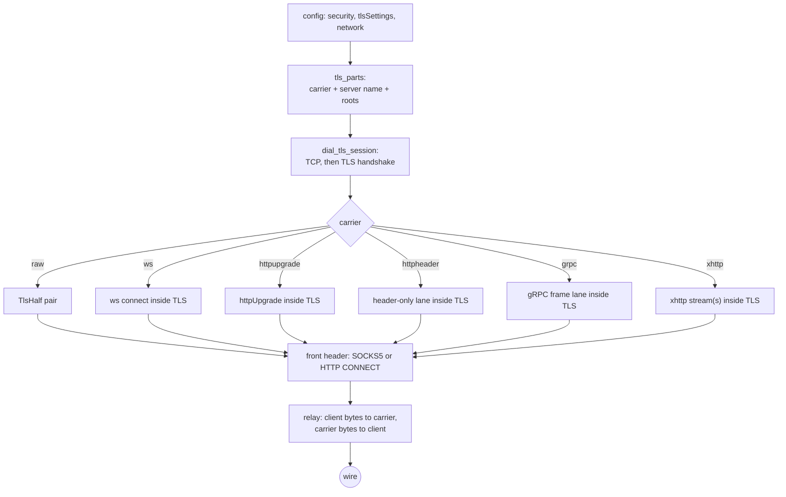

# TLS client from config

One dial owns the session: TCP is opened, the configured TLS handshake runs, and only
then does the carrier open and the protocol header travel inside it.  The same shape
serves every stream front that reads `tlsSettings`; the SOCKS and HTTP outbounds now
join VLESS, VMess, Trojan and Shadowsocks instead of dialling their configured
transport as a bare TCP socket.

`tls_parts` reads `streamSettings.security = "tls"` into
`(Carrier, server name, TlsConfig)`.  The carrier set is raw TCP, `ws`,
`httpupgrade`, `grpc`, `xhttp` and the TCP `http` header; `quic`, `kcp`,
`hysteria`, `masque`, `xdrive` and unknown networks are refused at parse time rather
than silently dialled raw.  Roots come from `caCertFile`, joined with the store, or
from no root when `allowInsecure` is set.  A plain `network: "tcp"` with no
`security` stays a plain dial; only the configured TLS arm changes.

## Data path



## Measured

<!-- counts:begin -->
| key | value | checked by |
| --- | --- | --- |
| ops-retired-instructions | UNBLESSED | scripts/count-ops.sh |
| syscalls-per-relayed-megabyte | UNBLESSED | scripts/count-ops.sh |
| relay-staging-copies-per-byte | UNBLESSED | not measured |
| seconds-per-relayed-megabyte | UNBLESSED | .github/workflows/bench.yml |
| socks-tls-carriers-parsed | 6 | ferrox-app-proxy::tests::socks_tls_outbound_parses_diallable_carriers |
| http-tls-carriers-parsed | 6 | ferrox-app-proxy::tests::http_tls_outbound_parses_diallable_carriers |
| socks-tls-raw-echo-round-trips | 1 | ferrox-app-proxy::tests::socks_tls_over_raw_reaches_echo |
| socks-tls-ws-echo-round-trips | 1 | ferrox-app-proxy::tests::socks_tls_over_ws_reaches_echo |
| http-tls-raw-echo-round-trips | 1 | ferrox-app-proxy::tests::http_tls_over_raw_reaches_echo |
| http-tls-ws-echo-round-trips | 1 | ferrox-app-proxy::tests::http_tls_over_ws_reaches_echo |
<!-- counts:end -->

The two parse rows are the six carrier forms in `tls_stream_cases`: raw, `ws`,
`grpc`, `xhttp`, `httpupgrade` and the TCP `http` header.  The same test also holds
all three of `quic`, `kcp` and `hysteria` refused.  The echo rows run the real
`dial_socks_outbound` or `dial_http_outbound` over a TLS echo listener; the carried
row reaches the listener through a WebSocket upgrade inside the TLS session, not
through a raw TCP re-dial.

## Ops

```bash
./scripts/count-ops.sh report \
  socks_tls_over_ws_reaches_echo 'proxy::dial_socks_tls_client'
```

`UNBLESSED`.  The dial and first handshake happen once per flow; no instruction count
has been read for this path, so none is quoted.  The relay's own cost is the existing
lane path, not new crypto in this change.

## Time

**Not measured yet.**  The matrix has no SOCKS-over-TLS or HTTP-over-TLS cell, so a
local duration would measure a tunnel, not this code.  The echo tests bound the
functional path; a throughput number waits for a CI cell.

## What we removed

- **The silent raw fallback.**  A SOCKS outbound with `security: "tls"` used to
  ignore the field and dial plain TCP; an HTTP outbound with a carrier used to keep
  the TLS config but dial its transport raw, so a `ws` config reached the server as a
  TLS ClientHello on the bare socket.  Both now hand the carrier to the session.
  `socks_tls_over_raw_reaches_echo`, `socks_tls_over_ws_reaches_echo`,
  `http_tls_over_raw_reaches_echo` and `http_tls_over_ws_reaches_echo` are the
  witnesses.
- **The second relay shape.** The carried SOCKS and HTTP fronts split the session
  into one reader and one writer and hand it to `relay_sink`, so one direction's read
  cannot hold the other direction's write behind a shared lock. The raw branch uses
  the same split. The tests drive both branches; the point is structural, not a new
  copy count, so `relay-staging-copies-per-byte` stays `UNBLESSED`.
- **The single-read SOCKS handshake.** The TLS session polls its transport on a 1 ms
  quantum; a handshake read that took the first `WouldBlock` for a refusal reset a
  flow under load. The SOCKS greeting, request and bound-address reads now wait out
  the poll under the handshake budget, and
  `a_handshake_read_waits_out_a_polled_transport` is the deterministic witness.

## Pins

| what | where |
| --- | --- |
| carrier selection and TLS fields | `upstream/xray-core/transport/internet/tls/config.go` |
| SOCKS outbound request on the stream | `upstream/xray-core/proxy/socks/client.go` |
| HTTP CONNECT on the stream | `upstream/xray-core/proxy/http/client.go` |
| WS carrier inside TLS | `upstream/xray-core/transport/internet/websocket/` |

## CI scope

<!-- scope:begin -->
- paths: -
- symbols: dial_socks_tls_client, dial_tls_carried_stream, RelayWrite, socks_tls_outbound_parses_diallable_carriers, http_tls_outbound_parses_diallable_carriers, socks_tls_over_raw_reaches_echo, socks_tls_over_ws_reaches_echo, http_tls_over_raw_reaches_echo, http_tls_over_ws_reaches_echo
- go: ./transport/internet/tls/..., ./proxy/socks/..., ./proxy/http/...
<!-- scope:end -->
