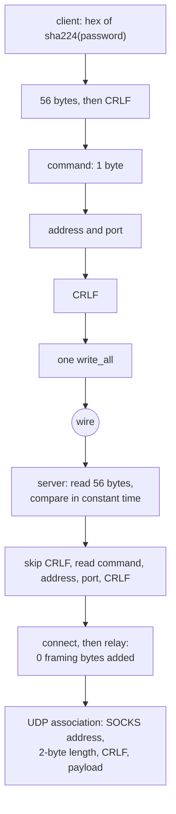

# Trojan over TCP

Trojan is a header and then nothing, which makes it the cheapest method in the matrix to relay and the easiest to get subtly wrong.

The header is `sha224_hex(password) | CRLF | command(1) | address | port | CRLF`. The 56 ASCII bytes are compared without an early exit on the server; after that the stream is the stream and the relay adds no framing bytes at all.

A `settings.clients` list is one key per entry and a header carrying any of them is served, as xray builds one account per client; the compare walks the list only until a key agrees, so a one-client inbound pays the one compare it always did. `a_trojan_inbound_accepts_every_clients_password` holds the second client's header and a stranger's refusal.

A dial that was handed a name writes it as ATYP 3 with its own length, the form this method's reader already accepts, so the edge answers the lookup rather than the client's resolver.

A listener that declares `security: tls` terminates the session its config names and reads the header off it, on each carrier the dial uses — the six TCP carriers, KCP, where the session wraps the connection itself, and QUIC and Hysteria, where the transport's own TLS is the session and no second layer is added; an `xdrive` row is the exception, where `security` names the store's own lane handshake rather than a session above it. `a_trojan_inbound_that_declares_tls_answers_every_carrier` dials all six TCP carriers and holds the echo, `a_trojan_kcp_inbound_that_declares_tls_answers_the_session` / `a_trojan_kcp_dial_under_tls_wraps_the_header_in_the_session` hold the KCP pair from both ends, and `quic_serves_trojan_echo_over_loopback` / `hysteria_carries_trojan_echo_over_loopback` hold the transport-TLS pair.

A raw TLS listener that names `settings.fallbacks` spends the reference's first read before it parses the header: bytes that do not carry the inbound key route to the row its SNI/ALPN selects, with the row's `xver` PROXY head ahead of them, and a stream that carries the key but a malformed header is dropped rather than shown the cover site. Bytes a valid request's first read carries past the header are not discarded: a TCP payload is written to the uplink before the relay, and a UDP association's first datagram is served ahead of the session. `a_trojan_tls_fallback_reaches_the_cover_site` drives a non-trojan TLS client through the listener and holds the cover site's echo and the v1 head; `a_trojan_tls_probe_keeps_the_payload_that_rides_with_the_header` and `a_trojan_tls_udp_probe_keeps_the_datagram_that_rides_with_the_header` hold the bytes behind a valid header.

A UDP association rides every TCP carrier the outbound dials — raw, ws, httpUpgrade, gRPC, xhttp (stream-one), http header and KCP — plain or under a terminated session, on both the client and the listener. The listener parses the association off whatever carrier the dial wrote; the client splits the session into the reader and writer its pump needs and wakes a parked reader by closing the carrier it came from. `a_trojan_udp_association_crosses_every_carrier` runs all fourteen pairs and holds two datagrams through each, 250 ms apart so a pump that gives up on an idle association is caught. QUIC carries the same SOCKS address, length, CRLF and payload frame on its stream, and Hysteria carries the association through its own datagram lane; `quic_serves_trojan_udp_over_loopback` and `hysteria_carries_a_trojan_udp_association_over_the_carrier` hold both ends.

REALITY is carried both roles on every TCP carrier the row names — raw, ws, httpUpgrade, gRPC, xhttp and http header — and above KCP, where the session wraps the connection. xray restricts REALITY to raw, XHTTP and gRPC, so the other carriers are a superset rather than a gap. `a_trojan_reality_inbound_answers_every_tcp_carrier` holds the six pairs, `a_trojan_reality_kcp_inbound_answers_the_session` holds the KCP pair, and an inbound that declares `security: reality` without an identity is refused by name rather than served as plaintext — `a_trojan_reality_inbound_without_identity_is_refused_not_downgraded` is the gate against a silent downgrade.

Mux opens `v1.mux.cool:9527` on a raw carrier both ends, plain, under TLS, and under REALITY, carrying a TCP stream or a UDP association through one session; `a_trojan_mux_carries_a_tcp_stream_over_raw_tls_and_reality` and `a_trojan_mux_carries_a_udp_association_over_raw_and_reality` are the gates. A mux row on a non-raw carrier is dialed directly rather than refused, and the outbound says so once. The `trojan://` share link is parsed by `ferrox_core::trojan::TrojanLink`, which `check`/`run` accept beside `vless://`, and its header probe goes through the same `encode_header` the dial uses. These are capability statements, not performance ones.

## Data path



## Measured

<!-- counts:begin -->
| key | value | checked by |
| --- | --- | --- |
| ops-retired-instructions | 1167 | scripts/count-ops.sh |
| password-bytes-on-the-wire | 56 | ferrox-app-proxy::tests::trojan_key_is_sha224_hex |
| framing-bytes-added-after-the-header | 0 | ferrox-app-proxy::tests::trojan_relay_round_trips_and_refuses_strangers |
| udp-framing-bytes-per-datagram | 2 | ferrox-app-proxy::tests::trojan_udp_frames_carry |
| udp-carriers-holding-an-association | 7 | ferrox-app-proxy::tests::a_trojan_udp_association_crosses_every_carrier |
| reality-tcp-carriers-holding-an-echo | 6 | ferrox-app-proxy::tests::a_trojan_reality_inbound_answers_every_tcp_carrier |
| reality-kcp-pairs-holding-an-echo | 1 | ferrox-app-proxy::tests::a_trojan_reality_kcp_inbound_answers_the_session |
| mux-tcp-carriers-holding-a-stream | 3 | ferrox-app-proxy::tests::a_trojan_mux_carries_a_tcp_stream_over_raw_tls_and_reality |
| mux-udp-carriers-holding-an-association | 2 | ferrox-app-proxy::tests::a_trojan_mux_carries_a_udp_association_over_raw_and_reality |
| header-reads-numeric-address | 2 | ferrox-app-proxy::tests::the_trojan_header_costs_two_reads_not_seven |
| header-reads-domain-address | 3 | ferrox-app-proxy::tests::the_trojan_header_costs_two_reads_not_seven |
| header-bytes-copied-out-of-the-buffer | 0 | ferrox-app-proxy::tests::the_trojan_header_costs_two_reads_not_seven |
| key-bytes-compared-early-exit | 0 | ferrox-app-proxy::tests::the_key_compare_reads_every_byte |
| numeric-domain-header-allocations | 0 | ferrox-app-proxy::tests::the_trojan_numeric_domain_header_allocates_nothing |
<!-- counts:end -->

## Ops

```bash
./scripts/count-ops.sh report \
  proxy::tests::the_trojan_header_costs_two_reads_not_seven 'proxy::decode_trojan_request'
```

The frame is `decode_trojan_request` over three fixed in-memory headers. The domain form carries the literal `127.0.0.1`, so the byte-level IPv4 reader returns the address directly and neither `resolve_name` nor `getaddrinfo` is entered; the count is the header parse alone and reproduces across runs. It is **1167** retired instructions, blessed in `scripts/expected-ops.txt`; before the literal arm and the word fold the same frame read `80397` then `80812` across two runs of one binary because the resolver was inside it, and before the byte-level IPv4 reader it read `1315`. The wire bytes and the three-read domain parse are unchanged.

## Time

Read from one CI run of one `benchmark-matrix.yml` cell, `trojan-tls-raw-down-8` (download, 8 connections, 16 384 × 65 536 B, standard tier, 3 repeats, `xray-core` as the reference) — the cell a plaintext listener used to fail with no byte moved. Each row is that runner's median over its three repeats, and no ratio is taken across two runners.

| runner | throughput vs `xray-core` | ferrox MiB/s | `xray-core` MiB/s | cpu per GiB |
| --- | --- | --- | --- | --- |
| ubuntu-24.04 x86_64 | 2.12× | 2814.1 | 1325.2 | 1136.2 vs 2235.0 ms |
| ubuntu-24.04-arm aarch64 | 1.45× | 2250.7 | 1552.3 | 1498.8 vs 1846.2 ms |
| macos-15 aarch64 | 1.69× | 1762.6 | 1043.8 | 1053.8 vs 1715.0 ms |
| windows-latest x86_64 | 2.81× | 1757.3 | 624.8 | 1851.6 vs 5146.5 ms |

`zeronet` medians 2000.0, 1712.7, 1600.0 and 1524.1 MiB/s on those four runners, so the row is not a reference that alone ran badly. Peak RSS on ubuntu x86_64 reads 13.5 MiB against `xray-core`'s 58.9 MiB.

## What we removed

- **Seven header reads down to two, and eight down to three for a domain.** The header is `56 + 2 + 1 + addr + port + 2` bytes. The old `decode_trojan_request` read it a field at a time: `read_exact` for the 56 key bytes, then CRLF, then the command, then `read_socks_addr`, which is another `read_exact` for `atyp` and one each for the address, the port and the closing CRLF. `decode_trojan_request` now fills one stack buffer through a cursor and parses it in place, so a numeric address costs two reads and a domain three — the domain cannot do better in two because its length byte has to arrive before the name's extent is known. `the_trojan_header_costs_two_reads_not_seven` drives all three address forms over a fixed byte source and counts the reads exactly.
- **A key compare that returned on the first wrong byte, then walked it a byte at a time.** `got != *key` short-circuits, so the time it took said how much of the key was right. `key_agrees` folds the 56 bytes as seven `u64` words into one accumulator — seven XOR/OR pairs instead of fifty-six byte folds, every byte still read — and refuses a short read outright. `the_key_compare_reads_every_byte` is the gate.
- **An MD5 or SHA-1 chain per connection.** The password arrives as its SHA-224 hex, so there is nothing to derive: 56 bytes on the wire, 56 bytes compared. Contrast Shadowsocks, where the MD5 chain and HKDF are real work and are named in [that page](shadowsocks.md).
- **The `host:port` `String` a domain header serialised for the resolver.** `resolve_endpoint` did `format!("{host}:{port}").to_socket_addrs()`: it built one owned `String` and the `str` form then re-scanned it for the last `:` to split host and port back apart. The `(&str, u16)` tuple hands the resolver both as separate arguments — no serialisation, no `String`, no port re-scan — and a bracketless IPv6 host is no longer mangled by that split. The tuple still carries a real name to the resolver; see the literal arm below for the numeric form.

- **The UTF-8 check and generic address parser a numeric domain paid for.** The domain form's bytes are already a slice, but the parser turned them into `&str` and then asked `IpAddr::from_str` to try IPv4 and IPv6 before `resolve_name`'s own literal arm. A byte-level IPv4 reader now consumes the same digits with the same leading-zero and three-digit rules, so a numeric host never crosses into UTF-8 validation or the generic parser. `the_trojan_ipv4_reader_matches_the_standard_parser` holds a table of valid and malformed literals against `Ipv4Addr::from_str`; the frame drops 148 instructions, and the reads, wire bytes and resolver path for a real name are unchanged.

- **The resolver iterator a numeric domain paid for.** `resolve_name` parsed the literal to decide the address was numeric, then handed the same `(host, port)` to `to_socket_addrs`, which parses it again and allocates a one-element `Vec` for the iterator. The literal arm now returns `SocketAddr::new(ip, port)` directly, with no second parse, no `Vec` and no resolver entry. `the_trojan_numeric_domain_header_allocates_nothing` measures a Trojan domain-form header carrying `127.0.0.1` through the counting allocator and asserts zero allocations; `a_datagram_target_is_resolved_without_a_host_port_string` holds the same zero on the Shadowsocks datagram path. Both the answer and the wire bytes are unchanged; a real name still takes the resolver tuple.

- **The `host:port` `String` a numeric dial address was serialised into, per flow.** The same shape this page condemns above for the resolver lived one layer out, in the dial: `serve_connect` cloned the configured address and formatted `{address}:{port}` before handing it to `to_socket_addrs`, and `dial_trojan_udp_uplink` spelled it again per UDP destination — so every cleartext trojan flow paid a `String` clone, a serialisation, and a host/port re-scan in front of the resolution. `resolve_outbound` parses a numeric address straight from the borrowed parts (IPv4, or IPv6 bare or bracketed) and sends a name to the resolver as the `(&str, u16)` tuple; the answer and the wire bytes are what the old spelling returned, and the removal is witnessed structurally — no `clone`, no `format!` left on that path — and gated for behavior by the loopback trojan dials, which all resolve through it. Like the tuple above, it carries no row: the resolver branch is dominated by `getaddrinfo`'s nondeterministic work, and a numeric branch that never reaches the syscall cannot be counted from a test that only sees the connected socket.

- **The client dial header's one heap `Vec` per numeric address.** The request side, `trojan_header`, built a `Vec::with_capacity(63 + addr_len)` — already exact, no realloc — for every dial. For a numeric address the header is bounded by the protocol (68 bytes IPv4, 80 IPv6), so it is now spelled into a fixed stack buffer behind the same `Deref`-to-`&[u8]` the dial sites already take, and that allocation is gone by construction. A name is not bounded (its length byte allows a host up to 255 bytes, past any stack buffer), so the name branch keeps the precise heap `Vec` and the bytes it emits are unchanged; `trojan_header_builds_identical_bytes_for_every_destination` checks IPv4, IPv6 and a name against the field-by-field reference. The removal carries no row — the measured frame is the header parse, and a once-per-connection control-path allocation never reaches it — so it is a structural claim, not a number. Spelling into the buffer adds one 80-byte zero-init pass before the fields are written; that pass is traded against the removed allocation and is not timed.

- **The relay pump's `SO_RCVTIMEO` poll.** The reply pump armed each UDP socket with `RELAY_POLL` and treated a timeout as an idle tick. On Windows a datagram that arrives as the timeout expires can be dropped, and the second datagram of `a_trojan_udp_association_crosses_every_carrier` was lost in the full suite while a targeted run passed. The sockets are nonblocking now; an empty read sleeps `RELAY_POLL` before the next one, so a reply waits in the socket queue instead of racing the timeout. The control — the fixed test ports in the gate with the timeout pump still in place — failed the full suite at the second KCP datagram; the nonblocking pump passed three full suites, and the test's ports are fixed outside the ephemeral range so a parallel suite cannot take the listener's port between the probe and the bind.

What is **not** removed: the 2-byte length prefix on UDP. It is wire format, not an optimisation, and `trojan_udp_frames_carry` / `trojan_udp_frames_reject_damage` are the gates on it. What is left on a domain header is the resolver's own work — a real DNS name still reaches `getaddrinfo`, and that lookup belongs to the system resolver, not to a copy this page controls; a numeric host in the name field now parses straight to an address with no allocation at all.

## Pins

| what | where |
| --- | --- |
| field-at-a-time header parse, `io.ReadFull` per field | `upstream/xray-core/proxy/trojan/protocol.go` |
| header read into one `buf.Buffer`, parsed in place | `upstream/xray-core/proxy/trojan/server.go` |
| header layout, headroom write | `upstream/sing-box` → `sagernet/trojan/protocol.go` |
| slice parser, zero allocations | `upstream/zeronet/crates/zero-protocol/src/trojan.rs` |

Xray's two ends disagree with each other, which is the honest summary: the server (`server.go`) reads the first request into one `buf.Buffer` and compares `first.Byte(56)` in place, while the client (`protocol.go`, `ParseHeader`) does five `io.ReadFull` calls plus `ReadAddressPort` against the bare socket.

## CI scope

What a change here owes, read by `scripts/ci-scope.py`; see [`docs/ci-scope.md`](../ci-scope.md).

<!-- scope:begin -->
- paths: -
- symbols: trojan
- scenarios: trojan-raw, trojan-tls
- oracle: trojan
- go: ./proxy/trojan/...
<!-- scope:end -->
