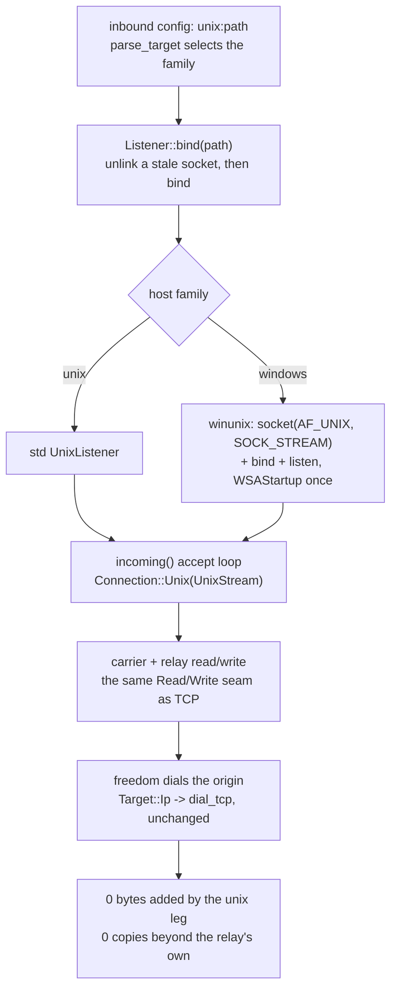

# Unix domain sockets

A `unix` field on an inbound names an `AF_UNIX` path and stands in for `listen`+`port`; a flow that arrives on it is served by the same engine that serves TCP. There is no second read/write path for the socket family: one `Connection` seam (`Tcp(TcpStream)` / `Unix(UnixStream)`, `crates/ferrox-app/src/conn.rs`) is the transport every carrier and the relay already read and wrote through, so switching a leg to a unix socket changes which `Read`/`Write` impl answers, not the bytes handed to it. The row is transparency, not a new framing: what leaves one end of a unix stream is what would leave the same round trip over TCP, octet for octet.

Both roles the method has are served, on both host families. The server role binds a path and accepts on it (`Listener::bind`, `accept_loop`); the client role dials a path (`connect`). The `unix:` spelling is parsed before anything is dialed (`parse_target`), so an empty path is refused rather than bound at the root.

On a Unix host the arm is `std`'s `UnixStream`. On Windows `std` has the type — `std::os::windows::net::UnixStream` — but keeps it behind the unstable `windows_unix_domain_sockets` feature (tracking issue `150487`), which a stable build cannot name, so the `winunix` module of `crates/ferrox-app/src/conn.rs` drives the same family itself: one `WSAStartup` for the process, then `socket`/`bind`/`listen`/`accept`/`connect` and `recv`/`send`, with `WSARecv`/`WSASend` over a `WSABUF` array where the Unix arm has `readv`/`writev`. The `SOCK_STREAM` shape and the Windows 10 build 17063 floor are the ones `std`'s own Windows unix module names.

What refuses, and where: a datagram carrier (kcp, quic, hysteria) cannot bind a stream socket, so an inbound naming one keeps the IP address it is given and the `unix` field does not reach it. A unix peer reports no socket address — there is no port to name — so `peer_addr`/`local_addr` answer `Unsupported` rather than a fabricated one; `reality_edges` reads the two ends through those and a unix leg yields the same `None` pair a never-bound TCP stream yields, which is what a cover origin expecting no PROXY header already handles.

What the Windows arm refuses, and where each refusal lives: it opens `SOCK_STREAM` only, the shape `std` opens for the family, so the datagram-carrier rule above reads the same on either host; an address is always a named path, so `parse_target` refuses the empty one before anything is dialed; `peer_addr`/`local_addr` answer `Unsupported` because a socket path has no port to name — the seam never asks the provider for an address it would throw away, and `accept` passes null address out-params for the same reason; and `try_clone` shares the one handle behind an `Arc` rather than calling `WSADuplicateSocket`, which is what `std`'s unstable Windows unix stream reaches for in its own `try_clone`. Nothing in this arm depends on whether the provider serves that call, and the shared handle gives the relay the lifetime a `dup`ed unix descriptor has: the last leg to drop closes the socket.

## Data path



## Measured

<!-- counts:begin -->
| key | value | checked by |
| --- | --- | --- |
| ops-retired-instructions | UNBLESSED | scripts/count-ops.sh |
| unix-stream-bytes-preserved | 65536 | ferrox-app-conn::tests::a_unix_connection_carries_the_same_bytes_the_tcp_round_trip_does |
| unix-head-not-vector-multiple | 1501 | ferrox-app-conn::tests::a_unix_round_trip_survives_lengths_a_vector_would_split |
| unix-timeout-bound-read-back | 50 | ferrox-app-conn::tests::a_unix_read_timeout_arms_the_way_the_tcp_one_does |
| unix-path-past-the-field-refused | 200 | ferrox-app-conn::tests::a_unix_path_past_the_socket_field_is_refused |
<!-- counts:end -->

The first row is the byte-identity claim itself: a 64 KiB stream round-tripped both ways over a real `AF_UNIX` socket equals the same round trip over TCP and equals the payload. The second is the arithmetic on the inputs a round number hides — lengths `1`, `3`, `1501`, `65535`, none a multiple of the vector width the vectored write path splits on — each arriving whole. Both rows run on either host, so they are the checkers of the Windows arm's open, dial, accept, read, write, half-close and EOF, not only of the Unix one.

The third is the wait bound: `50` ms handed to a unix leg comes back out of `read_timeout` on either host, which is the whole claim a test can make where hanging the suite is the failure mode. On a Unix host the same test adds the witness that the bound stops the block — an empty armed read returns `WouldBlock`/`TimedOut` rather than parking; on Windows a provider that ignored the option would hang that read, so only the read-back runs there.

The fourth is the input every round trip avoids: the path field of a socket address is a fixed array — `sun_path` is 108 bytes on Linux and in the Windows `SOCKADDR_UN`, 104 on macOS — and the test binds a short path in the same directory first, so the 200-character one is refused for its length rather than by where it sits. Two more names from the references reach no code here and are said plainly instead of tested: the Linux abstract-namespace spelling (a leading `NUL` in `sun_path`) is never written, so a path is a filesystem path on either host, and the Windows arm refuses a path that is not UTF-8 with `InvalidInput` — no test can name a non-UTF-8 temp directory on a runner, so that branch has no checker and no count.

Syscalls: a unix bind is `socket`+`bind`+`listen` where TCP is `socket`+`setsockopt`+`bind`+`listen`, so the unix leg issues no `SO_REUSEADDR` that has no meaning for a path, and the arm of `Connection` that decides this is chosen at `Listener::bind`, not per byte; a read/write over the unix stream is the same `read(2)`/`write(2)`/`writev(2)` the TCP path issues, one per call the relay makes. On the Windows arm the same three opens are `WinSock`'s `socket`/`bind`/`listen` behind one `WSAStartup` per process (a `Once`, and no `WSACleanup`, since a leg outlives the call that opened it), a read/write is `recv`/`send`, and a vectored write is one `WSASend` over at most 16 `WSABUF` entries — `writev(2)`'s analogue, with the same clamp `IOV_MAX` puts on the Unix one, so parts past it go on the next turn of `write_all_parts` and coalescing is clamped, not lost. No checker counts any of this, and a loopback `AF_UNIX` pair cannot gate a syscall total, so it stays prose. Copies: the seam forwards `read`/`write` to whichever socket it holds without staging; the `WSABUF` array is filled with the caller's own slice pointers, so the vectored Windows write stages an array of descriptors, never the bytes. The only copy on the data path is the relay's own, shared with TCP. There is no copy here that the unix row removes relative to a prior implementation — the row went from refused to served, so the claim is that it adds none, witnessed by `unix-stream-bytes-preserved` carrying 64 KiB through without a re-frame. The timeout arm is one `setsockopt(SO_RCVTIMEO)` on either family (the Unix path supplies it directly, `std` offering no setter); the Windows arm names the same option `std` names for a Windows stream, spelled as a `DWORD` of milliseconds with zero meaning no bound, so a bound handed to a unix leg is a bound the same getter reads back.

## Ops

```bash
./scripts/count-ops.sh report \
  conn::tests::a_unix_connection_carries_the_same_bytes_the_tcp_round_trip_does 'conn::Listener::bind'
```

`UNBLESSED`, as above — macOS/aarch64 ships no `valgrind`, so this count is CI-only there and has not been read; it is not a number and is not quoted as one.

## Time

**Not measured yet.** Durations in this repository come from CI runners (`bench.yml`, `parity.yml`); no CI artefact has been read, and a laptop behind a VPN measures a tunnel either way.

## What we removed

The address lie and the file-lock. Xray's `UnixConnWrapper` ( `transport/internet/system_listener.go`) rewrites `RemoteAddr()` to a fabricated `&net.TCPAddr{IP: {0,0,0,0}}` so the app-layer address machinery does not choke on a unix peer, and wraps the listener in a `FileLocker` it releases on `Close`. Neither has anything to feed here: this tree has no `net.Addr`-keyed dispatcher downstream of the seam, so the honest `Unsupported` — which the one consumer, `reality_edges`, already maps to `None` — replaces the fake address, and the stale-socket case is met by unlink-then-bind rather than a lock file. The unlink itself is the recovery the references reach for (sing-box `server_unix.go` / `cmd_worker_unix.go` run `os.Remove(path)` before `net.Listen("unix", path)`); the lock was its heavier stand-in for the same `EADDRINUSE`, and one unlink that owns the path needs no second file to say it is held.

## What was not removed

The `writev` coalescing on the vectored write path is kept on the unix arm, not relocated to a plain `write`: `write_vectored` is `writev(2)` for either family (a `Connection` is a socket on both), so the frame-part packing the TCP path already had is the same call on a unix stream — `impl Write for Connection` forwards `write_vectored` unchanged, and no frame is split to reach it. The Windows arm keeps it too: its `write_vectored` is one `WSASend` over the caller's `IoSlice` array rather than a `send` per part. `MSG_PEEK` is kept for the head readers (`Connection::peek`), the flag `recv` takes on either host. The `TCP_NODELAY` request is accepted-and-ignored on a unix stream rather than dropped from the caller: `set_nodelay` is called uniformly on either family in `no_delay`, and a unix socket has no internetwork to delay on, so the request does nothing instead of failing — the caller keeps one path, not a family test. xray-core-rust carries unix only on the commander/API socket, not the transport listener, so there is no transport dial/serve shape to take from it; and zeronet ships no unix transport at all — `grep` finds none — so this row borrows nothing from it and says so rather than naming a source it did not read.

## Pins

| what | where |
| --- | --- |
| `UnixListenerWrapper`, `FileLocker` release on close, `RemoteAddr` rewritten to a zero `TCPAddr` | `upstream/xray-core/transport/internet/system_listener.go` |
| unlink-then-bind a stale socket path before listening | `upstream/sing-box/experimental/boxdd/server_unix.go`, `upstream/sing-box/experimental/boxdd/cmd_worker_unix.go` |
| unix on the commander/API socket only, no transport listener | `upstream/xray-core-rust/crates/xray-app-commander/src/` |
| no unix transport to take from | `upstream/zero-net/` |
| the Windows call shapes: `WSAStartup(0x0202)` once with no `WSACleanup`, timeouts as a `DWORD` of milliseconds with zero for no bound and a zero `Duration` refused, `ioctlsocket(FIONBIO)`, `SD_SEND`/`SD_RECEIVE`/`SD_BOTH`, `WSASend`/`WSARecv` for vectored I/O, `from_raw_os_error(WSAGetLastError())` | the toolchain's own `std` sources — `library/std/src/os/windows/net/stream.rs`, `library/std/src/os/windows/net/addr.rs` (the unstable `SOCK_STREAM`/17063 shape) and `library/std/src/sys/net/connection/socket/windows.rs` (the stream spellings the arm copies). No pinned reference ships a Windows unix transport, so this row reads `std`, not `upstream/` |

## CI scope

What a change here owes, read by `scripts/ci-scope.py`; see [`docs/ci-scope.md`](../ci-scope.md).

<!-- scope:begin -->
- paths: crates/ferrox-app/src/conn.rs
<!-- scope:end -->
