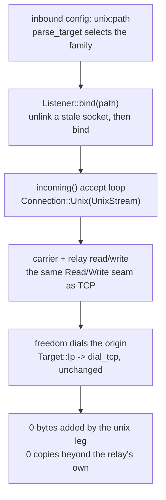

# Unix domain sockets

A `unix` field on an inbound names an `AF_UNIX` path and stands in for `listen`+`port`; a flow that arrives on it is served by the same engine that serves TCP. There is no second read/write path for the socket family: one `Connection` seam (`Tcp(TcpStream)` / `Unix(UnixStream)`, `crates/ferrox-app/src/conn.rs`) is the transport every carrier and the relay already read and wrote through, so switching a leg to a unix socket changes which `Read`/`Write` impl answers, not the bytes handed to it. The row is transparency, not a new framing: what leaves one end of a unix stream is what would leave the same round trip over TCP, octet for octet.

Both roles the method has are served. The server role binds a path and accepts on it (`Listener::bind`, `accept_loop`); the client role dials a path (`connect`). The `unix:` spelling is parsed before anything is dialed (`parse_target`), so an empty path is refused rather than bound at the root.

What refuses, and where: a datagram carrier (kcp, quic, hysteria) cannot bind a stream socket, so an inbound naming one keeps the IP address it is given and the `unix` field does not reach it. A unix peer reports no socket address — there is no port to name — so `peer_addr`/`local_addr` answer `Unsupported` rather than a fabricated one; `reality_edges` reads the two ends through those and a unix leg yields the same `None` pair a never-bound TCP stream yields, which is what a cover origin expecting no PROXY header already handles.

## Data path



## Measured

<!-- counts:begin -->
| key | value | checked by |
| --- | --- | --- |
| ops-retired-instructions | UNBLESSED | scripts/count-ops.sh |
| unix-stream-bytes-preserved | 65536 | ferrox-app-conn::tests::a_unix_connection_carries_the_same_bytes_the_tcp_round_trip_does |
| unix-head-not-vector-multiple | 1501 | ferrox-app-conn::tests::a_unix_round_trip_survives_lengths_a_vector_would_split |
<!-- counts:end -->

The first row is the byte-identity claim itself: a 64 KiB stream round-tripped both ways over a real `AF_UNIX` socket equals the same round trip over TCP and equals the payload. The second is the arithmetic on the inputs a round number hides — lengths `1`, `3`, `1501`, `65535`, none a multiple of the vector width the vectored write path splits on — each arriving whole.

Syscalls: a unix bind is `socket`+`bind`+`listen` where TCP is `socket`+`setsockopt`+`bind`+`listen`, so the unix leg issues no `SO_REUSEADDR` that has no meaning for a path, and the arm of `Connection` that decides this is chosen at `Listener::bind`, not per byte; a read/write over the unix stream is the same `read(2)`/`write(2)`/`writev(2)` the TCP path issues, one per call the relay makes — no checker counts this yet, and a loopback `AF_UNIX` pair cannot gate a syscall total, so it stays prose. Copies: the seam forwards `read`/`write` to whichever socket it holds without staging; the only copy on the data path is the relay's own, shared with TCP. There is no copy here that the unix row removes relative to a prior implementation — the row went from refused to served, so the claim is that it adds none, witnessed by `unix-stream-bytes-preserved` carrying 64 KiB through without a re-frame. The timeout arm is one `setsockopt(SO_RCVTIMEO)` on either family (the Unix path supplies it directly, `std` offering no setter), and `a_unix_read_timeout_arms_the_way_the_tcp_one_does` witnesses that an empty armed unix read blocks to the bound exactly as the TCP one does.

## Ops

```bash
./scripts/count-ops.sh report \
  conn::tests::a_unix_connection_carries_the_same_bytes_the_tcp_round_trip_does 'conn::Listener::bind'
```

`UNBLESSED`, as above — macOS/aarch64 ships no `valgrind`, so this count is CI-only there and has not been read; it is not a number and is not quoted as one.

## Time

**Not measured yet.** Durations in this repository come from CI runners (`bench.yml`, `parity.yml`); no CI artefact has been read, and a laptop behind a VPN measures a tunnel either way.

## What we removed

The address lie and the file-lock. Xray's `UnixConnWrapper` ( `transport/internet/system_listener.go`) rewrites `RemoteAddr()` to a fabricated `&net.TCPAddr{IP: {0,0,0,0}}` so the app-layer address machinery does not choke on a unix peer, and wraps the listener in a `FileLocker` it releases on `Close`. Neither has anything to feed here: this tree has no `net.Addr`-keyed dispatcher downstream of the seam, so the honest `Unsupported` — which the one consumer, `reality_edges`, already maps to `None` — replaces the fake address, and the stale-socket case is met by unlink-then-bind rather than a lock file. The unlink itself is the recovery the references reach for (sing-box `server_unix.go` / `cmd_worker_unix.go` run `os.Remove(path)` before `net.Listen("unix", path)`); the lock was its heavier stand-in for the same `EADDRINUSE`, and one unlink that owns the path needs no second file to say it is held.

## What was not removed

The `writev` coalescing on the vectored write path is kept on the unix arm, not relocated to a plain `write`: `write_vectored` is `writev(2)` for either family (a `Connection` is a socket on both), so the frame-part packing the TCP path already had is the same call on a unix stream — `impl Write for Connection` forwards `write_vectored` unchanged, and no frame is split to reach it. The `TCP_NODELAY` request is accepted-and-ignored on a unix stream rather than dropped from the caller: `set_nodelay` is called uniformly on either family in `no_delay`, and a unix socket has no internetwork to delay on, so the request does nothing instead of failing — the caller keeps one path, not a family test. xray-core-rust carries unix only on the commander/API socket, not the transport listener, so there is no transport dial/serve shape to take from it; and zeronet ships no unix transport at all — `grep` finds none — so this row borrows nothing from it and says so rather than naming a source it did not read.

## Pins

| what | where |
| --- | --- |
| `UnixListenerWrapper`, `FileLocker` release on close, `RemoteAddr` rewritten to a zero `TCPAddr` | `upstream/xray-core/transport/internet/system_listener.go` |
| unlink-then-bind a stale socket path before listening | `upstream/sing-box/experimental/boxdd/server_unix.go`, `upstream/sing-box/experimental/boxdd/cmd_worker_unix.go` |
| unix on the commander/API socket only, no transport listener | `upstream/xray-core-rust/crates/xray-app-commander/src/` |
| no unix transport to take from | `upstream/zero-net/` |

## CI scope

What a change here owes, read by `scripts/ci-scope.py`; see [`docs/ci-scope.md`](../ci-scope.md).

<!-- scope:begin -->
- paths: crates/ferrox-app/src/conn.rs
<!-- scope:end -->
