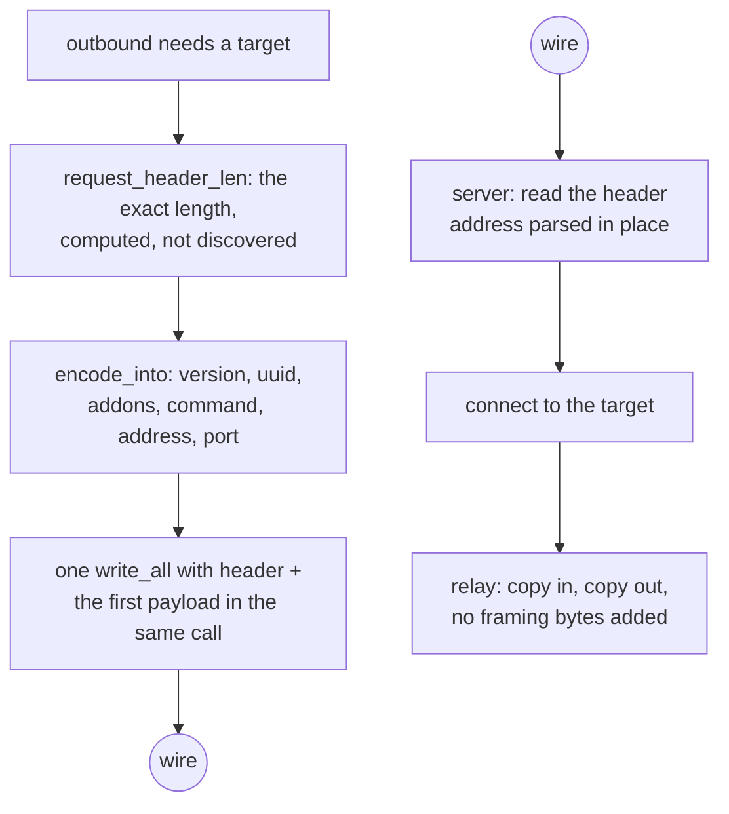

# VLESS over TCP

VLESS has no framing. One request header, then the stream is the stream, and
the whole method's cost is in reading that header without copying it and
encoding it without allocating.

The header is `version(1) | uuid(16) | addonsLen(1) | addons | command(1) |
address | port`. `addons` is a protobuf whose only field this tree honours is
`Flow`, the XTLS Vision selector; a header that carries a flow gets 2 add-on
bytes and nothing else. For `xtls-rprx-vision` the command byte and the address
are still written — Vision is a framing *around* VLESS, not a replacement for
its target field.

A dial keeps the destination the shape the client gave it: a name leaves as ATYP 2 plus its bytes and the edge answers the lookup, so nothing on this machine asks its own resolver for a host the tunnel was meant to carry. Only `Freedom`, the Foxy direct split and a UDP front that already resolved the datagram's destination look a name up here.

`request_header_len` is a pure function of the destination, so the caller knows
the exact length before reading anything. `encode_into` writes into a buffer the
caller owns. That combination is why `ferrox-bench` gate 2 can assert zero
allocations, zero allocated bytes and zero zero-fills for the encode at an
IPv4, an IPv6 and a domain destination.

## Data path



## Measured

<!-- counts:begin -->
| key | value | checked by |
| --- | --- | --- |
| ops-retired-instructions | UNBLESSED | scripts/count-ops.sh |
| request-header-allocations | 0 | ferrox-bench-gate-2 |
| request-header-bytes-zero-filled | 0 | ferrox-bench-gate-2 |
| address-families-encoded | 4 | ferrox-core-vless::tests::header_address_families_encode_stably |
| vision-addons-bytes | 2 | ferrox-core-vless::tests::non_vision_header_carries_empty_addons |
| reality-outbound-rows-dialled | 6 | ferrox-app-proxy::tests::vless_outbound_with_reality_dials_raw_and_every_carrier |
| vision-header-targets-matching-core | 2 | ferrox-app-proxy::tests::vision_header_matches_the_core_encoder |
| dial-header-reallocations | 0 | ferrox-app-proxy::tests::dial_headers_are_sized_to_the_bytes_they_hold |
| request-header-reads | 4 | ferrox-app-proxy::tests::the_vless_request_header_costs_four_reads_not_six |
| handshake-pump-buffer-reallocations | 0 | ferrox-app-proxy::tests::the_pump_forwards_its_buffer_by_pointer_and_holds_capacity_steady |
<!-- counts:end -->

The relay buffer's zero-fills are prose, not a row. A row needs a checker that
sees the thing it names, and the only counter that sees a fill is `alloc_zeroed`:
the counting `GlobalAlloc` that could watch one `RelayBuf`'s whole life (`new()`
and one promotion) has to be installed by the test binary that runs the gate, and
this crate's test binary is where the tree's one blessed instruction count lives.
CI measured the collision — `der_to_pem` went `2653 → 2743` because every
allocation it makes grew a thread-local test — and a harness cost is not a change
to the product, so the allocator stays in `ferrox-core`'s own test binary, where
nothing is blessed, and the shape it proves is
`alloc_count::tests::an_uninitialised_tail_is_allocated_but_not_filled`: capacity
plus `set_len` and `vec![0u8; n]` are the same allocation and the same bytes, and
the fill is the only difference. The promotion's 240 KiB was never visible to any
counter here anyway — growing with `resize(.., 0)` writes the tail with
`write_bytes`, which is not `alloc_zeroed` — and the only counter that would see
it is an instruction count, which is the `UNBLESSED` row above.

The handshake pump now spends that same `RelayBuf`, so a dial stops paying a
16 KiB `vec![0u8; …]` memset for bytes the first `read` overwrites. That fill is
prose by the rule just above; the row that is checked is the pump's buffer
*handoff* — the carrier receives the buffer's own bytes, and 64 sub-buffer
push/drain cycles neither move the allocation nor grow its `size()`, so steady
traffic reallocates none of it.

## Ops

```bash
./scripts/count-ops.sh report \
  vless::tests::header_address_families_encode_stably 'ferrox_core::vless::VlessLink::encode_into'
```

`UNBLESSED`, as above.

## Time

**Measured on this branch.** `.github/workflows/parity.yml` runs the
`vless-raw` scenario across the pinned engines for upload, download and
full-duplex; `.github/workflows/benchmark-matrix.yml` runs the same. Both are
CI-only. This branch's check run (`7fb86bf`, full tier, five repeats, ubuntu
`x86_64`) carries seven `vless-raw` cells, all of them gate-green with zero engine
failures, and every row below is read from one of its artefacts or from the cell
it names. The two cells quoted under **What we removed** for the splice pump are
main's nightly at `81c48ad` (the build before the pump's idle back-off) and the
dispatched replays of `vless-raw-up-1` and `vless-raw-down-1` on `905962d`, each
read from its own run artefact.

**The upload cell measured the harness, not the engines, until #166.** The sink
compared the bytes it was handed one at a time — a modulo and a bounds-checked
index per byte — so on main's nightly at `70fdfd0` (run `39001299614`,
`vless-raw-up-1`, ubuntu `x86_64`, 4 logical CPUs, standard tier, three repeats)
`xray-core` read 615.7, `ferrox` 616.4 and `zeronet` 619.8 MiB/s at their medians:
every engine within 0.7% of the others, at 14% of that cell's own one-hop ceiling
(4 294 MiB/s median), and the row verdict was `within-noise` at
[0.975×, 1.030×]. That run binds one direction only: the same build on the same
runner reads `vless-raw-down-8` at `ferrox` 5 885 against `xray-core`'s 2 813,
[2.092×, 2.150×] median 2.115× better, while `vless-raw-duplex-8` reads 1 466
against 1 171, median 1.248× — duplex carries an upload half, and it rode under the
same bound. A ceiling is one generator into one reader, so a relay can beat it and
it is read as a floor, never as a share to divide by.

**This branch's check run resolves the row.** At `7fb86bf` (full tier, five
repeats, same runner class, all seven `vless-raw` cells gate-green with zero engine
failures) `vless-raw-up-1` reads `ferrox` 4 354 MiB/s against `xray-core`'s 1 805:
throughput [2.288×, 2.455×] median 2.374× better, cpu per GiB [3.017×, 3.134×]
median 3.085×, peak RSS [5.604×, 5.700×] median 5.651×. `vless-raw-duplex-8` reads
5 058 against 2 690, median 1.892×, where the nightly's duplex cell read 1.248× —
the bound came off the upload half of a duplex flow. `vless-raw-down-1` is the
control on the reader this change also rewrote and it moves nothing that was
already moving: `ferrox` 2 911 against `xray-core`'s 1 236, [2.281×, 2.398×],
`better` in both cells. An upload *throughput* row measured before #166 is
therefore evidence about the sink and not about the engines; its cpu row survives
only as a ratio and its RSS row survives whole, since the sink's cpu and resident
set belong to the harness process — `ferrox` bills 243.75 ms/GiB at 616 MiB/s and
320 ms/GiB at 4 354, `xray-core` 565 and 977.5, because a parked engine bills less
per GiB than a busy one, while `ferrox`'s own median RSS is 6.64 MiB in both cells
and `xray-core`'s 39.3 and 37.7. The ratios (cpu 2.319× pre-fix, 3.085× here; RSS
5.875× and 5.651×) are what the pump pricing above stands on, and it needs no
re-reading. Each number here is read from the cell it names, and no ratio is taken
across two cells.

**The row resolves on a second machine class.** A standard-tier, three-repeat
dispatch of `vless-raw-up-1` on `ubuntu-24.04-arm` at `906312c` (linux aarch64, 4
logical CPUs) reads `ferrox` 5 882 MiB/s against `xray-core`'s 2 225, throughput
[2.413×, 3.497×] median 2.834× better, cpu per GiB [3.006×, 3.117×] median 3.057×,
`ferrox` at its median 203.75 ms/GiB against `xray-core`'s 635, peak RSS median
5.521× (5.86 MiB against 32.3), gate green. The arm runner's nightly has no upload
cell, so nothing in that paragraph is read across machine classes. On `macos-15`
this workload is not priceable at all: this branch's `vless-raw-duplex-8` dispatch
there failed every engine in every repeat with `No buffer space available (os error
55)` on the upload writes and `Connection reset by peer` on the reads at ceilings of
482–671 MiB/s, and the run-based compare left it exactly as broken, so that row is
a runner-buffer fault rather than a comparison.

## What we removed

- **A field-at-a-time header read.** This is the largest difference between the
  three implementations and it is not close. Xray's
  `proxy/vless/encoding/encoding.go:120` calls
  `addrParser.ReadAddressPort`, which issues a separate `io.ReadFull` for the
  port, another for the address type byte, then another per family, then one for
  a domain's length and one for its body — up to seven reads served out of one
  `BufferedReader`, so one syscall but seven slice splits and seven `Read`
  calls. sing-box's `sagernet/sing-vmess/vless/protocol.go:29-79` does the same
  thing against the **bare `net.Conn`**, so it is 6–8 real syscalls for a 19–34
  byte header, plus a `make([]byte, strLen)` and a `string(strBytes)` second
  allocation for a domain. Zray parses a slice in place with zero allocations.
  The core encoder and the in-memory parser here (`parses_the_brief_link`,
  `header_address_families_encode_stably`) were always the in-place half — but the
  **server** read, `decode_request` handed a raw `TcpStream` in `serve_vless_raw`,
  was the field-at-a-time shape this bullet condemns: `read_exact` for the 18-byte
  head, then the add-ons, then the command, then the port, then the family byte,
  then the body — five syscalls for an IP target, six for a domain. The reads are
  now folded on the grain of the wire: the add-ons ride in with the command byte
  (both always header, and a mux request's frame data starts after the command, so
  this read is safe for every command), and the port, family, and the body's first
  byte are the same four bytes for every family — an IPv4 or IPv6 octet, or a
  domain's length. So the server request costs four reads for every address family
  and two for mux. `the_vless_request_header_costs_four_reads_not_six` drives it
  from an in-memory stream that answers the whole buffer, where the count is exact
  (a loopback socket's read count moves with the scheduler and cannot gate it); the
  byte-identity is held by the loopback decode tests that dial every reader. No
  byte was added to the wire and none is over-read: every read is bounded to header
  bytes, so the first payload byte still reaches the relay untouched.
- **A header written through a temporary.** sing-box's `WriteBuffer` path is
  already good — it extends the header into the pooled buffer's headroom and
  writes header and payload in one call — and this tree matches that shape
  rather than the `buf.NewSize` + copy shape beside it.
- **An 8 KiB buffer per connection that is thrown away.** Xray's
  `proxy/vless/inbound/inbound.go:286` does
  `buf.FromBytes(make([]byte, buf.Size))`, and because `FromBytes` marks the
  buffer `ownership: unmanaged` its `Release` is a no-op, so that 8 KiB never
  reaches `bytespool`. The relay buffer here starts at 16 KiB and is promoted to
  256 KiB only once a read fills it completely, and on Linux the plain `copy`
  path is `splice(2)` with no user-space copy at all.
- **A `POLLIN` the pipe ring could not serve.** The pump armed it while the pipe
  held fewer bytes than its capacity, which is a question in bytes, and the ring
  refuses by *slots*: a wake that is honest about the socket still has nowhere to
  put what it sees, and re-arming it is a spin on a flow nobody can move. The
  `vless-raw-up-1` cell priced that spin as a resolved regression: main's nightly
  cost 2 501 ms of system time per GiB where xray-core cost 1 076 on that same
  runner (0.431× its cost, interval [0.423×, 0.441×], the cell exiting red), and the
  fixed build costs 185 where xray-core costs 721 (3.818× better, interval
  [3.606×, 4.020×]). The two cells ran on different machines, so only each one's
  ratio to its own comparator is comparable — not 2 501 against 185.
  `vless-raw-down-1` moved the same way it already did (2.271× xray-core's cost to
  2.459×), so the back-off gave nothing up there. Measured against the pump that
  re-armed the wake, a destination reading 512 bytes every 2 ms cost 78 183 ingest
  splices that moved nothing out of 79 013 wakes in a 400 ms window; the same window
  on this pump measures 2. Item 15 of
  `docs/method-superset.md` carries the counts, and
  `poll_relay::no_pollin_is_armed_on_a_ring_that_holds_bytes_it_cannot_take` holds
  the arm's truth table while
  `relay_tests::a_trickling_destination_does_not_spin_the_pump` counts the wake.
  What was not removed: the first refusal of each stall is still an ingest attempt,
  so the pump pays one splice that moves nothing per stall cycle, and a byte the ring
  could take now waits for the drain wake that clears the stall rather than the source
  wake that found it. That delay is priced, not assumed: the same cell's throughput
  measured inside noise afterwards (mid 0.988×), with the system time at a thirteenth.
- **The relay buffer's own `memset`.** Both of its fills were setup cost paid
  before the first byte arrived: `vec![0u8; 16 KiB]` reaches for `alloc_zeroed`,
  and `resize(256 KiB, 0)` on promotion writes another 240 KiB — 32 KiB per
  connection up front, since each direction has its own buffer, and 240 KiB per
  direction that ever sees a full read. None of it is read: the buffer's whole
  length goes to `read`, and `filled` hands back only the prefix that read
  reported, so the socket writes every byte before a caller can reach it. Both
  paths are `with_capacity` plus `set_len` now, the shape `read_into_tail` and
  the head reader already use. What that trades is stated plainly: the invariant
  is no longer enforced by the type, it is the fact that `as_mut` is only ever
  given to a `read`. A caller that compared or printed the whole buffer would be
  reading bytes nobody wrote, which is why `RelayBuf` lost its `Debug`, and why
  the two size gates (`a_relay_buffer_promotes_only_on_a_read_that_filled_it`,
  `a_promoted_buffer_returns_the_bytes_that_were_read`) fill the buffer before
  reading through it.

- **A reallocating dial header.** The app-side `vless_header` and
  `vless_vision_header` reserved a fixed 30 and 30+18 bytes, but an IPv6
  destination writes 38 and 56 — the family byte plus 16 octets instead of 4 —
  so every v6 dial, including this row's TLS path, overran the reservation and
  paid a heap reallocation, a copy, and a free on a 38-byte header. They now
  reserve the exact length (the fixed prefix plus `1 + 4` or `1 + 16` chosen
  from the destination family), so `capacity == len` and the buffer never
  grows. `dial_headers_are_sized_to_the_bytes_they_hold` holds the capacity at
  the length for both families and both header shapes; nothing got worse — the
  IPv4 shape also loses its 4 bytes of slack, and the bytes on the wire are the
  same the core encoder writes.

- **A doomed IPv4 parse on every domain encode.** `Addr::of` scanned for `:`,
  found none for a domain, and handed the whole host to `std`'s IPv4 parser
  regardless of shape — so `example.com`, the destination `compare.yml` loops
  `encode_into` over, paid a parse that can only fail, since an IPv4 literal is
  `.` and decimal digits and nothing else. The classifier now folds the decision
  into that single pass: a `:` still breaks to the IPv6 branch as `contains` did,
  and the IPv4 parse is reached only when every byte is in `[0-9.]` — exactly the
  set `std` can accept, so the skipped call was always a miss. IPv4 and IPv6
  hosts are untouched; only the doomed call is gone.
  `addr::tests::the_fused_classifier_is_the_original_two_call_logic_on_every_host`
  sweeps well-formed and malformed literals, scope ids and domains against the
  old two-call logic and holds them byte-identical;
  `header_address_families_encode_stably` still fixes the encoded bytes for all
  three families.

- **The UDP relay loops' zero fill.** Nineteen SOCKS-inbound loops in this file
  and two in `shadowsocks2022.rs` (`serve_socks_udp_{freedom,foxy,foxy_ip,
  vless,vless_xudp,vmess,trojan,shadowsocks2022}`, `serve_vless_udp`,
  `pump_vmess_udp`, `serve_trojan_udp`, the three `spawn_*_udp_reader` loops,
  `serve_udp_on`, `serve_udp_relay`) each calloc'd a 64 KiB `UDP_BUF` per flow
  before the first datagram arrived. They now take `udp_buffer()`, which asks
  for the bytes through `RelayBuf::with_len` without filling them; the fill is
  the only difference, the shape `an_uninitialised_tail_is_allocated_but_not_
  filled` measures. Nothing past a datagram escapes: every use is a `recv`
  target followed by `&buf[..n]`, or an `&mut buf` handed to `read_udp_datagram`
  / `read_trojan_datagram` / `pump_trojan_replies`, each of which `read_exact`s
  or `recv_from`s only the length it reports. Syscalls, read granularity and the
  datagram bytes are unchanged, which is what the exact-ops job holds steady;
  what retires is the 64 KiB fill per flow, witnessed by the CI RSS matrix.
  The handshake and small fixed buffers beside these loops stay zeroed, and the
  KCP lanes' two receive buffers are untouched — that page still carries its own
  argument for them.

## Rows that are dialled

`security=reality` outbounds dial raw TCP and every carried carrier
(`vless_outbound_with_reality_dials_raw_and_every_carrier`): the dial seals the
session id into a stock hello, verifies the bound leaf, and relays with or
without Vision. A carried REALITY row rides the same `ws`, `httpupgrade`,
`grpc`, `xhttp` and `http-header` framings a plain-`TLS` row does, over the one
seal the raw dial pays; only the UDP-carrier set stays a server row, so those
shapes are still skipped rather than dialled. The dial writes the same header
bytes the core encoder writes (`vision_header_matches_the_core_encoder`).

## Pins

| what | where |
| --- | --- |
| header layout, addons, address parsing | `upstream/xray-core/proxy/vless/encoding/` |
| header layout, field-at-a-time socket reads | `upstream/sing-box` → `sagernet/sing-vmess/vless/protocol.go` |
| slice parser, zero allocations | `upstream/zeronet/crates/zero-protocol/src/vless.rs` |

## CI scope

What a change here owes, read by `scripts/ci-scope.py`; see [`docs/ci-scope.md`](../ci-scope.md).

<!-- scope:begin -->
- paths: crates/ferrox-core/src/vless.rs
- symbols: vless
- scenarios: vless-raw
- oracle: vless
- go: ./proxy/vless/...
<!-- scope:end -->
