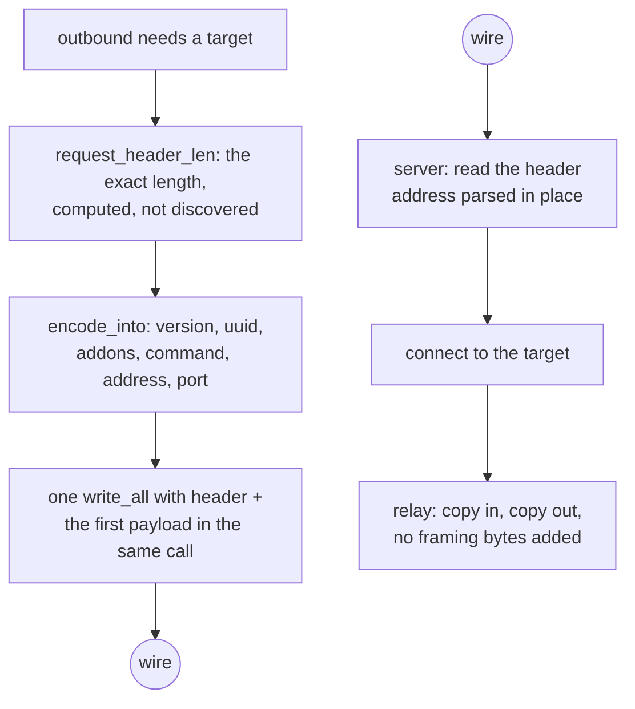

# VLESS over TCP

VLESS has no framing. One request header, then the stream is the stream, and
the whole method's cost is in reading that header without copying it and
encoding it without allocating.

The header is `version(1) | uuid(16) | addonsLen(1) | addons | command(1) |
address | port`. `addons` is a protobuf whose only field this tree honours is
`Flow`, the XTLS Vision selector; a header that carries a flow gets 2 add-on
bytes and nothing else. For `xtls-rprx-vision` the command byte and the address
are still written — Vision is a framing *around* VLESS, not a replacement for
its target field.

`request_header_len` is a pure function of the destination, so the caller knows
the exact length before reading anything. `encode_into` writes into a buffer the
caller owns. That combination is why `ferrox-bench` gate 2 can assert zero
allocations, zero allocated bytes and zero zero-fills for the encode at an
IPv4, an IPv6 and a domain destination.

## Data path



## Measured

<!-- counts:begin -->
| key | value | checked by |
| --- | --- | --- |
| ops-retired-instructions | UNBLESSED | scripts/count-ops.sh |
| request-header-allocations | 0 | ferrox-bench-gate-2 |
| request-header-bytes-zero-filled | 0 | ferrox-bench-gate-2 |
| address-families-encoded | 4 | ferrox-core-vless::tests::header_address_families_encode_stably |
| vision-addons-bytes | 2 | ferrox-core-vless::tests::non_vision_header_carries_empty_addons |
| reality-outbound-rows-dialled | 1 | ferrox-app-proxy::tests::vless_outbound_with_reality_security_dials_raw_only |
| vision-header-targets-matching-core | 2 | ferrox-app-proxy::tests::vision_header_matches_the_core_encoder |
| dial-header-reallocations | 0 | ferrox-app-proxy::tests::dial_headers_are_sized_to_the_bytes_they_hold |
| request-header-reads | 4 | ferrox-app-proxy::tests::the_vless_request_header_costs_four_reads_not_six |
<!-- counts:end -->

The relay buffer's zero-fills are prose, not a row. A row needs a checker that
sees the thing it names, and the only counter that sees a fill is `alloc_zeroed`:
the counting `GlobalAlloc` that could watch one `RelayBuf`'s whole life (`new()`
and one promotion) has to be installed by the test binary that runs the gate, and
this crate's test binary is where the tree's one blessed instruction count lives.
CI measured the collision — `der_to_pem` went `2653 → 2743` because every
allocation it makes grew a thread-local test — and a harness cost is not a change
to the product, so the allocator stays in `ferrox-core`'s own test binary, where
nothing is blessed, and the shape it proves is
`alloc_count::tests::an_uninitialised_tail_is_allocated_but_not_filled`: capacity
plus `set_len` and `vec![0u8; n]` are the same allocation and the same bytes, and
the fill is the only difference. The promotion's 240 KiB was never visible to any
counter here anyway — growing with `resize(.., 0)` writes the tail with
`write_bytes`, which is not `alloc_zeroed` — and the only counter that would see
it is an instruction count, which is the `UNBLESSED` row above.

## Ops

```bash
./scripts/count-ops.sh report \
  vless::tests::header_address_families_encode_stably 'ferrox_core::vless::VlessLink::encode_into'
```

`UNBLESSED`, as above.

## Time

**Not measured on this branch.** `.github/workflows/parity.yml` runs the
`vless-raw` scenario across the pinned engines for upload, download and
full-duplex; `.github/workflows/benchmark-matrix.yml` runs the same. Both are
CI-only. No artefact from this branch has been read.

## What we removed

- **A field-at-a-time header read.** This is the largest difference between the
  three implementations and it is not close. Xray's
  `proxy/vless/encoding/encoding.go:120` calls
  `addrParser.ReadAddressPort`, which issues a separate `io.ReadFull` for the
  port, another for the address type byte, then another per family, then one for
  a domain's length and one for its body — up to seven reads served out of one
  `BufferedReader`, so one syscall but seven slice splits and seven `Read`
  calls. sing-box's `sagernet/sing-vmess/vless/protocol.go:29-79` does the same
  thing against the **bare `net.Conn`**, so it is 6–8 real syscalls for a 19–34
  byte header, plus a `make([]byte, strLen)` and a `string(strBytes)` second
  allocation for a domain. Zray parses a slice in place with zero allocations.
  The core encoder and the in-memory parser here (`parses_the_brief_link`,
  `header_address_families_encode_stably`) were always the in-place half — but the
  **server** read, `decode_request` handed a raw `TcpStream` in `serve_vless_raw`,
  was the field-at-a-time shape this bullet condemns: `read_exact` for the 18-byte
  head, then the add-ons, then the command, then the port, then the family byte,
  then the body — five syscalls for an IP target, six for a domain. The reads are
  now folded on the grain of the wire: the add-ons ride in with the command byte
  (both always header, and a mux request's frame data starts after the command, so
  this read is safe for every command), and the port, family, and the body's first
  byte are the same four bytes for every family — an IPv4 or IPv6 octet, or a
  domain's length. So the server request costs four reads for every address family
  and two for mux. `the_vless_request_header_costs_four_reads_not_six` drives it
  from an in-memory stream that answers the whole buffer, where the count is exact
  (a loopback socket's read count moves with the scheduler and cannot gate it); the
  byte-identity is held by the loopback decode tests that dial every reader. No
  byte was added to the wire and none is over-read: every read is bounded to header
  bytes, so the first payload byte still reaches the relay untouched.
- **A header written through a temporary.** sing-box's `WriteBuffer` path is
  already good — it extends the header into the pooled buffer's headroom and
  writes header and payload in one call — and this tree matches that shape
  rather than the `buf.NewSize` + copy shape beside it.
- **An 8 KiB buffer per connection that is thrown away.** Xray's
  `proxy/vless/inbound/inbound.go:286` does
  `buf.FromBytes(make([]byte, buf.Size))`, and because `FromBytes` marks the
  buffer `ownership: unmanaged` its `Release` is a no-op, so that 8 KiB never
  reaches `bytespool`. The relay buffer here starts at 16 KiB and is promoted to
  256 KiB only once a read fills it completely, and on Linux the plain `copy`
  path is `splice(2)` with no user-space copy at all.
- **The relay buffer's own `memset`.** Both of its fills were setup cost paid
  before the first byte arrived: `vec![0u8; 16 KiB]` reaches for `alloc_zeroed`,
  and `resize(256 KiB, 0)` on promotion writes another 240 KiB — 32 KiB per
  connection up front, since each direction has its own buffer, and 240 KiB per
  direction that ever sees a full read. None of it is read: the buffer's whole
  length goes to `read`, and `filled` hands back only the prefix that read
  reported, so the socket writes every byte before a caller can reach it. Both
  paths are `with_capacity` plus `set_len` now, the shape `read_into_tail` and
  the head reader already use. What that trades is stated plainly: the invariant
  is no longer enforced by the type, it is the fact that `as_mut` is only ever
  given to a `read`. A caller that compared or printed the whole buffer would be
  reading bytes nobody wrote, which is why `RelayBuf` lost its `Debug`, and why
  the two size gates (`a_relay_buffer_promotes_only_on_a_read_that_filled_it`,
  `a_promoted_buffer_returns_the_bytes_that_were_read`) fill the buffer before
  reading through it.

- **A reallocating dial header.** The app-side `vless_header` and
  `vless_vision_header` reserved a fixed 30 and 30+18 bytes, but an IPv6
  destination writes 38 and 56 — the family byte plus 16 octets instead of 4 —
  so every v6 dial, including this row's TLS path, overran the reservation and
  paid a heap reallocation, a copy, and a free on a 38-byte header. They now
  reserve the exact length (the fixed prefix plus `1 + 4` or `1 + 16` chosen
  from the destination family), so `capacity == len` and the buffer never
  grows. `dial_headers_are_sized_to_the_bytes_they_hold` holds the capacity at
  the length for both families and both header shapes; nothing got worse — the
  IPv4 shape also loses its 4 bytes of slack, and the bytes on the wire are the
  same the core encoder writes.

- **A doomed IPv4 parse on every domain encode.** `Addr::of` scanned for `:`,
  found none for a domain, and handed the whole host to `std`'s IPv4 parser
  regardless of shape — so `example.com`, the destination `compare.yml` loops
  `encode_into` over, paid a parse that can only fail, since an IPv4 literal is
  `.` and decimal digits and nothing else. The classifier now folds the decision
  into that single pass: a `:` still breaks to the IPv6 branch as `contains` did,
  and the IPv4 parse is reached only when every byte is in `[0-9.]` — exactly the
  set `std` can accept, so the skipped call was always a miss. IPv4 and IPv6
  hosts are untouched; only the doomed call is gone.
  `addr::tests::the_fused_classifier_is_the_original_two_call_logic_on_every_host`
  sweeps well-formed and malformed literals, scope ids and domains against the
  old two-call logic and holds them byte-identical;
  `header_address_families_encode_stably` still fixes the encoded bytes for all
  three families.

## Rows that are dialled

`security=reality` outbounds dial raw TCP
(`vless_outbound_with_reality_security_dials_raw_only`): the dial seals the
session id into a stock hello, verifies the bound leaf, and relays with or
without Vision. A REALITY row over any carrier is still skipped rather than
dialled, so those shapes stay server rows. The dial writes the same header
bytes the core encoder writes (`vision_header_matches_the_core_encoder`).

## Pins

| what | where |
| --- | --- |
| header layout, addons, address parsing | `upstream/xray-core/proxy/vless/encoding/` |
| header layout, field-at-a-time socket reads | `upstream/sing-box` → `sagernet/sing-vmess/vless/protocol.go` |
| slice parser, zero allocations | `upstream/zeronet/crates/zero-protocol/src/vless.rs` |

## CI scope

What a change here owes, read by `scripts/ci-scope.py`; see [`docs/ci-scope.md`](../ci-scope.md).

<!-- scope:begin -->
- paths: crates/ferrox-core/src/vless.rs
- scenarios: vless-raw
- oracle: vless
- go: ./proxy/vless/...
<!-- scope:end -->
