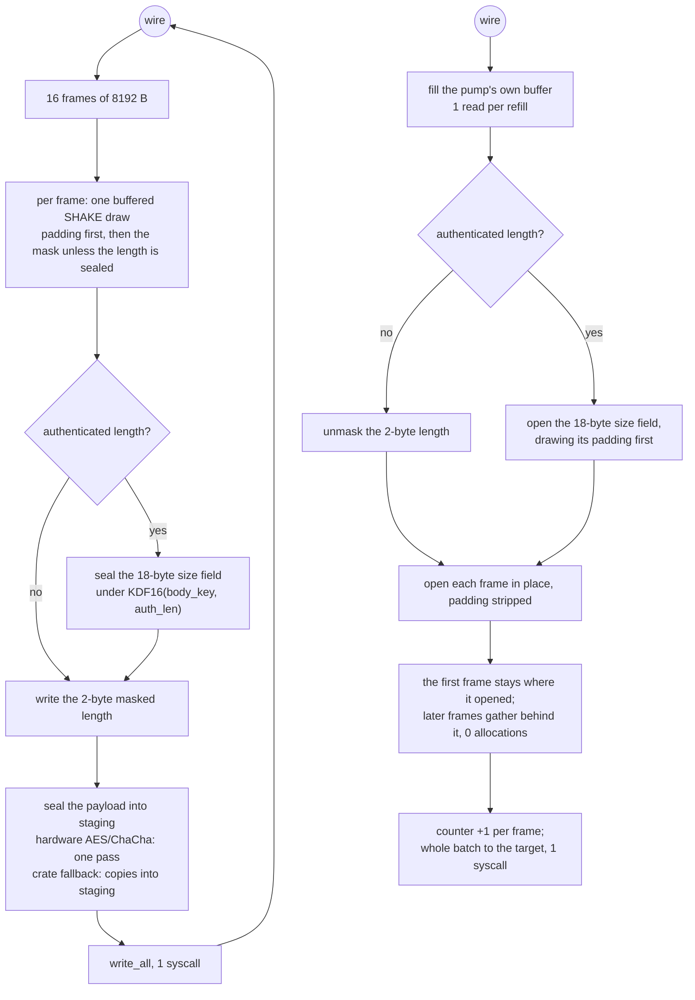

# VMess AEAD

VMess is the one method here that pays for a keyed handshake and then gets out of the way. The header is read once per connection and every later frame carries up to an 8 KiB payload, a size field — a SHAKE-masked 2-byte length by default, an 18-byte sealed length under `AuthenticatedLengthExperiment` — and a 16-byte tag.

A dial that was handed a name writes it inside the sealed request header as ATYP 2 with its own length, so the edge resolves it and the client's resolver is never asked.

The default framing this tree speaks is `OptionChunkStream | OptionChunkMasking | OptionGlobalPadding`, the shape that costs one AEAD call per frame. It also carries the reference's `AuthenticatedLengthExperiment`: an account whose `experiments` string contains `AuthenticatedLength` dials with `OptionAuthenticatedLength` added, and every frame's size field becomes two plain octets plus a tag sealed under `KDF16(body_key, "auth_len")` (`proxy/vmess/encoding/server.go`), a second AEAD call per frame. The option is negotiated in the clear, so a peer sees which set it got; xray's default is the same three bits and the experiment is opt-in, which keeps the default wire bytes and cost unchanged. Padding stays on in both sets and is still drawn from the SHAKE stream, before the length, exactly where the reference draws it (`common/crypto/auth.go` `AuthenticationReader::readSize`).

The client's selection is the account's experiment string — `experiments` in the reference's JSON, `tests_enabled` in its protobuf (`proxy/vmess/outbound/outbound.go:117`); `the_client_asks_for_the_authenticated_length_experiment` checks both ciphers' flows switch to the sealed size field and that a plain `Cipher::None` flow refuses the experiment, while `vmess_tls_outbound_parses_diallable_carriers` checks a config spelling `security: "none"` with the experiment resolves to the reference's `auto`. `the_option_byte_has_four_named_bits` holds the four-bit combinations, including the reference's padding-without-masking refusal, and `an_authenticated_length_peer_is_read_like_any_other` drives a padded and an unpadded sealed-length stream through both `read_frame` and `Wire`, with the response size sealed from the request pair. The default hot path was measured against `main` at `fe7723d6` in CI's `ops.yml` (`41216189413` baseline, `41246668876` after): `vmess::stage_frame` moved **9 232 947 → 9 261 845 Ir** (+28 898, +0.313%) and `vmess::read_frame` **66 421 → 66 434 Ir** (+13, +0.020%). The added instructions are the per-frame choice between the masked and the authenticated-length SHAKE draw — one branch on the size parser — with the default wire bytes unchanged. What is **not** removed: the second AEAD per frame when the experiment is on; the default path still pays one.

An account whose experiment string also names `NoTerminationSignal` ends its side without the zero-length marker (`proxy/vmess/inbound/inbound.go:217`, `proxy/vmess/outbound/outbound.go:180`); both roles still read a peer's marker either way. `an_account_without_the_termination_signal_ends_without_the_marker` drives the same pump with the signal kept and suppressed: the payload arrives both times and only the run that keeps the signal ends on the marker.

## Carriers

The sealed request and the UDP chunks are ordinary VMess stream bytes, so they ride raw, ws, xhttp, http header, httpUpgrade, gRPC, KCP and xdrive the same way a TCP payload does. A dial that names `security: tls` wraps the carrier — raw, carried, or KCP — and the listener that names `security: tls` answers it; before this change the listener ignored the security field and served plaintext anyway. An xdrive row's `security` names the store's own lanes, so the VMess session above it is plaintext either way.

UDP is carried as VMess command 2 chunks over the same carrier as TCP, both roles: the dial opens the carrier, writes the command-2 request and frames each SOCKS datagram; the listener decodes command 2 and pumps the same carrier. `vmess_serves_udp_over_every_carrier` and `vmess_tls_serves_udp_over_every_carrier` drive the six stream carriers end to end, `vmess_serves_udp_over_kcp` / `vmess_tls_serves_udp_over_kcp` the KCP pair, `a_vmess_kcp_tls_outbound_parses_and_carries_udp` its config parse and datagram echo, and `vmess_serves_udp_over_xdrive` the store; `vmess_serves_tcp_over_every_carrier` / `vmess_tls_serves_tcp_over_every_carrier` do the same for TCP. What is **not** removed: CI's parity scenarios still cover only `vmess-raw` and `vmess-tls-ws`; the carrier and TLS-role coverage above is the workspace test gate, not a comparison cell.

Read and write are symmetric about one thing: both batch. Writing stages sixteen 8 KiB frames into one buffer and writes them once. Reading keeps the sealed bytes and the plaintext gathered from them in one buffer, so the pump can tell without asking the carrier that a whole batch is already here, and it leaves the plain leg in one write instead of sixteen. A `BufReader` cannot offer that — it hides how much it holds — which is why the relay reads through `vmess::Wire` and the handshake still reads through `read_frame`.

The two directions end independently. A zero-length frame is the peer's marker that it has finished sending, not the end of the session: the relay half-closes that direction's target and keeps the other one, so a client that stops uploading first still receives its download. Only a carrier that ends without the marker tears the session down, and a lone leg's `RELAY_POLL` timeout only ends it once `RELAY_RESPONSE_IDLE` has passed since its sibling ended, so a reply written after the marker still reaches the peer; `a_peer_that_ends_its_upload_with_the_marker_still_gets_the_download` and `a_peer_that_ends_its_download_with_the_marker_still_takes_the_upload` are the gates for the two directions, and `only_the_marker_marks_a_stream_as_ended_by_its_peer` keeps the two ends distinct.

Both directions ride the relay lane pool rather than a thread each: `pump_relay_carried` arms the plain socket at `RELAY_POLL`, submits the staging direction and the decoding direction as two steps sharing one `RelayFinish`, and returns — the raw listener's `serve` hands its decoded session to the same pump, so raw costs the pool too, and only the raw *dial* and its tests still call the blocking `pump_relay`, so the serving thread is not held for the session and eight sessions cost the pool's fixed workers instead of sixteen threads. A step that finds nothing to do hands the wait back — `Wire::step` returns `Idle` when the carrier has no bytes yet, and the lazy server's response header is the same shape in `Answer`, which keeps the sealed length, the body and how much of each it already has across steps instead of waiting inside `read_exact`. The carrier holds the same quantum as the plain socket — `RelayPoll` arms the ws, httpUpgrade, http header, gRPC and xHTTP reader (and a bare `Connection`) before the first step, while a `TlsHalf`, a KCP read and an xdrive mailbox already poll — because a carrier read with no timeout parks its worker, and six parked downloads leave no lane for the upload a lazy server's reply waits on: `eight_live_carried_sessions_share_one_pool` opens eight sessions that hold a leg each before any of them carries a byte and fails on that stall. `a_live_vmess_session_costs_no_thread` holds eight sessions with no traffic and fails when the task count under `/proc/self/task` grows by eight, which the old shape did on its own; CI's `server-threads` leg is the number, and the bytes are unchanged: the batch, the marker and the half-closes are the same writes.

The payload cipher follows the reference's `auto` negotiation rather than a fixed choice: AES-128-GCM where the machine has hardware for it, ChaCha20-Poly1305 where it does not. Xray's `GetSecurityType` (`common/protocol/headers.go:82`) selects on `HasAESGCMHardwareSupport` the same way, so on a runner with AES-NI or armv8 crypto this tree pays hardware AES like the reference instead of a software stream cipher, and the request's cipher byte and the flows that seal the body are resolved through one function so they cannot diverge — `the_header_cipher_byte_matches_the_flow_cipher` is that gate.

## Data path



## Measured

<!-- counts:begin -->
| key | value | checked by |
| --- | --- | --- |
| ops-retired-instructions | UNBLESSED | scripts/count-ops.sh |
| maximum-payload-per-frame | 8192 | ferrox-app-vmess::tests::frames_seal_to_stable_bytes |
| frames-per-write-syscall | 16 | ferrox-app-vmess::tests::a_batch_on_the_wire_is_the_frames_written_one_at_a_time |
| write-syscalls-per-128KiB-relay-read | 1 | ferrox-app-vmess::tests::a_batch_on_the_wire_is_the_frames_written_one_at_a_time |
| frame-buffer-allocations-per-relay-write | 0 | ferrox-app-vmess::tests::frames_reuse_the_callers_buffers |
| frames-per-plain-write | 16 | ferrox-app-vmess::tests::a_batch_of_frames_leaves_the_pump_in_one_write |
| plain-write-syscalls-per-16-frame-batch | 1 | ferrox-app-vmess::tests::a_batch_of_frames_leaves_the_pump_in_one_write |
| pump-buffer-allocations-per-batch | 0 | ferrox-app-vmess::tests::the_pump_gathers_into_its_own_buffer_and_never_moves_it |
| first-frame-moves-per-batch | 0 | ferrox-app-vmess::tests::the_pump_gathers_into_its_own_buffer_and_never_moves_it |
| web-socket-staging-copies-per-batch | 0 | ferrox-app-vmess::tests::a_sealed_batch_reaches_a_web_socket_carrier_where_it_lies |
| web-socket-carrier-bytes-opened-at-most | 1024 | ferrox-app-vmess::tests::a_web_socket_carrier_opens_no_batch_buffer |
| counters-per-frame | 1 | ferrox-app-vmess::tests::counters_advance_one_per_frame_at_any_offset |
| replay-keys-held-at-most | 131072 | ferrox-app-vmess::tests::the_window_holds_two_rotations_at_most |
| zero-filled-bytes-per-flow | 0 | ferrox-app-vmess::tests::the_flows_windows_are_not_zero_filled |
| response-header-allocations-per-read | 0 | ferrox-app-vmess::tests::a_response_header_reads_without_allocating |
<!-- counts:end -->

`zero-filled-bytes-per-flow 0` is the flow's own windows: the wire's receive window, the relay leg's read window and the response header's buffer were each `vec![0u8; n]`, so a flow zeroed 393 KiB that its first read overwrites in full. `the_flows_windows_are_not_zero_filled` drives the counting allocator over the two windows a flow allocates and reads its `zeroed` counter, which is zero only when no allocation asked for zeroed memory; the same counter would read three on the old shape. The bytes on the wire are not in question: no buffer changed size, and the reads that filled them are the same reads.

`first-frame-moves-per-batch 0` is the batch's own shape: the plaintext a step hands back starts where the first frame opened, not at offset 0, so the gate asserts the returned base at `held.as_ptr() + HEADER_LEN` **and** that the first frame's two-byte size field is still in front of it. A move of the batch to the front overwrites that field with the second frame's bytes, so the pair of assertions is a witness that cannot pass with the copy present.

## Ops

```bash
./scripts/count-ops.sh report \
  vmess::tests::a_batch_on_the_wire_is_the_frames_written_one_at_a_time 'vmess::stage_frame'
./scripts/count-ops.sh report \
  vmess::tests::frames_reuse_the_callers_buffers 'vmess::read_frame'
./scripts/count-ops.sh report \
  vmess::tests::an_aes_batch_is_the_frames_written_one_at_a_time 'vmess::stage_frame'
./scripts/count-ops.sh report \
  vmess::tests::a_batch_on_the_wire_is_the_frames_written_one_at_a_time 'ferrox_core::chacha::avx2::xor_blocks_from'
./scripts/count-ops.sh report \
  vmess::tests::a_batch_on_the_wire_is_the_frames_written_one_at_a_time 'ferrox_core::chacha::avx512::xor_blocks_from'
```

The last two rows ask a question about the first, not about VMess. A count is only a claim about the code path that ran, and chacha's dispatch takes `avx512f + avx2`, then `avx2`, then the `portable::U4` fallback; a `#[target_feature]` function cannot inline into a non-feature caller, so a rung appears as its own frame if and only if it ran. CI's `ops.yml` on this head answers it: **`ferrox_core::chacha::avx2::xor_blocks_from Ir=4 898 648`**, and **`avx512::xor_blocks_from Ir=inlined-not-a-frame`** — the AVX2 rung is what the runner measures, and the profile holds no AVX-512 frame. So the blessed chacha number is the vector path's, and the write-side work left for this page is `stage_frame`'s own 9 261 398 Ir — the seal and its Poly1305 absorb inline into that frame — beside the 4.90 M the rung books as its own.

Read each row as the work it runs, not against the other. The stage probe sweeps twelve lengths from 1 byte to a full 16-frame batch and stages each of them twice — once frame by frame, and once as a batch whose over-long run is refused only *after* its sixteen frames are sealed — so it is **174 `stage_frame` calls over 1 335 556 staged bytes**, about 6.9 Ir a byte. The AES row is the same sweep at the other cipher: **1 666 246 Ir**, 5.6x under the chacha row on the same bytes; which frame the AES payload work lands in is not probed here. `read_frame`'s row is a different shape again: **8 calls over 6 305 bytes** through a real loopback socket, about 10.5 Ir a byte — and a loopback row is not a gate, so only its per-byte half is even comparable, and it is not a like-for-like half: this head has no row naming the AEAD open inside the read profile, and the record layer's own probe finds `aead::chacha20_poly1305_decrypt_in_place` inlined into *its* caller (`Ir=inlined-not-a-frame` at `the_ladder_reports_the_blocks_the_caller_asked_for`). The two per-byte figures therefore price two different frames, not a seal against an open.

`UNBLESSED` for the gate, as above; the artefact's pair is the claim. This head re-measured all three rows in CI's `ops.yml` (`41255841090`): `stage_frame` **9 261 398 Ir** with ChaCha20-Poly1305 and **1 666 246 Ir** with AES-128-GCM, `read_frame` **66 434 Ir** — the same three numbers `main` reads in its own run (`41251462662`), to the instruction. The batch-placement change is invisible in all three, and that is the honest reading rather than a missed win: the removed `copy_within` lives in `Wire::step`, which no row on this page names — the rows bound the handshake reader and the staging path, and the gather's price is the pointer-identity row above plus the arithmetic, 8 KiB less moved per 128 KiB step. No libc frame is used as a row either: callgrind names `__memcpy_avx_unaligned_erms` on this runner's glibc and something else on the next, so a row that read a memcpy would be a machine claim, not a code claim.

On the same twelve-length sweep — 174 `stage_frame` calls — `vmess::stage_frame` read **9 646 837 Ir** before the buffered draw (`p2-vmess-gate`), **9 637 793 Ir** after it, **9 636 923 Ir** after the in-place nonce (`p2-vmess-nonce`), and **9 629 747 Ir** after the length is written once (`p2-vmess-stage`): **−17 090 Ir / −0.177 %**, about 98 Ir a call. `vmess::read_frame` moved 69 533 → 69 284 → 69 072 → **66 201 Ir** after the scratch stops zeroing: **−3 332 Ir / −4.79 %**. The wire bytes are the unchanged side: `frames_seal_to_stable_bytes`, `a_batch_on_the_wire_is_the_frames_written_one_at_a_time`, and the counter tests hold them.

## Time

`ferrox-bench` gate 4 (`framing.rs`) compares VMess-style framing rows byte for byte against the pinned reference, and gate 7b compares the AEAD seals; neither is a clock. The clock is gate 3's ratio at every measured length plus `.github/workflows/parity.yml`'s `vmess-raw` scenario, and the batch's own number is `benchmark-matrix.yml`'s `vmess-raw-down-8` cell: **full tier, ubuntu-latest (4 logical CPUs), 5 medians per engine.**

| ratio vs xray-core (higher throughput / lower CPU is better) | interval | verdict |
| --- | --- | --- |
| throughput | 1.235 [1.216, 1.269] | better, gating |
| cpu per GiB | 1.178 [1.169, 1.187] | better, gating |
| peak rss | 7.122 [7.079, 7.165] | better, gating |

The same cell ran at `standard` tier (3 repeats) on `main`'s `fe7723d6` (EPYC 7763, run `41246681271`) and on this head `184e3a9c` (EPYC 9V74, run `41246678961`); the runners differ, so each run's own ratio to the reference is what reads across them.

| run | server | throughput | cpu per GiB | peak rss |
| --- | --- | --- | --- | --- |
| `fe7723d6` | ferrox | 2.649x | 1.818x | 3.082x |
| `fe7723d6` | xray-core | 2.368x | 1.727x | 3.022x |
| `184e3a9c` | ferrox | 2.996x | 2.000x | 2.972x |
| `184e3a9c` | xray-core | 2.708x | 2.000x | 3.005x |

With the default wire bytes unchanged, the throughput and CPU leads widened on both servers and peak RSS held near 3x.

The split those two totals are made of, in ms/GiB medians:

| engine | user | sys | total | MiB/s | peak RSS MiB | threads |
| --- | --- | --- | --- | --- | --- | --- |
| ferrox | 790 | 1 291 | 2 065 | 1 557.5 | 8.6 | 35 |
| xray-core | 1 264 | 1 170 | 2 435 | 1 274.8 | 61.2 | 14 |
| zeronet | 7 578 | 1 614 | 9 201 | 399.2 | 12.5 | 5 |

Against the standard-tier baseline (788 user / 1 850 sys, cpu per GiB 0.921 of xray-core) **the batch moved the kernel half and only the kernel half**: −30 % sys per GiB, user CPU inside the noise, and the reference on this run reads 1 170 sys against its baseline's 1 153, so the runner did not move under the number. zeronet's `vmess` rows are informational and non-gating; sing-box and xray-rust are **unproven** here for the reasons the cell records — Xray-dialect configs and a pin that does not serve vmess.

The tag and the payload are both authenticated over the ciphertext, so this method's open path is the [`record-layer`](record-layer.md) open path: the tag is checked before any keystream exists and block one onward is xored into the frame buffer once. The buffer stays the caller's: `vmess frame-buffer-allocations-per-relay-write 0` is that witness, and the Poly1305 rungs it shares — one absorb per padded section, no empty absorb at either end of a record, no head recursion into the dispatch on a 64-byte-aligned frame — apply to every 8 KiB VMess frame on the AVX2 and NEON-4 paths.

- **Two rows this page claims were not being checked at all.** The gate for `frames-per-write-syscall` and `write-syscalls-per-128KiB-relay-read` swept payload lengths that topped out at `3 * MAX_PLAIN` when the batch was four frames — **three** frames, so the fourth iteration of `stage_frames`' loop was never entered by any test and the number 4 was unobserved; and the sink was a `Vec`, which cannot tell one `write` from four, so the syscall row had no counter behind it either. The sweep now runs to the batch bound *written in the constant* — `(FRAMES_PER_WRITE - 1) * MAX_PLAIN`, `FRAMES_PER_WRITE * MAX_PLAIN - 1`, `FRAMES_PER_WRITE * MAX_PLAIN`, one over it, and `READ_PLAIN` — and writes into a `CountingWriter`, so both rows are observed at whatever width the batch is, not at the width they were written for. Nothing about the frames changed; only what the test can see.
- **A silent truncation that the same gap was hiding.** `stage_frames` staged at most `FRAMES_PER_WRITE` frames and, if the read was wider, exited its loop with bytes left and returned `true` — a truncated frame sequence on the wire, with no assertion anywhere. `pump_relay` clamps to `READ_PLAIN`, which equals the batch bound, so nothing reaches it today; but the two expressions that have to agree were checked by nobody, and raising `FRAMES_PER_WRITE` without raising `READ_PLAIN` would have dropped the tail of every relay read over one batch. `stage_frames` now refuses instead, and `a_read_wider_than_one_batch_is_refused_not_truncated` gates that: it drives `READ_PLAIN + 1` and `READ_PLAIN + MAX_PLAIN`, requires `false`, and requires that **nothing** reached the sink.

## What we removed

- **A `host:port` string per datagram.** The datagram lane's target was re-serialised into a `host:port` string for the resolver, so every datagram that named a host paid a string the resolver then had to take apart again. The resolver is asked for a host and a port now, the way this tree already asks on the flow's own dial, and the `host:port` spelling is gone from the tree.
- **The response header's buffers and the KDF's boxes.** A response header read into three `Vec`s — one for the encrypted length, one for the encrypted body, and a copy of each inside `open_header` — and every KDF layer boxed its HMAC states. The header now opens into stack arrays and the chain replays its pad prefixes over one stack HMAC, so `a_response_header_reads_without_allocating` counts zero allocations where the old shape counted three buffers and a box per layer. The bytes are unchanged: `kdf_matches_the_oracle_vectors` holds the chain against the reference vectors and the response-header round trip holds the wire.
- **Three hundred and ninety-three kilobytes of zero fill per flow.** The wire's receive window, the relay leg's read window and the response header's buffer were each allocated with `vec![0u8; n]`, so a flow paid a zero pass over 393 KiB of memory that the first read overwrites in full. They are the same buffers without the pass now: the counting allocator's `zeroed` counter is the witness, and `the_flows_windows_are_not_zero_filled` fails if any of them is zeroed again. What did not move: the bytes on the wire, and the buffers' sizes — the same memory is still allocated, and the pages the fill used to fault in are now faulted in by the read that overwrites them.
- **A SHAKE refill per frame.** `Shake::draw` asked `Shake128Reader` for two or four bytes for every frame's length mask and padding, so a sixteen-frame batch entered the XOF sixteen times. The reader now fills one sixty-four-byte buffer and the batch consumes it; `batched_draws_keep_the_reference_stream` compares the wrapped stream against a raw `Shake128Reader` for padding off, padding with masking, and authenticated-length padding over 200 draws, so the bytes and the draw order are the reference's. Measured on the same twelve-length sweep: `vmess::stage_frame` **9 646 837 → 9 637 793 Ir** (−9 044, −0.094 %). What is **not** removed: every length is still xored with its mask and every pad still writes its zeros; only the number of XOF calls falls.
- **A 12-byte nonce rebuilt per frame.** `Flow::nonce` zeroed a twelve-byte array and copied the ten-byte IV tail into it on every seal and open; `SizeAead` did the same for an authenticated length. The nonce is a field now, with only the two counter bytes overwritten, and the AEAD borrows it. Measured: `stage_frame` **9 637 793 → 9 636 923 Ir** (−870) and `read_frame` **69 284 → 69 072** (−212). The bytes are unchanged; `counter_wrap_matches_the_reference`, `counters_advance_one_per_frame_at_any_offset`, and the seal/open round trips hold them.
- **A zeroed length hole and its overwrite.** `stage_frame` resized the staging buffer by the size field's width — two bytes, or eighteen when the length is authenticated — sealed the body after that hole, then copied the length over the zeros. The length is computed from the plain, tag and padding and appended once now, and the body follows it. Measured: `stage_frame` **9 636 923 → 9 629 747 Ir** (−7 176, −0.074 %); `read_frame` held at **69 072**. The bytes are unchanged, and `frames_seal_to_stable_bytes` plus `a_batch_on_the_wire_is_the_frames_written_one_at_a_time` are the gate.
- **A zero pass over every read frame.** `read_frame` grew its scratch with `resize(total, 0)`, zeroing every byte the following `read_exact` overwrites. `grow_scratch` claims the room instead; the buffer, its capacity and the bytes read are the same. Measured: `read_frame` **69 072 → 66 201 Ir** (−2 871, −4.16 %); `stage_frame` held at **9 629 747**. The bytes are unchanged, and the frame round trips plus `frames_reuse_the_callers_buffers` are the gate.
- **A frame buffer per relay write.** `frames_reuse_the_callers_buffers` is the gate: one buffer, sized once per connection by `with_capacity`, refilled by `clear`. For comparison, Xray's `common/crypto/auth.go:287` does `mb2Write := make(buf.MultiBuffer, 0, len(mb)+10)` and takes a pooled `temp := buf.New()` scratch on every `WriteMultiBuffer` call, so the batch is the pipe's read granularity rather than a number chosen for syscalls.
- **Sixteen write syscalls per relay read.** sing-box's VMess writes one `ChunkWriter` frame per write with `WriteChunkSize = 15000` (`sing-vmess/protocol.go:24-32`) and only coalesces when the upper layer is vectorised. Xray's stream path coalesces with `writev` but starts from a fresh scratch each call. This tree stages sixteen frames and writes once; `a_batch_on_the_wire_is_the_frames_written_one_at_a_time` is the gate that the batch is byte-identical to writing the frames one at a time.
- **Four write syscalls — and four segments — per relayed batch.** The plain leg of a relay wrote one decoded frame per `write_all`: a syscall and a loopback segment for every 8 KiB. On `vmess-raw-down-8` (ubuntu-latest, 3 repeats each) ferrox reads **1 850 ms/GiB of system CPU against xray-core's 1 153**, while the same runs read **788 ms/GiB of user CPU against their 1 275**: the user-space half of this method already costs 1.6x less than the reference, and the row that is red is entirely the kernel. The reference batches for the same reason — `AuthenticationReader.ReadMultiBuffer` (`common/crypto/auth.go:207`) pulls one frame and then up to fifteen more **only from what its `BufferedReader` already holds**, so a batch never waits and an interactive byte is never held up to fill one. `Wire::batch` is that shape over one buffer instead of two, which also drops the `BufReader` hop into a scratch `Vec` and the `resize` that zeroed a frame right before `read_exact` overwrote it. `a_batch_of_frames_leaves_the_pump_in_one_write` gates the batch, and `a_dribbled_carrier_still_offers_one_frame_and_loses_nothing` that a carrier arriving three bytes at a time still loses nothing. The moved row: **1 850 → 1 291 ms/GiB of system CPU**, user CPU left where it was (788 → 790), which is what makes this a kernel-side removal rather than a relocation into user space.
- **Three more writes, and three more reads, per relayed batch.** The same lever, taken to the width the reference already caps itself at: `FRAMES_PER_WRITE` 4 → 16, xray's `one frame, then up to fifteen more from what the buffer holds`. The batch still never waits — only the first frame blocks — so the width buys syscalls and costs buffer, nothing else. Measured on `vmess-raw-down-8` (ubuntu-latest, 5 medians) against the 4-frame shape's own cell (same runner and reader): **system CPU 1 301 → 1 098 ms/GiB**, which is under xray-core's 1 171 for the first time on this cell, and **user CPU 781 → 635**, so total CPU **2 083 → 1 737** and the gating rows move with it — `cpu per GiB` 1.172x → **1.403x**, throughput 1.208x → **1.459x**. What that buys in RAM is named rather than hidden: `WIRE_LEN` 41 365 → 140 641 B per pump and `READ_PLAIN` 32 → 128 KiB per relay read, so peak RSS goes **8.67 → 11.4 MiB (+32 %)** and the RSS row's lead over the reference narrows from 7.31x to 5.43x; thread count is unmoved at 35. What is *not* removed is the gather for a batch of two or more frames: it still leaves as one buffer's bytes gathered behind the first frame, one copy per byte but the first frame's, because the four-`iovec` shape that avoided it lost more on the kernel than it gained in user space; a one-frame batch leaves where it opened.
- **A second cipher state to test per record.** `Flow` carried `aes: Option<Aes128Gcm>` and `chacha: Option<[u8; 32]>`, so every seal and open tested both and kept an unreachable both-set arm; `SizeAead` carried the same pair. The pair is one `Aead` enum now — `Aes`, `Chacha`, or `Plain` — so each record dispatches on one discriminant, and `SizeAead` uses the same enum. Measured on the twelve-length sweep: `vmess::stage_frame` **9 629 747 → 9 629 081 Ir** (−666, −0.0069 %). The bytes are unchanged; the seal/open round trips, the counter tests, and `frames_seal_to_stable_bytes` hold them.
- **A seal failure that cannot happen, and a batch that is never empty.** After the cipher enum, `seal_onto` has no arm that returns false, and every successful `stage_frame` writes at least a two-byte length, so `stage_frames`' `staging.is_empty()` check could not be true. Both checks are gone; `seal_onto` returns nothing. Measured: `vmess::stage_frame` held at **9 629 081 Ir** on both — the compiler had already removed them, so this is a source simplification at equal instructions, not a count win. The attempt to remove the live `u16` bound from the batch path with a const-generic specialization measured **9 634 992 Ir** (+5 911), so it was reverted.
- **A gather for a one-frame batch.** The pump gathered every frame's plaintext to the front of its buffer, even when the batch held one frame and the opened bytes were already a contiguous slice where they lay. A one-frame batch hands that slice over at its own offset now; a later frame gathers behind the first, so a full batch keeps its one contiguous write. `a_one_frame_batch_is_handed_over_where_it_opened` holds the returned base inside the pump's buffer and past its front, and `the_pump_gathers_into_its_own_buffer_and_never_moves_it` holds the multi-frame path contiguous and the first frame where it opened. The bytes are unchanged; the batch tests and `a_dribbled_carrier_still_offers_one_frame_and_loses_nothing` are the gate.
- **The first frame's move in every multi-frame batch.** `Wire::step` opened the first frame where it lay and then, the moment a second frame arrived, relocated the batch to offset 0 before gathering the rest behind it. That pass moves the first frame's whole payload over again to buy an address nobody uses: every consumer takes the batch by position — `&held[at..at + len]` in `batch`, in `backward_step` and in the UDP pump — so the front was only ever a habit. The batch now starts where the first frame opened, which makes a batch of *n* frames *n* − 1 `copy_within` calls instead of *n*, and at the full width, 128 KiB read into 16 frames, one frame's payload per step less: a GiB relayed is 8 192 steps, so 64 MiB per GiB off the 1 024 MiB the pump used to move inside its own buffer. `first-frame-moves-per-batch 0` is the row, gated by the pair of assertions in `the_pump_gathers_into_its_own_buffer_and_never_moves_it`: the batch's base at the pump's own pointer plus one header, and the first frame's masked size field still in front of it. The safety of the smaller destination is arithmetic, not observation: frame *j*'s plaintext is at most its `total` bytes, so after *i* frames the batch ends at `width + Σ_{j≤i} L_j` while the next header begins at `i * width + Σ_{j≤i} total_j`, which is never behind it — the gather cannot eat a header it has not opened yet. What is **not** removed: frames 2..*n* still gather, one copy each, because the no-copy shapes were measured and lost — see the paragraph below on `write_vectored`.
- **A second copy on read.** Xray's large-chunk read path (`common/crypto/auth.go:188-203`) allocates a pooled buffer, reads into it, opens in place, and then calls `buf.MergeBytes`, which is a second copy plus a whole new `MultiBuffer` of 8 KiB buffers per chunk. The `≤ 8 KiB` path (`:137-151`) is in place and is the cheaper of the two; this tree always takes the in-place shape because its frame size is fixed at 8 KiB.
- **A staging copy on every relayed byte, and its buffer.** The webSocket carrier wrapped the relay's writer in a `WsSink` that copied each sealed batch into a `Vec::with_capacity(READ_PLAIN + FRAMES_PER_WRITE * (TAG_LEN + 2 + 64))` — 132 384 bytes opened per flow on both sides — before `flush` handed that copy to the frame writer, so every relayed byte crossed user space twice on the way out. The batch buffer the relay already stages into is what the carrier writes now: `web-socket-staging-copies-per-batch 0` is gated by `a_sealed_batch_reaches_a_web_socket_carrier_where_it_lies`, which holds the payload's base at the staging buffer's own base (a copy puts it in another allocation) and that buffer's capacity steady across the write, and `web-socket-carrier-bytes-opened-at-most 1024` by `a_web_socket_carrier_opens_no_batch_buffer`, which holds the carrier's construction under a kilobyte where the removed buffer was 132 384. The frames are unchanged, one webSocket message per batch with the client's mask drawn per message as before: `WsWriter::write` already sends the slice it is handed, and `write_all` hands it a whole batch in one call, which is why nothing between the seal and the socket had to own the bytes. What was *not* removed: the mask copy a client pays for every message (`write_frame` masks into the frame buffer, mask bytes first), the `aes-gcm 0.10` fallback's seal copy into `staging`, and the one write per batch.
- **The staging copy on the AEAD seal.** `seal_onto` appended every plaintext byte to `staging` and then sealed it there, so every relayed byte crossed user space twice on the way out. Both hardware ciphers now seal from the pump's plaintext straight into the staging buffer's spare capacity: `Aes128Gcm::seal_from` (`crates/ferrox-core/src/aesgcm/{mod,x86,x86v,arm}.rs`) and `chacha20_poly1305_seal_from` (`aead.rs` over the fused `xor_blocks_from` in `chacha/{mod,avx2,avx512,wide,soa,neon,sse2,portable}.rs`) read the source and write the destination in one pass, and VMess claims the staged length only after the tag is appended. `sealing_from_a_source_writes_the_same_bytes_and_leaves_the_source_alone` and `sealing_from_a_source_is_the_in_place_seal_and_leaves_the_source_alone` sweep every length against the in-place seal, and `an_aes_batch_is_the_frames_written_one_at_a_time` plus `a_batch_on_the_wire_is_the_frames_written_one_at_a_time` hold both ciphers at the frame stream. The retired-instruction side is `scripts/count-ops.sh report vmess::tests::an_aes_batch_is_the_frames_written_one_at_a_time 'vmess::stage_frame'` and `... a_batch_on_the_wire_is_the_frames_written_one_at_a_time 'vmess::stage_frame'` under CI's `ops.yml`; they are `UNBLESSED` on this page because the slice host has no valgrind. What was **not** removed: the `aes-gcm 0.10` fallback still copies into `staging` before its in-place seal, because it has no kernel to fuse with. That copy has no row: it lands in the same output buffer, so no pointer-identity test can see it, and the page names it here instead of quoting a number no checker observes.
- **An `auto` that was never automatic.** `Cipher::Auto` used to resolve to ChaCha20-Poly1305 unconditionally, so on a machine with hardware AES this tree sealed every VMess payload with a software stream cipher while the reference pays hardware AES for the same `auto` config. The measured cost was the whole payload path: on the `vmess-raw-down-8` matrix cell ferrox ran ~0.44x of xray-core's throughput and ~2.3x its CPU per GiB, and the gap was the cipher, not the concurrency — `vless-raw-down-8`, which shares the relay model but negotiates no cipher, beats xray on the same runner. `Auto` now resolves the way `GetSecurityType` does, onto the already-gated hardware AES path.
- **Nested HMAC construction.** The VMess KDF is an explicit HMAC-chain state machine (`vmess::Kdf`) that reuses a precomputed inner/outer pair, where Xray's `proxy/vmess/aead/kdf.go` builds a fresh `hmac.New` per path element and the handshake pays four of them. Zray made the same call for the same reason.
- **The 512 MiB flow ceiling.** The seal counter used to stop at `u16::MAX`, which ends every flow past 65536 seals while the reference wraps its `uint16` counter and continues. The counter now wraps exactly like `GenerateChunkNonce` (`proxy/vmess/encoding/client.go:302`), so long flows keep the reference's nonces; past the wrap the nonces repeat, which is the reference's wire and is named here rather than hidden. `counter_wrap_matches_the_reference` is the gate.
- **The replay set that grew for the life of the process.** `replay_seen` kept every 16-byte auth id it had ever accepted, so each new connection added to it and nothing ever left; a subscriber reconnecting on its own could grow it without bound. It is now the two-rotation window Shadowsocks 2022's salt filter already used, shared as one `Replay` type rather than written twice. The span is 240 s because `valid_auth_id` accepts an id 120 s either side of the clock, so an id is still refused for the whole time it can be replayed; `the_window_refuses_a_replay_for_its_span_and_forgets_after_two` moves the clock over both edges of that. What is **not** removed is the bound's cost: past 64 Ki ids in one span the window rotates early and the oldest ids are forgotten, which is the same trade the salt filter makes, and `the_window_holds_two_rotations_at_most` is the gate that it stays at two rotations.

What was **not** removed, and is named rather than rounded off: the auth-id lookup. `replay_seen` is a probe over the window's two `HashSet`s of 16-byte ids with no per-connection cache keyed by auth id, which is the same shape as Xray's `AuthIDDecoderHolder.Match`. The read side of the header costs three `read_exact` calls (16 + 18 + 8 bytes) rather than one, because the auth id has to be read before the length can be decrypted. Both are handshake-only, once per connection, and neither is where a connection spends its time.

The tag-length check inside `open_chunk` stays: `open_body` already refuses a body shorter than its tag, but removing the inner repeat moved `read_frame` **66 313 → 66 463 Ir** (+150) on `frames_reuse_the_callers_buffers`, a loopback row whose count includes scheduler-dependent work, so it proves neither the removal nor its absence. #565's one-frame offset moved the same row **66 201 → 66 313 Ir** (+112); its claim is the pointer identity of the returned slice, not a count. The current row reads **66 305 Ir**, inside that noise.

The batch also **trades one user-space copy for three kernel calls**: gathering a batch of two or more frames is one `copy_within` per frame after the first, which the one-frame-per-`write` pump did not pay; a one-frame batch is handed over where it opened and pays none. It is a relocation, not a removal, and it is on the side of the ledger the split above says is already cheap — the page has no copy row for the leg that writes, so this read-leg gather is prose apart from the one frame it no longer moves. `the_pump_gathers_into_its_own_buffer_and_never_moves_it` holds the buffer's pointer and capacity steady across a batch so the gather cannot quietly become a reallocating batch. The multi-frame copy was removed once and put back: leaving each frame where its open left it and sending the batch as four iovecs of one `write_vectored` moves no byte at all, and on `vmess-raw-down-8` that shape read **user 757.5 against system 1 351.7 ms/GiB** (3 repeats) where the gather reads **user 790.3 against system 1 284.2** pooled over 8 repeats, total CPU spread 2 027 to 2 110 ms/GiB. The vectored batch took ~33 ms/GiB off user space and put ~68 ms/GiB on the kernel, ending ~35 ms/GiB worse on total CPU and tied on throughput (−0.6%): a relocation onto the half of the ledger this method is already behind on, so it does not land. A second copy-free shape — opening every frame into a disjoint plaintext region of the same buffer — was measured on `9V74` against `73567def`: the ferrox-server throughput ratio fell **3.0211 → 2.8535** (xray-server **2.7514 → 2.3957**) and the CPU ratio rose **0.4667 → 0.5294** (**0.5 → 0.5714**), with RSS flat; the larger 271 713 B working set cost more than the gather saved, so it was reverted too. The gather is the measured winner. The same runs clear the other suspect. `vless-raw-down-8` — this relay model with no framing — holds **31 threads at peak** and spends **498.75 ms/GiB of system CPU against xray-core's 1 225.8**: 2.6x less kernel than this method's 1 284 at four more threads. **35 threads against xray-core's 14** is therefore not what makes the sys row red here; the framing is, and which part of it the kernel charges for stays open on this page.

## Pins

| what | where |
| --- | --- |
| chunk stream + chunk masking options, frame sizes | `upstream/xray-core/proxy/vmess/encoding/`, `common/crypto/auth.go` |
| chunk stream + chunk masking options, `WriteChunkSize` | `upstream/sing-box` → `sagernet/sing-vmess/protocol.go` |
| the same framing, in place, batched | `upstream/zeronet/crates/zero-protocol/src/vmess.rs` |

## CI scope

What a change here owes, read by `scripts/ci-scope.py`; see [`docs/ci-scope.md`](../ci-scope.md).

<!-- scope:begin -->
- paths: crates/ferrox-app/src/vmess.rs
- symbols: vmess, Replay
- engines: xray-core, zeronet
- scenarios: vmess-raw, vmess-tls-raw, vmess-tls-ws
- oracle: vmess
- go: ./proxy/vmess/..., ./common/crypto/...
<!-- scope:end -->
