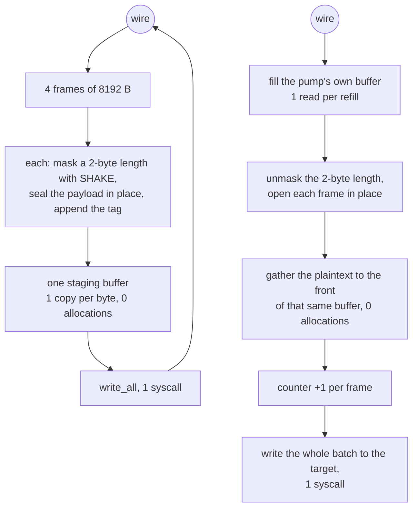

# VMess AEAD

VMess is the one method here that pays for a keyed handshake and then gets out
of the way. The header is read once per connection and every later frame is an
8 KiB payload, a SHAKE-masked 2-byte length, and a 16-byte tag.

The framing this tree speaks is `OptionChunkStream | OptionChunkMasking |
OptionGlobalPadding` with **no** authenticated-length option, which is the shape
that costs one AEAD call per frame instead of two. That is not a simplification:
a peer negotiates framing options in the clear, so a different set is visible on
the wire. Xray's client default is the same three bits, so this matches.

Read and write are symmetric about one thing: both batch. Writing stages four
8 KiB frames into one buffer and writes them once. Reading keeps the sealed bytes
and the plaintext gathered from them in one buffer, so the pump can tell without
asking the carrier that four frames are already here, and it leaves the plain leg
in one write instead of four. A `BufReader` cannot offer that — it hides how much
it holds — which is why the relay reads through `vmess::Wire` and the handshake
still reads through `read_frame`.

The payload cipher follows the reference's `auto` negotiation rather than a fixed
choice: AES-128-GCM where the machine has hardware for it, ChaCha20-Poly1305
where it does not. Xray's `GetSecurityType` (`common/protocol/headers.go:82`)
selects on `HasAESGCMHardwareSupport` the same way, so on a runner with AES-NI or
armv8 crypto this tree pays hardware AES like the reference instead of a software
stream cipher, and the request's cipher byte and the flows that seal the body are
resolved through one function so they cannot diverge —
`the_header_cipher_byte_matches_the_flow_cipher` is that gate.

## Data path



## Measured

<!-- counts:begin -->
| key | value | checked by |
| --- | --- | --- |
| ops-retired-instructions | UNBLESSED | scripts/count-ops.sh |
| maximum-payload-per-frame | 8192 | ferrox-app-vmess::tests::frames_seal_to_stable_bytes |
| frames-per-write-syscall | 4 | ferrox-app-vmess::tests::a_batch_on_the_wire_is_the_frames_written_one_at_a_time |
| write-syscalls-per-32KiB-relay-read | 1 | ferrox-app-vmess::tests::a_batch_on_the_wire_is_the_frames_written_one_at_a_time |
| user-space-copies-per-byte-written | 1 | ferrox-app-vmess::tests::frames_reuse_the_callers_buffers |
| frame-buffer-allocations-per-relay-write | 0 | ferrox-app-vmess::tests::frames_reuse_the_callers_buffers |
| frames-per-plain-write | 4 | ferrox-app-vmess::tests::a_batch_of_frames_leaves_the_pump_in_one_write |
| plain-write-syscalls-per-4-frame-batch | 1 | ferrox-app-vmess::tests::a_batch_of_frames_leaves_the_pump_in_one_write |
| pump-buffer-allocations-per-batch | 0 | ferrox-app-vmess::tests::the_pump_gathers_into_its_own_buffer_and_never_moves_it |
| counters-per-frame | 1 | ferrox-app-vmess::tests::counters_advance_one_per_frame_at_any_offset |
<!-- counts:end -->

## Ops

```bash
./scripts/count-ops.sh report \
  vmess::tests::frames_reuse_the_callers_buffers 'vmess::stage_frames'
```

`UNBLESSED`, as above.

## Time

**Measured on this branch.** `ferrox-bench` gate 4 (`framing.rs`) compares
VMess-style framing rows byte for byte against the pinned reference, and gate 7b
compares the AEAD seals; neither is a clock. The clock is gate 3's ratio at
every measured length plus `.github/workflows/parity.yml`'s `vmess-raw`
scenario, and the batch's own number is `benchmark-matrix.yml`'s
`vmess-raw-down-8` cell: **full tier, ubuntu-latest (4 logical CPUs), 5 medians
per engine, run 38667435571 on this branch's head.**

| ratio vs xray-core (higher throughput / lower CPU is better) | interval | verdict |
| --- | --- | --- |
| throughput | 1.235 [1.216, 1.269] | better, gating |
| cpu per GiB | 1.178 [1.169, 1.187] | better, gating |
| peak rss | 7.122 [7.079, 7.165] | better, gating |

The split those two totals are made of, in ms/GiB medians:

| engine | user | sys | total | MiB/s | peak RSS MiB | threads |
| --- | --- | --- | --- | --- | --- | --- |
| ferrox | 790 | 1 291 | 2 065 | 1 557.5 | 8.6 | 35 |
| xray-core | 1 264 | 1 170 | 2 435 | 1 274.8 | 61.2 | 14 |
| zeronet | 7 578 | 1 614 | 9 201 | 399.2 | 12.5 | 5 |

Against the same branch's own baseline (run 38663342157, standard tier, 3
repeats: 788 user / 1 850 sys, cpu per GiB 0.921 of xray-core) **the batch moved
the kernel half and only the kernel half**: −30 % sys per GiB, user CPU inside
the noise, and the reference on this run reads 1 170 sys against its baseline's
1 153, so the runner did not move under the number. zeronet's `vmess` rows are
informational and non-gating; sing-box and xray-rust are **unproven** here for
the reasons the cell records — Xray-dialect configs and a pin that does not
serve vmess.

The tag and the payload are both authenticated over the ciphertext, so this
method's open path is the [`record-layer`](record-layer.md) open path: the tag is
checked before any keystream exists and block one onward is xored into the
frame buffer once. That is what `vmess user-space-copies-per-byte-written 1` and
`vmess frame-buffer-allocations-per-relay-write 0` above are counting, and the
Poly1305 rungs it shares — one absorb per padded section, no empty absorb at
either end of a record, no head recursion into the dispatch on a 64-byte-aligned
frame — apply to every 8 KiB VMess frame on the AVX2 and NEON-4 paths.

- **Two rows this page claims were not being checked at all.** The gate for
  `frames-per-write-syscall 4` and `write-syscalls-per-32KiB-relay-read 1` swept
  payload lengths that topped out at `3 * MAX_PLAIN` — which is **three** frames.
  The fourth iteration of `stage_frames`' loop was never entered by any test, so
  the number 4 was unobserved; and the sink was a `Vec`, which cannot tell one
  `write` from four, so the syscall row had no counter behind it either. The
  sweep now runs to `4 * MAX_PLAIN - 1`, `4 * MAX_PLAIN` and `READ_PLAIN`, and
  writes into a `CountingWriter`, so both rows are observed rather than assumed.
  Nothing about the frames changed; only what the test can see.
- **A silent truncation that the same gap was hiding.** `stage_frames` staged at
  most `FRAMES_PER_WRITE` frames and, if the read was wider, exited its loop with
  bytes left and returned `true` — a truncated frame sequence on the wire, with
  no assertion anywhere. `pump_relay` clamps to `READ_PLAIN`, which equals the
  batch bound, so nothing reaches it today; but the two expressions that have to
  agree were checked by nobody, and raising `FRAMES_PER_WRITE` without raising
  `READ_PLAIN` would have dropped the tail of every relay read over 32 KiB.
  `stage_frames` now refuses instead, and
  `a_read_wider_than_one_batch_is_refused_not_truncated` gates that: it drives
  `READ_PLAIN + 1` and `READ_PLAIN + MAX_PLAIN`, requires `false`, and requires
  that **nothing** reached the sink.

## What we removed

- **A frame buffer per relay write.** `frames_reuse_the_callers_buffers` is the
  gate: one buffer, sized once per connection by `with_capacity`, refilled by
  `clear`. For comparison, Xray's `common/crypto/auth.go:287` does
  `mb2Write := make(buf.MultiBuffer, 0, len(mb)+10)` and takes a pooled
  `temp := buf.New()` scratch on every `WriteMultiBuffer` call, so the batch is
  the pipe's read granularity rather than a number chosen for syscalls.
- **Four write syscalls per relay read.** sing-box's VMess writes one
  `ChunkWriter` frame per write with `WriteChunkSize = 15000`
  (`sing-vmess/protocol.go:24-32`) and only coalesces when the upper layer is
  vectorised. Xray's stream path coalesces with `writev` but starts from a fresh
  scratch each call. This tree stages four frames and writes once;
  `a_batch_on_the_wire_is_the_frames_written_one_at_a_time` is the gate that
  the batch is byte-identical to writing the frames one at a time.
- **Four write syscalls — and four segments — per relayed batch.** The plain leg of a
  relay wrote one decoded frame per `write_all`: a syscall and a loopback segment for
  every 8 KiB. On `vmess-raw-down-8` (run 38663342157, ubuntu-latest, 3 repeats each)
  ferrox reads **1 850 ms/GiB of system CPU against xray-core's 1 153**, while the same
  runs read **788 ms/GiB of user CPU against their 1 275**: the user-space half of this
  method already costs 1.6x less than the reference, and the row that is red is entirely
  the kernel. The reference batches for the same reason —
  `AuthenticationReader.ReadMultiBuffer` (`common/crypto/auth.go:207`) pulls one frame
  and then up to fifteen more **only from what its `BufferedReader` already holds**, so a
  batch never waits and an interactive byte is never held up to fill one. `Wire::batch`
  is that shape over one buffer instead of two, which also drops the `BufReader` hop into
  a scratch `Vec` and the `resize` that zeroed a frame right before `read_exact`
  overwrote it. `a_batch_of_frames_leaves_the_pump_in_one_write` gates the batch, and
  `a_dribbled_carrier_still_offers_one_frame_and_loses_nothing` that a carrier arriving
  three bytes at a time still loses nothing. The moved row, measured on this
  branch (run 38667435571): **1 850 → 1 291 ms/GiB of system CPU**, user CPU left
  where it was (788 → 790), which is what makes this a kernel-side removal rather
  than a relocation into user space.
- **A second copy on read.** Xray's large-chunk read path
  (`common/crypto/auth.go:188-203`) allocates a pooled buffer, reads into it,
  opens in place, and then calls `buf.MergeBytes`, which is a second copy plus a
  whole new `MultiBuffer` of 8 KiB buffers per chunk. The `≤ 8 KiB` path
  (`:137-151`) is in place and is the cheaper of the two; this tree always
  takes the in-place shape because its frame size is fixed at 8 KiB.
- **An `auto` that was never automatic.** `Cipher::Auto` used to resolve to
  ChaCha20-Poly1305 unconditionally, so on a machine with hardware AES this tree
  sealed every VMess payload with a software stream cipher while the reference
  pays hardware AES for the same `auto` config. The measured cost was the whole
  payload path: on the `vmess-raw-down-8` matrix cell ferrox ran ~0.44x of
  xray-core's throughput and ~2.3x its CPU per GiB, and the gap was the cipher,
  not the concurrency — `vless-raw-down-8`, which shares the relay model but
  negotiates no cipher, beats xray on the same runner. `Auto` now resolves the
  way `GetSecurityType` does, onto the already-gated hardware AES path.
- **Nested HMAC construction.** The VMess KDF is an explicit HMAC-chain state
  machine (`vmess::Kdf`) that reuses a precomputed inner/outer pair, where
  Xray's `proxy/vmess/aead/kdf.go` builds a fresh `hmac.New` per path element
  and the handshake pays four of them. Zray made the same call for the same
  reason.
- **The 512 MiB flow ceiling.** The seal counter used to stop at `u16::MAX`,
  which ends every flow past 65536 seals while the reference wraps its
  `uint16` counter and continues. The counter now wraps exactly like
  `GenerateChunkNonce` (`proxy/vmess/encoding/client.go:302`), so long flows
  keep the reference's nonces; past the wrap the nonces repeat, which is the
  reference's wire and is named here rather than hidden.
  `counter_wrap_matches_the_reference` is the gate.

What was **not** removed, and is named rather than rounded off: the auth-id
lookup. `replay_seen` is a linear probe over a `HashSet` of 16-byte ids with no
per-connection cache keyed by auth id, which is the same shape as Xray's
`AuthIDDecoderHolder.Match`. The read side of the header costs three `read_exact`
calls (16 + 18 + 8 bytes) rather than one, because the auth id has to be read
before the length can be decrypted. Both are handshake-only, once per
connection, and neither is where a connection spends its time.

The batch also **trades one user-space copy for three kernel calls**: gathering
a frame's plaintext to the front of the pump's buffer is one `copy_within` per
frame, which the one-frame-per-`write` pump did not pay. It is a relocation, not
a removal, and it is on the side of the ledger the split above says is already
cheap — `vmess user-space-copies-per-byte-written 1` counts the write leg only,
so this read-leg copy is prose rather than a row. `the_pump_gathers_into_its_own_buffer_and_never_moves_it`
holds the buffer's pointer and capacity steady across a batch so the gather
cannot quietly become a reallocating batch. The copy was removed once and put
back: leaving each frame where its open left it and sending the batch as four
iovecs of one `write_vectored` moves no byte at all, and on `vmess-raw-down-8`
that shape read **user 757.5 against system 1 351.7 ms/GiB** (run 38796771414,
3 repeats) where the gather reads **user 790.3 against system 1 284.2** pooled
over the run before it (38789957983) and the five after it (38799273839) — 8
repeats, total CPU spread 2 027 to 2 110 ms/GiB. The vectored batch took
~33 ms/GiB off user space and put ~68 ms/GiB on the kernel, ending ~35 ms/GiB
worse on total CPU and tied on throughput (−0.6%): a relocation onto the half of
the ledger this method is already behind on, so it does not land.
The same runs clear the other suspect. `vless-raw-down-8` — this relay model with
no framing — holds **31 threads at peak** and spends **498.75 ms/GiB of system
CPU against xray-core's 1 225.8** (run 38801134197): 2.6x less kernel than this
method's 1 284 at four more threads. **35 threads against xray-core's 14** is
therefore not what makes the sys row red here; the framing is, and which part of
it the kernel charges for stays open on this page.

## Pins

| what | where |
| --- | --- |
| chunk stream + chunk masking options, frame sizes | `upstream/xray-core/proxy/vmess/encoding/`, `common/crypto/auth.go` |
| chunk stream + chunk masking options, `WriteChunkSize` | `upstream/sing-box` → `sagernet/sing-vmess/protocol.go` |
| the same framing, in place, batched | `upstream/zeronet/crates/zero-protocol/src/vmess.rs` |

## CI scope

What a change here owes, read by `scripts/ci-scope.py`; see [`docs/ci-scope.md`](../ci-scope.md).

<!-- scope:begin -->
- paths: crates/ferrox-app/src/vmess.rs
- symbols: vmess
- engines: xray-core, zeronet
- scenarios: vmess-raw
- oracle: vmess
- go: ./proxy/vmess/..., ./common/crypto/...
<!-- scope:end -->
