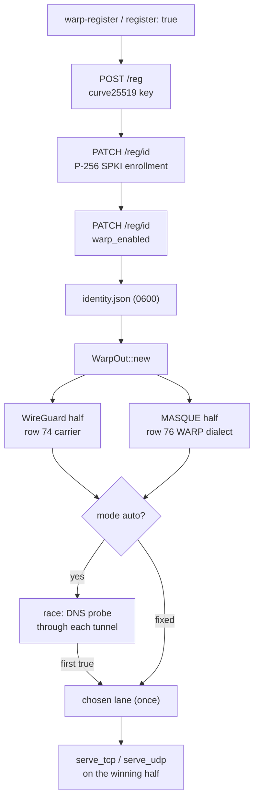

# WARP outbound

`protocol: warp` is Cloudflare WARP as one outbound: a device identity, the WireGuard half (row 74's carrier) and the MASQUE CONNECT-IP half (row 76's carrier), with `mode: auto` racing the two and the first real DNS answer deciding which carries the flows.
`mode: wireguard` and `mode: masque` pin one half and never probe; an auto with only one built half takes it without a race.
The identity comes from an inline `identity` block, a saved `identityFile`, or `register: true` which registers once and saves into `identityFile` — a restart reuses the file and never creates a second device.
`ferrox-app warp-register [-o warp-identity.json] [--mode auto|wireguard|masque] [--api URL]` is the one-tap form: it registers, saves the identity owner-only (0600), and prints the outbound config that references it.

Registration is the three calls the pinned clients make: `POST /v0a4471/reg` with a fresh clamped Curve25519 key, `PATCH /reg/{id}` enrolling a P-256 SPKI for the MASQUE half, and `PATCH /reg/{id}` with `{"warp_enabled":true}`.
The API hosts are tried in order (`api.devices.cloudflare.com`, then `api.cloudflareclient.com`); a failure before the device exists moves to the next host, a failure after it does not retry the POST, so a flaky plane cannot mint two accounts.
The enable call's failure is a warning, not a refusal: the identity is saved and the tunnel may carry nothing until it is enabled, which is what the API's own clients do.
The WireGuard endpoint reads the reply's `endpoint.v4` host with port 2408 when the reply lists it (the first listed port otherwise), the reserved bytes are the reply's `client_id`, and the tunnel addresses are the reply's interface v4/v6.
The MASQUE half reuses the row 76 WARP dialect unchanged: the enrolled key mints the client certificate, the reply's server key is the SPKI pin, and the edge defaults to `cloudflareaccess.com` with SNI `consumer-masque.cloudflareclient.com`.

The race asks `one.one.one.one` through each half's own tunnel DNS (`WireGuardOut::probe`, `MasqueOut::probe`) and takes the first `true`.
A `false` answer does not end the race: the other half may still carry, and the wait runs to the 8 s deadline; two failures or a silent pair fall back to WireGuard, the half a fixed config would have chosen.
The choice is made once per outbound under one lock, so concurrent flows wait for the first flow's answer instead of probing again.
`endpoint`, `mtu` (1280), `keepAlive` (25), `probe`, `probePort`, `dns`, and a `masque` block (`address`, `port`, `serverName`, `host`, `path`) override the WARP defaults; every one has the default WARP's own clients use, so the identity file is the whole config.

Against the references: ZeroNet's `warp.rs` races whole tunnels with a registry of keep-alive stacks and re-races on staleness; this races once per process and keeps the winner, because the carriers themselves already reconnect.
Aether registers through a fragmented ClientHello and keeps a TOML identity per transport with cert renewal; the identity here is one JSON file for both halves, and the API cut is row 197, not this page.
What was removed: the per-transport identity files, the second registration on a stale tunnel, and the async runtime the references carry — the race is two probe threads and a channel.
What was not removed: the registration is still three sequential HTTPS calls (the API requires the device id from the first), and the losing probe thread runs to its own timeout — it is detached, not cancelled.
Edge discovery and cooldowns are row 190; the fuller identity lifecycle (refresh, team enrollment, re-provision) is row 189.

## Data path

<!-- counts:begin -->
| key | value | checked by |
| --- | --- | --- |
| ops-retired-instructions | UNBLESSED | scripts/count-ops.sh |
| registration-api-calls | 3 | ferrox-app-warp::tests::a_registration_is_register_enroll_enable |
| tunnel-halves-built | 2 | ferrox-app-warp::tests::a_registered_identity_builds_both_tunnels |
| identity-file-mode | 600 | ferrox-app-warp::tests::an_identity_survives_a_save_and_load |
| race-first-winner | wireguard | ferrox-app-warp::tests::the_first_answering_half_wins_the_race |
| race-surviving-lane | masque | ferrox-app-warp::tests::a_failed_probe_does_not_end_the_race |
| race-fallback-lane | wireguard | ferrox-app-warp::tests::two_failed_probes_fall_back_to_wireguard |
| race-wait-bound-ms | 5000 | ferrox-app-warp::tests::a_silent_pair_falls_back_at_the_deadline |
<!-- counts:end -->

## Time

No local duration is quoted: every contributor dials through a VPN, so a local race measures the tunnel.
The race's bound is the 8 s deadline, witnessed by `a_silent_pair_falls_back_at_the_deadline`; throughput of the two halves is the carriers' own CI cells (rows 74 and 76), and the WARP-vs-Aether comparison is the benchmark matrix's WARP rows.

## CI scope

What a change here owes, read by `scripts/ci-scope.py`; see [`docs/ci-scope.md`](../ci-scope.md). The dial-side of the row is this page's own unit races, and the throughput comparison is the matrix's WARP rows (`warp-masque-*`): ferrox's warp outbound against Aether in the same cell, which runs only in CI because everything beyond loopback is.

<!-- scope:begin -->
- paths: crates/ferrox-app/src/warp.rs
- symbols: find_warp_outbound
- scenarios: warp-masque
- engines: xray-core, aether
<!-- scope:end -->