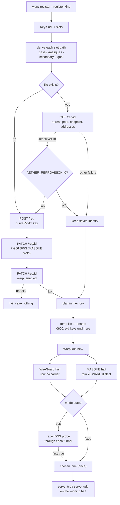

# WARP outbound

`protocol: warp` is Cloudflare WARP as one outbound: a device identity, the WireGuard half (row 74's carrier) and the MASQUE CONNECT-IP half (row 76's carrier), with `mode: auto` racing the two and the first real DNS answer deciding which carries the flows.
`mode: wireguard` and `mode: masque` pin one half and never probe; an auto with only one built half takes it without a race.
The identity comes from an inline `identity` block, a saved `identityFile`, or `register: true` which registers once and saves into `identityFile` — a restart reuses the file and never creates a second device.
A saved file is read back from the API before it is used: the peer, endpoint, reserved bytes and addresses are refreshed in place, so a device whose edge moved keeps working.
`ferrox-app warp-register [--register masque|wg|gool|gool-classic|mim|all] [-o|--config FILE] [--wg-config FILE] [--masque-config FILE] [--api URL] [--api-address ADDR] [--mode auto|wireguard|masque]` is the form.
Without `--register` it registers one combined device (both halves), saves the identity owner-only (0600 on Unix; on Windows it inherits the directory ACL), and prints the outbound config that references it.
With `--register` it makes the identities the kind names and prints one readiness line per file: `wg` is the WireGuard file, `masque` the MASQUE file beside it, `gool` is MASQUE plus the WireGuard identity it carries (`<masque>-gool`), `gool-classic` is WireGuard plus its second hop (`<config>-secondary`), `mim` is MASQUE plus its second hop, and `all` is all five in that order.
`-o`/`--config` names the base identity file (default `warp-identity.json`); `--wg-config` and `--masque-config` move the WireGuard and MASQUE files, and every second hop is derived beside its own first: `<config>-secondary`, `<masque>-secondary`, `<masque>-gool`.
An identity file already there is kept and refreshed, never replaced while it works; a corrupt file is moved to `<name>.corrupt`, and a refused one is registered afresh unless `AETHER_REPROVISION` is `0`, `off` or `false`.
An outbound replaces a refused saved file only when its own `register` is true; without it the file is reported and kept.

Registration is the three calls the pinned clients make: `POST /v0a4471/reg` with a fresh clamped Curve25519 key, `PATCH /reg/{id}` enrolling a P-256 SPKI for a MASQUE identity, and `PATCH /reg/{id}` with `{"warp_enabled":true}`.
A WireGuard-only identity (the `wg` and `gool` slots, and any outbound pinned to `mode: wireguard`) skips the enrollment and makes two calls.
The API hosts are tried in order (`api.devices.cloudflare.com`, then `api.cloudflareclient.com`); a failure before the device exists moves to the next host, a failure after it does not retry the POST, so a flaky plane cannot mint two accounts.
The enable call must answer 2xx: the identity is saved only once WARP is enabled, so a refused enable fails the registration and leaves the previous keys where they were.
A read-back answering 401 or 410, or a 404 in Cloudflare's own error envelope, is a refusal of that identity, not an outage; a 404 page from a front that knows only the other API name is not, and the next name is tried. Any other failure keeps the saved identity and says it was not checked.
`--api-address` moves where the API is dialled while the TLS name and HTTP `Host` stay the origin's: an IP, a bracketed IPv6, or a domain, with or without a port (443 when absent).

The WireGuard endpoint reads the reply's `endpoint.v4` host with port 2408 when the reply lists it (the first listed port otherwise), the reserved bytes are the reply's `client_id`, and the tunnel addresses are the reply's interface v4/v6.
The MASQUE half reuses the row 76 WARP dialect unchanged: the enrolled key mints the client certificate, the reply's server key is the SPKI pin, and the edge defaults to `cloudflareaccess.com` with SNI `consumer-masque.cloudflareclient.com`.

Every identity the kind names is made in memory before any file is written, so a later slot's refusal leaves all old keys in use; each save writes a temp file beside the target and renames it, so a reader never sees half an identity.
The race asks `one.one.one.one` through each half's own tunnel DNS (`WireGuardOut::probe`, `MasqueOut::probe`) and takes the first `true`.
A `false` answer does not end the race: the other half may still carry, and the wait runs to the 8 s deadline; two failures or a silent pair fall back to WireGuard, the half a fixed config would have chosen.
The choice is made once per outbound under one lock, so concurrent flows wait for the first flow's answer instead of probing again.
`endpoint`, `mtu` (1280), `keepAlive` (25), `probe`, `probePort`, `dns`, `apiAddress`, and a `masque` block (`address`, `port`, `serverName`, `host`, `path`) override the WARP defaults; every one has the default WARP's own clients use, so the identity file is the whole config.

Against the references: ZeroNet's `warp.rs` races whole tunnels with a registry of keep-alive stacks and re-races on staleness; this races once per process and keeps the winner, because the carriers themselves already reconnect.
Aether keeps one TOML identity per transport and re-registers a refused one through `api.rs`; the layout here is the same (base, `-masque`, `-secondary`, `-gool`) in JSON, because `ferrox-app` has no TOML reader, and the read-back is the same `GET /reg/{id}`.
PattNG's WARP-keys page stages a renewal and keeps the old keys until the new ones answer; here that is the in-memory plan plus the temp-and-rename save.
What was removed: the second registration on a stale tunnel, the rejected identity saved for a later resume (a refusal now fails cleanly and re-provisions in one act), and the async runtime the references carry — the race is two probe threads and a channel.
What was not removed: the registration is still sequential HTTPS calls (the API requires the device id from the first), the per-slot read-back is one more call per existing file, and the losing probe thread runs to its own timeout — it is detached, not cancelled.
Certificate renewal and the last-connected edge cache are not on this page; edge discovery and cooldowns are row 190, team enrollment is row 192, and the API cut is row 197.

## Data path

<!-- counts:begin -->
| key | value | checked by |
| --- | --- | --- |
| ops-retired-instructions | UNBLESSED | scripts/count-ops.sh |
| registration-api-calls | 3 | ferrox-app-warp::tests::a_registration_is_register_enroll_enable |
| registration-api-calls-wg | 2 | ferrox-app-warp::tests::a_wireguard_slot_registers_without_enrolling_masque |
| register-kinds | 6 | ferrox-app-warp::tests::six_register_kinds_parse |
| identity-files-all | 5 | ferrox-app-warp::tests::every_slot_derives_beside_its_own_first_hop |
| tunnel-halves-built | 2 | ferrox-app-warp::tests::a_registered_identity_builds_both_tunnels |
| identity-file-mode | 600 | ferrox-app-warp::tests::an_identity_survives_a_save_and_load |
| api-address-dial-port | 8443 | ferrox-app-warp::tests::an_api_address_moves_the_dial_not_the_name |
| refused-statuses | 3 | ferrox-app-warp::tests::a_refused_read_back_is_told_apart_from_an_outage |
| reprovision-off-spellings | 3 | ferrox-app-warp::tests::three_spellings_turn_reprovisioning_off |
| race-first-winner | wireguard | ferrox-app-warp::tests::the_first_answering_half_wins_the_race |
| race-surviving-lane | masque | ferrox-app-warp::tests::a_failed_probe_does_not_end_the_race |
| race-fallback-lane | wireguard | ferrox-app-warp::tests::two_failed_probes_fall_back_to_wireguard |
| race-wait-bound-ms | 5000 | ferrox-app-warp::tests::a_silent_pair_falls_back_at_the_deadline |
<!-- counts:end -->

## Time

No local duration is quoted: every contributor dials through a VPN, so a local race measures the tunnel.
The race's bound is the 8 s deadline, witnessed by `a_silent_pair_falls_back_at_the_deadline`; throughput of the two halves is the carriers' own CI cells (rows 74 and 76), and the WARP data plane is compared in the benchmark matrix's WARP rows — `warp-masque-down-8` in standard, `-down-16`, `-down-64` and `-duplex-64` in full — against Aether and ZeroNet in the same cell, ZeroNet through `scripts/xray-to-zeronet-warp.py`, the certificate's own SPKI as its pin and the identity key rewritten to SEC1 because ZeroNet reads an outer version 1 as SEC1. A host where neither external leg built skips the WARP cell with that reason instead of reporting a one-engine comparison.

## CI scope

What a change here owes, read by `scripts/ci-scope.py`; see [`docs/ci-scope.md`](../ci-scope.md). The dial-side of the row is this page's own unit races, and the throughput comparison is the matrix's WARP rows (`warp-masque-*`): ferrox's warp outbound against Aether and ZeroNet in the same cell, which runs only in CI because everything beyond loopback is.

<!-- scope:begin -->
- paths: crates/ferrox-app/src/warp.rs
- symbols: find_warp_outbound
- scenarios: warp-masque
- engines: xray-core, aether, zeronet
<!-- scope:end -->
