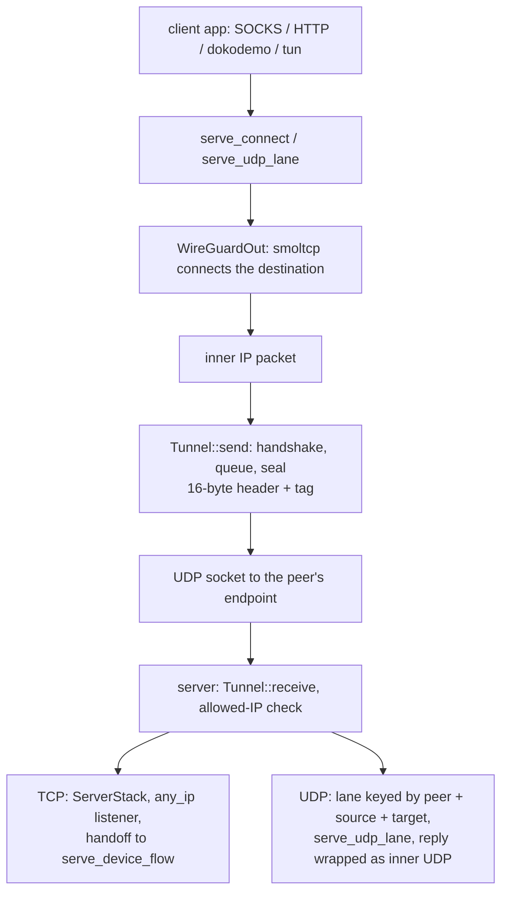

# The WireGuard tunnel, both roles

<!-- scope:begin -->
- paths: crates/ferrox-app/src/wg.rs, crates/ferrox-app/src/wg_stack.rs, crates/ferrox-app/src/wireguard.rs, crates/ferrox-core/src/wireguard/device.rs, crates/ferrox-core/src/wireguard/handshake.rs, crates/ferrox-core/src/wireguard/transport.rs
- symbols: find_wireguard_outbound, wireguard_settings
- go: ./proxy/wireguard/...
<!-- scope:end -->

Row 46: a `wireguard` handler carries IP packets over UDP. The outbound is the client — it dials the peer's endpoint, raises a handshake on the first flow, and puts every inner packet through the tunnel — and the inbound is the server, which answers an initiation, routes the decrypted packet by the peer's allowed IPs, and hands a TCP flow to the tree's own outbound or a datagram flow to the tree's own lane. Both roles carry IPv4 and IPv6 TCP and UDP.

The wire is the reference's: a 16-byte transport header (type, receiver index, counter) and a 16-byte tag, 148-byte initiations, 92-byte responses, and the three reserved bytes where WARP writes its routing id. The reserved bytes are written after `mac1`/`mac2` and cleared before a message is parsed or checked, so a peer that fills them and one that leaves them zero read the same. The handshake is Noise_IKpsk2 with an optional pre-shared key; the timers are the reference's five seconds, ninety seconds, two minutes, three minutes and ten seconds, and a replayed timestamp and a replayed counter are refused. A responder answers into a pending keypair and promotes it on the first authenticated transport record, so the old session stays send-capable until the initiator proves it received the response.

The config is xray's own dialect. `secretKey`, `address`, `peers`, `mtu`, `reserved`, `remoteDNS`, `noKernelTun` are read with the reference's defaults: a missing address list is `10.0.0.1` and `fd59:7153:2388:b5fd::1`, a missing peer allowed-IP list is `0.0.0.0/0` and `::0/0`, a missing MTU is 1420, and a reserved value is empty or exactly three bytes. Keys arrive as 64 hexadecimal characters, or as standard or URL-safe base64 with the padding ignored. A server's `users[*].account` is the peer, flattened the way the config builder flattens it. The role comes from the position: an outbound is the client, an inbound is the server, and an explicit `isClient` that contradicts the position is refused at startup.

The userspace stack is `smoltcp` 0.14 on both sides — one dependency for the TCP state machine, its windows, retransmits and IPv6, instead of the reference's gVisor netstack. The client connects a local flow to the destination the rules chose. The server resolves its outbound the way any served inbound does: a TCP flow takes the tag its rules name for `tcp`, a datagram the tag for `udp`, so two freedom outbounds with different redirects serve one tunnel. The server owns no address it receives: `any_ip` plus a wildcard listener raised on the SYN's port accepts `192.0.2.1:7` and `2001:db8::1:7` alike, then hands the established flow to `serve_device_flow` over a loopback pair. A datagram skips the state machine: the client frames the app's SOCKS5 datagram into an inner UDP packet and remembers the relay port that asked; the server keys a lane by peer, source and target, dials it through `serve_udp_lane`, and wraps each answer as the packet the client expects.

`noKernelTun: false` is the reference's kernel-TUN path. This tree opens no kernel device, so it names the divergence once and serves the userspace stack; `remoteDNS` is not carried and names resolve on the host, which is named once too. The protobuf seam is the one the scenario suite uses: `xray.proxy.wireguard.DeviceConfig`, `PeerConfig` and a user's account decode into the same JSON the file form reads.

## Data path



## Measured

<!-- counts:begin -->
| key | value | checked by |
| --- | --- | --- |
| ops-retired-instructions | UNBLESSED | scripts/count-ops.sh |
| transport-header-bytes | 16 | ferrox-core-wireguard::tests::the_reference_message_sizes |
| initiation-bytes | 148 | ferrox-core-wireguard::tests::the_reference_message_sizes |
| response-bytes | 92 | ferrox-core-wireguard::tests::the_reference_message_sizes |
| default-mtu | 1420 | ferrox-app-wireguard::tests::the_defaults_are_the_reference_ones |
| tcp-bytes-echoed | 9 | ferrox-app-wg::tests::a_tcp_flow_crosses_the_tunnel_to_a_freedom_dial |
| client-datagram-bytes-echoed | 6 | ferrox-app-wg-stack::tests::a_client_datagram_lane_frames_and_unframes |
| server-datagram-bytes-echoed | 2 | ferrox-app-wg-stack::tests::a_server_datagram_lane_echoes_through_freedom |
<!-- counts:end -->

The size rows are the constants the record and handshake write, asserted against the reference's numbers. The echo rows are bytes, not durations: a TCP flow crosses both tunnel directions, the smoltcp handoff, the freedom dial and a loopback echo with its nine bytes unchanged; a client datagram lane frames a six-byte answer and unframes it; a server datagram lane frames a two-byte answer through `serve_udp_lane` and wraps the reply. The scenario gate is `TestWireguard` in `upstream/pins.toml`; it is green in `conformance.yml` at this pin.

## Ops

```bash
./scripts/count-ops.sh report wireguard::device::tests::a_replayed_transport_counter_is_refused 'wireguard::device::Tunnel::send'
```

`UNBLESSED`. `scripts/count-ops.sh` needs valgrind, which does not exist on macOS/aarch64, so this count is CI-only (`ops.yml`) and nothing quotes it until the artefact has been read.

## Syscalls

**Not measured.** The sending path reaches a real UDP socket, and a loopback test cannot witness a syscall count: the reader's `recv_from` timeout and the writer's `send_to` are scheduler- and kernel-dependent. No in-memory stream observes this path, so no syscall row is claimed; `tcp-bytes-echoed` proves the bytes, not the calls behind them.

## Memory copies

**Not measured.** The plaintext is copied into a transport record and decrypted into the reader's buffer, and an inner packet is copied between `smoltcp` and the local stream. No test asserts pointer identity across those copies, so the page makes no copy or allocation row; `ops-retired-instructions` remains `UNBLESSED` for the same reason.

## Time

**Not measured.** `scripts/lib-matrix.sh` carries no benchmark cell for this row and no scenario id names wireguard, so `bench.yml` and `parity.yml` gate nothing here. What is argued is the shape: one userspace stack per device, one thread per tunnel direction, a 10 ms reader tick that bounds both the timer check and a queued packet's wait, 256 KiB per TCP direction, up to eight listeners per destination port and 64 per inbound with a 60 s reap, and one lane per server datagram tuple capped at 4096 and reaped on the UDP idle budget. A duration would come from a CI runner, and no CI artefact has been read for this row.

## What we removed

The kernel device. The reference's client opens a TUN when `noKernelTun` is false and the platform has one, and the server's netstack is a separate path; this row serves both roles from the same `smoltcp` bridge and opens no device. The reserved bytes are handled in one place — after the MACs are computed, before any parse, and put back when a record is refused — so the WARP form and the vanilla form are the same code path rather than two.

The gVisor dependency. The reference's netstack pulls gVisor's `tcpip`; this tree's `smoltcp` is one small crate, and its only new transitive licence is `0BSD` (`managed`), now in `deny.toml`. It is a dependency change, not a measured speed claim.

## What was not removed

No syscall or copy claim is made. The tunnel still copies an inner packet into a transport record and copies it out again; the stack owns two 256 KiB buffers per connected flow, which is memory the reference's netstack also spends; a server datagram lane owns a loopback relay and two threads, and is reclaimed after the UDP idle budget, within the 4096 cap. `remoteDNS` is not carried, so a name resolves on the host; `noKernelTun: false` does not open a kernel device, so a config that expected the host's routes to see the tunnel does not get them; the responder does not issue cookie replies; and an explicit `isClient` that contradicts the handler's position is a startup refusal rather than a silent role swap. The UDP reply reader takes every answer the lane's relay returns, including one a freedom `redirect` rewrote, and reports it to the client as the original target the inner packet named; a lane still drops a datagram whose framing it cannot parse. A client whose peers name endpoints in both address families is refused, because the client binds one UDP socket and this row does not open a second; a single peer keeps either family.

## Pins

| what | where |
| --- | --- |
| the device config, peers, users and role | `upstream/xray-core/proxy/wireguard/`, `upstream/xray-core/infra/conf/wireguard.go` |
| the JSON defaults and key parsing | `upstream/xray-core/infra/conf/wireguard.go` |
| the netstack the userspace stack replaces | `upstream/xray-core/proxy/wireguard/netstack.go` |
| the scenario both roles answer | `upstream/xray-core/testing/scenarios/wireguard_test.go` |
| the smoltcp stack and its device trait | `upstream/` nothing vendored; crate `smoltcp` 0.14 |
