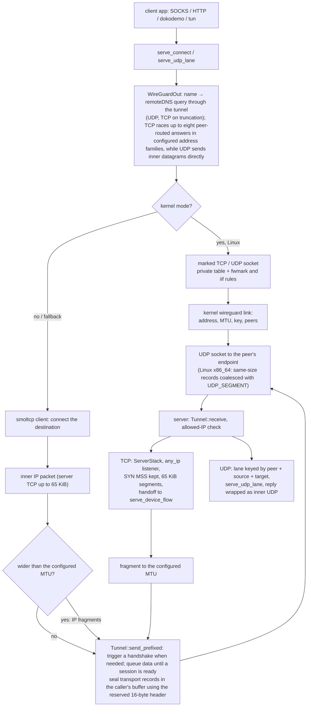

# The WireGuard tunnel, both roles

<!-- scope:begin -->
- paths: crates/ferrox-app/src/wg.rs, crates/ferrox-app/src/wg_kernel.rs, crates/ferrox-app/src/wg_stack.rs, crates/ferrox-app/src/wireguard.rs, crates/ferrox-core/src/wireguard/device.rs, crates/ferrox-core/src/wireguard/handshake.rs, crates/ferrox-core/src/wireguard/transport.rs
- symbols: find_wireguard_outbound, wireguard_settings, a_wireguard_server_datagram_takes_its_udp_lane_and_redirect
- scenarios: wireguard-raw, wireguard-kernel-raw
- engines: xray-core, sing-box
- go: ./proxy/wireguard/...
<!-- scope:end -->

Row 46: a `wireguard` handler carries IP packets over UDP. The outbound is the client — it dials the peer's endpoint, raises a handshake on the first flow, and puts every inner packet through the tunnel — and the inbound is the server, which answers an initiation, routes the decrypted packet by the peer's allowed IPs, and hands a TCP flow to the tree's own outbound or a datagram flow to the tree's own lane. Both roles carry IPv4 and IPv6 TCP and UDP, and answer an ICMP echo request to the device's own address at both families.

The wire is the reference's: a 16-byte transport header (type, receiver index, counter) and a 16-byte tag, 148-byte initiations, 92-byte responses, and the three reserved bytes where WARP writes its routing id. The reserved bytes are written after `mac1`/`mac2` and cleared before a message is parsed or checked, so a peer that fills them and one that leaves them zero read the same. The handshake is Noise_IKpsk2 with an optional pre-shared key; the timers are the reference's five seconds, ninety seconds, two minutes, three minutes and ten seconds, and a replayed timestamp and a replayed counter are refused. A responder answers into a pending keypair and promotes it on the first authenticated transport record, so the old session stays send-capable until the initiator proves it received the response.

The config is xray's own dialect, plus `largeSegments`, a client opt-in: it advertises a 65 KiB MSS and reassembles the fragments a peer sends, so the peer must itself write those segments and split them; a peer that keeps the tunnel MSS gains nothing. On Linux, a successful kernel device bypasses the userspace stack, so `noKernelTun: true` (or `kernelMode: false`) is required to use it. `secretKey`, `address`, `peers`, `mtu`, `reserved`, `remoteDNS`, `noKernelTun` and `kernelMode` are read with the reference's defaults: a missing address list is `10.0.0.1` and `fd59:7153:2388:b5fd::1`, a missing peer allowed-IP list is `0.0.0.0/0` and `::0/0`, a missing MTU is 1420, a reserved value is empty or exactly three bytes, and a missing `remoteDNS` list is the reference's four Cloudflare resolver addresses (two IPv4, two IPv6). Keys arrive as 64 hexadecimal characters, or as standard or URL-safe base64 with the padding ignored. An endpoint that names a host keeps every answer it resolves to, up to eight, so both address families are dialled rather than whichever the resolver listed first. A server's `users[*].account` is the peer, flattened the way the config builder flattens it. The role comes from the position: an outbound is the client, an inbound is the server, and an explicit `isClient` that contradicts the position is refused at startup.

The userspace stack is `smoltcp` 0.14 on both sides — one dependency for the TCP state machine, its windows, retransmits and IPv6, instead of the reference's gVisor netstack. The client connects a local flow to the destination the rules chose. The server's TCP segmenter is the reference's shape without its TUN requirement: xray only splits a large write when the TUN exposes `IFF_VNET_HDR`, while here the server reports a 65,535-byte inner MTU and keeps the MSS a peer advertises. A client opts in with `largeSegments: true`; its SYN then advertises 65,495 (v4) or 65,475 (v6), and a 2 MiB send buffer leaves as 65 KiB segments instead of 1,240-byte pieces waiting on one acknowledgement per RTT. Without that opt-in the client reports the configured MTU instead, so its SYN advertises the tunnel MSS (1,380 v4 / 1,360 v6 at the default 1,420) and a peer that does not reassemble is never handed a segment wider than its path. The SYN-ACK it returns advertises the configured MTU less its IP and TCP headers instead (1,380 v4 / 1,360 v6 at the default 1,420), so the client's own direction stays inside one tunnel datagram. Every outgoing packet wider than the configured MTU is split into IPv4 fragments or IPv6 fragments with a fragment header; the receiving stack reassembles them, a complete set is the packet the sender wrote, and the tunnel's IPv4 identification is cleared on completion. An upload whose remote TCP endpoint advertises a large MSS takes the same path, so the peer must reassemble those fragments or forward them to an endpoint that can; the Ferrox server avoids it by advertising the smaller MSS. An incomplete set is bounded to 8 MiB, 1,024 sets (64 and 512 KiB per peer), 256 ranges per set and 30 seconds, so a flood of first fragments cannot grow the table or evict another peer's work without bound. `ferrox-app-wg-stack::tests::the_client_advertises_the_inner_mss`, `the_client_keeps_the_tunnel_mss_without_large_segments`, `a_large_inner_packet_fragments_to_the_tunnel_and_reassembles` and `an_ipv6_packet_fragments_and_reassembles_without_its_fragment_header` are the checkers. The server resolves its outbound the way any served inbound does: a TCP flow takes the tag its rules name for `tcp`, a datagram the tag for `udp`, so two freedom outbounds with different redirects serve one tunnel. The server owns no address it receives: `any_ip` plus a wildcard listener raised on the SYN's port accepts `192.0.2.1:7` and `2001:db8::1:7` alike, then hands the established flow to `serve_device_flow` over a loopback pair whose logical peer is the flow's own inner endpoint, so a freedom `proxyProtocol` header carries the device's source address instead of `UNKNOWN`. A datagram skips the state machine: the client frames the app's SOCKS5 datagram into an inner UDP packet and remembers the relay port that asked; the server keys a lane by peer, source and target, dials it through `serve_udp_lane`, and wraps each answer as the packet the client expects.

On Linux, `noKernelTun: false` (or `kernelMode: true`, which is the same switch under its newer name) opens a real `wireguard` link through generic and route netlink. The link carries the configured address, MTU, private key and peers; a private routing table holds the default route through the link, and two rules per family send marked sockets and reverse-path lookups on the link into that table. The data path is the kernel's: a marked TCP or UDP socket is routed into the device, and the kernel module encrypts it, so no userspace stack or inner-packet copy is in the flow. The link, its addresses, routes and rules are removed when the outbound is dropped. A kernel that refuses the device — no `CAP_NET_ADMIN`, no `wireguard` module, no netlink family — falls back to the userspace stack with one warning, so a config still runs where the device is unavailable. The server role stays on the userspace stack. `remoteDNS` is carried on both paths: a name the client is asked for becomes a DNS query through the tunnel to the configured server of the matching address family, and up to eight peer-routed answers in configured address families are raced; for TCP the primary candidate is preferred once established, and for UDP the first reply pins that name; on the kernel path each name owns its own connected socket, so one name's reply pins only that name. A numeric target never asks. The answer is cached for the minimum record TTL, at most the reference's 300 seconds, so a burst of flows pays one lookup. The exchange is UDP first; a truncated answer is asked again over a TCP flow through the same tunnel, length-prefixed as the reference's retry is. The protobuf seam is the one the scenario suite uses: `xray.proxy.wireguard.DeviceConfig`, `PeerConfig` and a user's account decode into the same JSON the file form reads.

## Data path



## Measured

<!-- counts:begin -->
| key | value | checked by |
| --- | --- | --- |
| ops-retired-instructions | UNBLESSED | scripts/count-ops.sh |
| route-scan-instructions | 68609 | scripts/count-ops.sh |
| route-table-instructions | 585 | scripts/count-ops.sh |
| transport-header-bytes | 16 | ferrox-core-wireguard::tests::the_reference_message_sizes |
| initiation-bytes | 148 | ferrox-core-wireguard::tests::the_reference_message_sizes |
| response-bytes | 92 | ferrox-core-wireguard::tests::the_reference_message_sizes |
| default-mtu | 1420 | ferrox-app-wireguard::tests::the_defaults_are_the_reference_ones |
| inner-mtu-bytes | 65535 | ferrox-app-wg-stack::tests::a_client_cannot_narrow_the_server_mtu |
| tunnel-fragment-bytes | 1344 | ferrox-app-wg-stack::tests::a_large_inner_packet_fragments_to_the_tunnel_and_reassembles |
| wireguard-fragment-bytes | 1420 | ferrox-app-wg-stack::tests::the_fragment_limit_follows_the_carrier |
| reassembly-set-cap | 1024 | ferrox-app-wg-stack::tests::a_flood_of_first_fragments_is_bounded_by_count |
| reassembly-peer-set-cap | 64 | ferrox-app-wg-stack::tests::one_peers_fragments_do_not_evict_anothers |
| reassembly-peer-byte-cap | 524288 | ferrox-app-wg-stack::tests::a_peer_cannot_take_the_whole_reassembly_byte_budget |
| reassembly-range-cap | 256 | ferrox-app-wg-stack::tests::range_metadata_is_bounded |
| range-merge-allocations | 0 | ferrox-app-wg-stack::tests::merging_fragment_ranges_reuses_the_list |
| timeout-walks-per-unexpired-fragment | 0 | ferrox-app-wg-stack::tests::an_unexpired_fragment_does_not_walk_the_sets |
| reassembly-byte-cap | 8388608 | ferrox-app-wg-stack::tests::a_growing_set_cannot_exceed_the_reassembly_byte_cap |
| large-segment-fragments | 4 | ferrox-app-wg-stack::tests::a_large_inner_packet_fragments_to_the_tunnel_and_reassembles |
| ipv4-fragment-round-trips | 1 | ferrox-app-wg-stack::tests::a_large_inner_packet_fragments_to_the_tunnel_and_reassembles |
| download-bytes-reassembled | 16384 | ferrox-app-wg-stack::tests::a_server_download_leaves_as_fragments_the_client_reassembles |
| ipv6-fragment-round-trips | 1 | ferrox-app-wg-stack::tests::an_ipv6_packet_fragments_and_reassembles_without_its_fragment_header |
| syn-conservative-mss-bytes | 1380 | ferrox-app-wg-stack::tests::the_client_keeps_the_tunnel_mss_without_large_segments |
| syn-advertised-mss-bytes | 65495 | ferrox-app-wg-stack::tests::the_client_advertises_the_inner_mss |
| syn-ack-advertised-mss-bytes | 1380 | ferrox-app-wg-stack::tests::the_server_keeps_the_syn_mss_and_lowers_its_answer |
| tcp-bytes-echoed | 9 | ferrox-app-wg::tests::a_tcp_flow_crosses_the_tunnel_to_a_freedom_dial |
| client-datagram-bytes-echoed | 6 | ferrox-app-wg-stack::tests::a_client_datagram_lane_frames_and_unframes |
| server-datagram-bytes-echoed | 2 | ferrox-app-wg-stack::tests::a_server_datagram_lane_echoes_through_freedom |
| echo-answers-on-the-client | 2 | ferrox-app-wg-stack::tests::an_echo_to_the_devices_own_address_is_answered_on_the_tunnel |
| echo-answers-on-the-server | 1 | ferrox-app-wg-stack::tests::a_server_answers_an_echo_to_its_own_address |
| prefixed-record-allocations | 0 | ferrox-core-wireguard::tests::a_prefixed_record_reuses_the_stack_headroom |
| prefixed-record-zeroed-bytes | 0 | ferrox-core-wireguard::tests::a_prefixed_record_reuses_the_stack_headroom |
| received-record-copies | 0 | ferrox-core-wireguard::tests::an_owned_transport_record_keeps_the_received_allocation |
| kernel-rule-priority | 32765 | ferrox-app-wg-kernel::tests::the_rule_marks_the_table |
| kernel-iif-priority | 32764 | ferrox-app-wg-kernel::tests::the_iif_rule_keeps_the_reverse_path_inside_the_tunnel |
<!-- counts:end -->

The two routing rows are one test's two wrappers: `route_scan_once` calls the peer-by-peer longest-prefix scan and `route_table_once` calls the prefix table for the same destination in the same run, so the difference is the lookup and not a different binary. Over 512 peers, one lookup costs 68,609 retired instructions through the scan and 585 through the table, 117x fewer. A config whose peers carry more than 32 allowed prefixes in total, with at least one IPv4 prefix, builds the IPv4 table; more than 128 in total, with at least one IPv6 prefix, builds the IPv6 table. These are chosen thresholds, not a measured crossover; below them the scan stays. The build is outside the measured wrapper; the row prices the steady-state lookup, which is what a packet pays. The differential test covers an exact `/32`, a `/8` tie, a miss, an exact `/128`, a `/8` tie and a miss, and asserts the table and the scan agree on every one. The size rows are the constants the record and handshake write, asserted against the reference's numbers. The echo rows are bytes, not durations: a TCP flow crosses both tunnel directions, the smoltcp handoff, the freedom dial and a loopback echo with its nine bytes unchanged; a client datagram lane frames a six-byte answer and unframes it; a server datagram lane frames a two-byte answer through `serve_udp_lane` and wraps the reply; and the stack answers an echo request to its own address at both families while refusing another destination. The rule rows are the two priorities the kernel path installs, asserted by the message builders; the privileged test that creates and removes the link is `#[ignore]`d because it needs `CAP_NET_ADMIN`. The scenario gate is `TestWireguard` in `upstream/pins.toml`; it is green in `conformance.yml` at this pin.

## Ops

```bash
./scripts/count-ops.sh report wireguard::device::tests::a_replayed_transport_counter_is_refused 'wireguard::device::Tunnel::send'
```

`UNBLESSED`. `scripts/count-ops.sh` needs valgrind, which does not exist on macOS/aarch64, so this count is CI-only (`ops.yml`) and nothing quotes it until the artefact has been read.

The two routing-table lookup paths are measured together, so their difference is one run on one binary:

```bash
./scripts/count-ops.sh report wg::tests::a_prefix_table_picks_the_peer_the_scan_picks \
  ferrox_app::wg::tests::route_scan_once ferrox_app::wg::tests::route_table_once
```

## Syscalls

**Not measured.** The userspace sending path reaches a real UDP socket, and a loopback test cannot witness a syscall count: the reader's `recv_from` timeout and the writer's `send_to` are scheduler- and kernel-dependent. The Linux writer coalesces a run of equal-sized transport records for one endpoint into one `sendmsg` with `UDP_SEGMENT` on x86_64, so the kernel splits the payload into the datagrams the peer expects; the trailing record of a run may be shorter, and the coalesced payload stops at 65,507 bytes over IPv4 or 65,527 over IPv6. An initiation is sent alone, a new endpoint ends the run and compatible records for the new endpoint may coalesce again; a refused or unsupported call falls back to `sendmmsg`, a partial call resumes at the next whole segment or falls back to `send_to` for the remainder, and anything `sendmmsg` cannot take goes to `send_to`. The kernel path replaces that path with the kernel module's own socket and a marked inner socket, which a loopback test also cannot count. No in-memory stream observes either path, so no syscall row is claimed; `a_batch_sends_every_transport_packet_in_order` and `a_batch_keeps_each_packet_size_after_segmentation` prove the batch's bytes, order and segment sizes, not the calls behind them.

## Memory copies

Zero extra copies on the stack send path. Every producer reserves the 16-byte transport header (`QueueDevice`, `QueueTx`, the client and server datagram lanes, the DNS exchange and the IO loop), and `Tunnel::send_prefixed` seals the record where the packet already lies. `prefixed-record-allocations` and `prefixed-record-zeroed-bytes` are both zero: `a_prefixed_record_reuses_the_stack_headroom` asserts the returned packet's base is the caller's, the caller's pointer does not move and its capacity does not grow, and the peer decrypts it. A caller without headroom still takes the old path: `send_owned` seals in place from offset zero, while `send(&[u8])` allocates one sized buffer and copies the payload once. The server datagram lane hands its payload to the loopback relay by pointer: `socks_udp_parts` returns the lane's reused SOCKS head and the caller's payload, and `send_two` puts both in one `sendmsg` (`WSASend` on Windows) rather than gathering them into a per-datagram frame. `ferrox-app-proxy::tests::a_udp_reply_hands_the_payload_over_by_pointer` is the pointer witness for those parts; `a_server_stack_datagram_reuses_its_frame_head` holds the lane's `.head` capacity steady across two datagrams; the per-datagram `Vec` that held head and payload is gone. The Linux batch names every transport record by its existing buffer in the `sendmsg` iovecs, so the kernel segments the coalesced payload without a new frame; the pending-record `Vec` is reused across flushes, so neither the batch nor the syscall gathers a payload into a new frame; `a_batch_reuses_its_pending_buffer` holds that capacity steady across two flushes. `ServerStack::datagram` inlines in the counted build, so `ops.yml` reports no frame for it and this path claims no instruction count. The client lane still frames its reply into its reused buffer before `send_to`. On receive, the Linux batch path hands the decrypted record's allocation to the stack instead of copying its payload: the transport header stays in front, `Packet::at` names the first payload byte, and the client and server stacks slice past it. `received-record-copies` is zero because `an_owned_transport_record_keeps_the_received_allocation` asserts the event's base is the received buffer's, its capacity does not change, and its payload is at `HEADER_SIZE`. A routed UDP lane still copies the payload out before the lane sees it, because that channel carries a payload-only `Vec`. The macOS and Windows receive loops and any Linux batch that has spent its spare-buffer budget keeps the old copy into `Event::Data`. The userspace TCP stack no longer stages local stream bytes through a per-stack 64 KiB buffer: `upload` reads the local stream straight into smoltcp's transmit ring inside `TcpSocket::send`, and `download` writes the receive ring straight to the local stream inside `TcpSocket::recv`, so each direction copies once instead of twice. A local stream that is full pulls one 64 KiB slice off the receive ring into a per-flow spill, so the peer never sees a closed window while the local drains; `an_upload_writes_into_the_socket_transmit_ring` and `a_download_reads_from_the_socket_receive_ring` assert the reader and writer are handed the ring's own slice, and `a_stalled_download_spills_the_ring_instead_of_closing_the_window` asserts the full-local path consumes the ring and keeps the bytes, so a reintroduced staging copy fails the first two and a closed-window hold fails the third. The segmenter is not free: a wide server segment is copied once into each outgoing fragment buffer, and each received fragment is copied into its reassembly set, so a 65 KiB segment is about fifty buffers on the way out and one growing buffer on the way in; the 5 KiB witness takes four fragments and one set.

## Time

`benchmark-matrix.yml` measures both paths. The userspace cells set `noKernelTun: true`; the Linux kernel cells set it false and run only the ferrox client, because the reference clients would need the same privilege, while xray-core and sing-box still serve. The cell grants the ferrox binary `CAP_NET_ADMIN` and checks the runner can create a `wireguard` link; a runner without the module skips the cell. The numbers below are the userspace cells: tier `full`, five repeats on 2026-11-11 (`ubuntu-24.04-arm`, `wireguard-raw-*`, run `43127254767`). Legs are ferrox against xray-core in the same cell: down-8 client 1.20x and server 1.03x; duplex-8 client 1.33x and server 1.22x; up-1 client 1.25x and server 1.12x. The median throughputs behind those legs are 220/184, 209/190, 229/172, 222/211, 238/190 and 230/213 MiB/s. Ferrox is best on four of the nine priced rows and 0.99x on the third down cell; the remaining deficits are against sing-box's kernel-TCP client (up 0.71-0.94x) and its duplex cell (0.70x), filed under 1214. That duplex cell stalls in some repeats at the same CPU per GiB (5.0-6.0 s at wall 1.3 s against 0.6 s in run 43160364255), so its median is the runner's, not the writer's. Client CPU per GiB through the xray-core server is 5.36 s against 8.00 for down-8, 5.12 against 8.56 for duplex-8, and 4.72 against 8.80 for up-1; client peak RSS is 13-34 MiB against 49-69 MiB. The down-8 server leg's xray client is bimodal on arm: it split 74/189/190/192/194 against the ferrox server in this run and 69/74/74/75/192 in run 43155796255 while the ferrox server held 208-213 and its own server held 180-184, so the 1.03x leg is the median when the client does not collapse and the cell stays filed under 861; a nine-repeat rerun is the gate that separates the client from the writer. The first one or two upload repeats of a cell sometimes idle for a second (wall 1.6-3.5 s at the same CPU per GiB, then 0.55 s), so the median is the only stable figure. The Linux writer drains up to 128 queued packets and coalesces same-size runs with `UDP_SEGMENT`; for 1,420-byte records a full 65,507-byte payload carries about 46, so a full drain is at most three coalesced calls where the per-record path took 128. On aarch64 it keeps `sendmmsg`: the coalesced super-packet collapses the arm pool's reference client, so the writer is the architecture's. The shape behind it: one `smoltcp` stack and one socket thread per device, a 1 ms stack tick (10 ms for UDP lanes), a 1 MiB receive and 1 MiB send buffer per TCP direction, Cubic with immediate acknowledgements, 256 received / 128 sent datagrams per stack turn, and up to 256 datagrams read before the stack is drained. The socket asks for a 7 MiB queue, which Linux clamps to about 212 KiB, so a send turn is bounded to what the peer can hold. The pending-record `Vec` is reused across flushes.

## What we removed

The per-packet peer-by-peer longest-prefix scan. The client's outbound lookup and the server's source-owner check now walk one bit trie per family, so a packet costs at most 32 or 128 bit steps instead of one full scan of every peer's allowed list. The scan remains below the chosen 32/128-prefix thresholds, and the table preserves the scan's deepest-prefix choice and its last-peer tie. The iptables control plane. The upstream kernel-mode work installs mangle rules, toggles `src_valid_mark`, and vendors an iptables runner; this tree writes route and generic netlink only, uses a private table with `SO_MARK` on the inner sockets, and adds an `iif` rule so the reverse-path lookup stays on the link. No firewall chain, global sysctl or `SO_BINDTODEVICE` is touched, and the link, table and rules are removed on drop. The host resolver for a client name is also gone: the query rides the tunnel against `remoteDNS`, so the name and the answer are not visible to the host's resolver. The reserved bytes are handled in one place — after the MACs are computed, before any parse, and put back when a record is refused — so the WARP form and the vanilla form are the same code path rather than two.

The per-stack 64 KiB staging buffer on the userspace TCP path. `pump` used to read the local stream into that buffer and then copy it into the socket's transmit ring, and read the receive ring into it before writing the local stream; `upload` and `download` now hand the ring's slice to `Read` and `Write` directly, so the buffer and its second copy are gone. What is not removed: a connect's request prefix is still a `Vec` written with `send_slice`, and a local stream that is full pulls up to 64 KiB off the receive ring into a per-flow spill so the peer keeps its window; that spill is the old tail buffer, paid only under backpressure.

The second list every fragment merge built. `merge_ranges` now compacts the sorted range list where it lies, so the merge step itself allocates nothing; payload growth and range-list growth may still allocate during `Reassembly::accept`, but not for the merge. `merging_fragment_ranges_reuses_the_list` measures the old second list at one allocation and the in-place pass at zero over the same ranges. The peer-scoped byte and set counts are now a table keyed by peer, so `peer_usage` is one lookup instead of a scan of every incomplete set; `the_peer_table_agrees_with_the_sets` checks the table against the sets it summarizes. The timeout sweep is a comparison against the earliest set's expiry, so an unexpired fragment does not walk the sets; `an_unexpired_fragment_does_not_walk_the_sets` counts the walks at zero until that instant arrives.

The per-datagram frame on the server datagram lane. Its head is now the lane's reused buffer and its payload is the second iovec of one `sendmsg`, so the relay gets the SOCKS frame without a new `Vec` and without copying the inner payload into it; on Windows the connected lane's `WSASend` does the same. The client lane still builds its reply frame in the buffer it already reused.

The reference's GSO-only segmenter, and the acknowledgement clock it leaves on a userspace stack. xray splits a large write only when its TUN exposes `IFF_VNET_HDR`; this tree's client stack advertises the inner MSS when `largeSegments` is set and the peer writes and fragments 65 KiB segments, the server keeps it, lets smoltcp write 65 KiB segments, and fragments them into the tunnel's datagrams, so the server leg no longer waits one RTT per 1,240 bytes. What is not removed: without `largeSegments` the client advertises the configured MTU less its IP and TCP headers, so the default path keeps the old segment size; reassembly copies each received fragment into its set, and an incomplete set holds up to 8 MiB for 30 seconds. The timeout check still reads the monotonic clock on every fragment; only the walk is gone, and it still runs when the earliest set expires.

The per-record `send_to` on the Linux writer's transport path. A run of equal-sized records to one endpoint now rides one `sendmsg` with `UDP_SEGMENT` on x86_64, and stays `sendmmsg` on aarch64 where the super-packet collapses the arm reference client; a handshake, a new endpoint, an unsupported kernel, or a refused batch falls back to `sendmmsg`, a partial batch resumes at the next whole segment or falls back to `send_to` for the remainder, anything `sendmmsg` cannot take goes to `send_to`, and every other platform keeps `send_to` per record.

The gVisor dependency. The reference's netstack pulls gVisor's `tcpip`; this tree's `smoltcp` is one small crate, and its only new transitive licence is `0BSD` (`managed`), now in `deny.toml`. It is a dependency change, not a measured speed claim.

Against sing-box, nothing is removed: its pinned WireGuard endpoint is a separate implementation, now the matrix's third server, and the translator maps this row's Xray-shaped config onto it. ZeroNet's pin carries no WireGuard lane. The pinned AmneziaWG device is a third implementation of the same wire format, not the source of this row; its kernel device and hand-rolled ChaCha20 are left where they are.

## What was not removed

No syscall claim is made. The batch is Linux-only, so no syscall row is claimed and the per-record `send_to` remains on Windows, macOS and the fallback. On transmit, non-prefixed userspace paths copy or shift an inner packet into a transport record. The prefixed stack path reuses the caller's packet buffer, seals in place without moving the payload, and writes the record rather than zero-filling it first. On receive, the Linux batch path moves the opened record instead of copying its payload, but a routed UDP lane pays one payload copy and the macOS and Windows loops keep the old `Event::Data` copy; the stack owns a 512 KiB receive and a 2 MiB send buffer per connected flow and up to eight such pairs while a TCP flow races resolved answers, which is memory the reference's netstack also spends; a server datagram lane owns a loopback relay and two threads, and is reclaimed after the UDP idle budget, within the 4096 cap. Remote DNS races up to eight peer-routed answers in the configured address families: a TCP flow prefers its primary candidate once established, and UDP sends to up to eight until one name's reply pins that name; another name on the same lane still races, and the kernel lane stops at 64 connected sockets. Kernel mode is Linux-only and needs `CAP_NET_ADMIN` and the `wireguard` module; when it is unavailable the userspace stack serves the same config, and the server role always uses that stack. A non-zero `reserved` value also stays on the userspace stack, because the kernel device has no field for WARP's routing id. An explicit `isClient` that contradicts the handler's position is a startup refusal rather than a silent role swap. A client whose peers name endpoints in both address families binds one dual-stack UDP socket and maps IPv4 endpoints through it; when the host cannot open that socket it falls back to IPv4 and skips the IPv6 candidates rather than refusing a reachable v4 endpoint. A single peer keeps either family, and a name that resolves to several answers keeps one of each family before the eight-slot cap and sends its handshake to the current endpoint and all of them, with the first response pinning the tunnel. After 128 initiations in a second the responder answers a missing or stale `mac2` with a rotatable cookie reply, and the retry is accepted under the same load. The UDP reply reader takes every answer the lane's relay returns, including one a freedom `redirect` rewrote, and reports it to the client as the original target the inner packet named; a lane still drops a datagram whose framing it cannot parse.

## Pins

| what | where |
| --- | --- |
| the device config, peers, users and role | `upstream/xray-core/proxy/wireguard/`, `upstream/xray-core/infra/conf/wireguard.go` |
| the JSON defaults and key parsing | `upstream/xray-core/infra/conf/wireguard.go` |
| the netstack the userspace stack replaces | `upstream/xray-core/proxy/wireguard/netstack.go` |
| the scenario both roles answer | `upstream/xray-core/testing/scenarios/wireguard_test.go` |
| the endpoint the matrix translates to | `upstream/sing-box/option/wireguard.go`, `upstream/sing-box/transport/wireguard/endpoint.go` |
| the smoltcp stack and its device trait | `upstream/` nothing vendored; crate `smoltcp` 0.14 |
