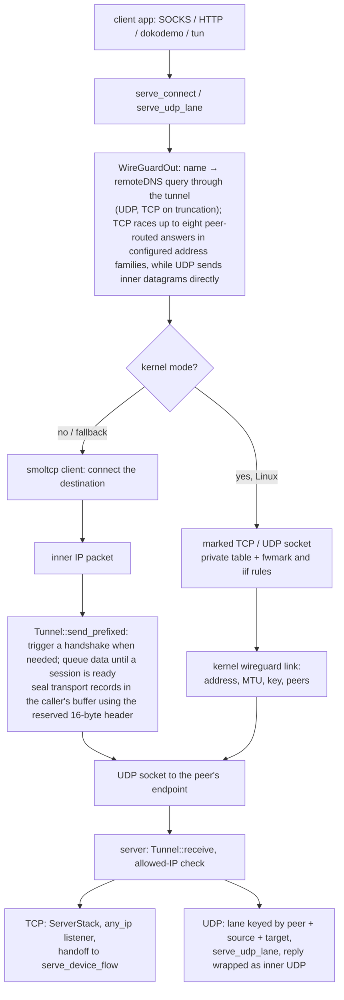

# The WireGuard tunnel, both roles

<!-- scope:begin -->
- paths: crates/ferrox-app/src/wg.rs, crates/ferrox-app/src/wg_kernel.rs, crates/ferrox-app/src/wg_stack.rs, crates/ferrox-app/src/wireguard.rs, crates/ferrox-core/src/wireguard/device.rs, crates/ferrox-core/src/wireguard/handshake.rs, crates/ferrox-core/src/wireguard/transport.rs
- symbols: find_wireguard_outbound, wireguard_settings, a_wireguard_server_datagram_takes_its_udp_lane_and_redirect
- scenarios: wireguard-raw, wireguard-kernel-raw
- engines: xray-core, sing-box
- go: ./proxy/wireguard/...
<!-- scope:end -->

Row 46: a `wireguard` handler carries IP packets over UDP. The outbound is the client — it dials the peer's endpoint, raises a handshake on the first flow, and puts every inner packet through the tunnel — and the inbound is the server, which answers an initiation, routes the decrypted packet by the peer's allowed IPs, and hands a TCP flow to the tree's own outbound or a datagram flow to the tree's own lane. Both roles carry IPv4 and IPv6 TCP and UDP, and answer an ICMP echo request to the device's own address at both families.

The wire is the reference's: a 16-byte transport header (type, receiver index, counter) and a 16-byte tag, 148-byte initiations, 92-byte responses, and the three reserved bytes where WARP writes its routing id. The reserved bytes are written after `mac1`/`mac2` and cleared before a message is parsed or checked, so a peer that fills them and one that leaves them zero read the same. The handshake is Noise_IKpsk2 with an optional pre-shared key; the timers are the reference's five seconds, ninety seconds, two minutes, three minutes and ten seconds, and a replayed timestamp and a replayed counter are refused. A responder answers into a pending keypair and promotes it on the first authenticated transport record, so the old session stays send-capable until the initiator proves it received the response.

The config is xray's own dialect. `secretKey`, `address`, `peers`, `mtu`, `reserved`, `remoteDNS`, `noKernelTun` and `kernelMode` are read with the reference's defaults: a missing address list is `10.0.0.1` and `fd59:7153:2388:b5fd::1`, a missing peer allowed-IP list is `0.0.0.0/0` and `::0/0`, a missing MTU is 1420, a reserved value is empty or exactly three bytes, and a missing `remoteDNS` list is the reference's four Cloudflare resolver addresses (two IPv4, two IPv6). Keys arrive as 64 hexadecimal characters, or as standard or URL-safe base64 with the padding ignored. An endpoint that names a host keeps every answer it resolves to, up to eight, so both address families are dialled rather than whichever the resolver listed first. A server's `users[*].account` is the peer, flattened the way the config builder flattens it. The role comes from the position: an outbound is the client, an inbound is the server, and an explicit `isClient` that contradicts the position is refused at startup.

The userspace stack is `smoltcp` 0.14 on both sides — one dependency for the TCP state machine, its windows, retransmits and IPv6, instead of the reference's gVisor netstack. The client connects a local flow to the destination the rules chose. The server resolves its outbound the way any served inbound does: a TCP flow takes the tag its rules name for `tcp`, a datagram the tag for `udp`, so two freedom outbounds with different redirects serve one tunnel. The server owns no address it receives: `any_ip` plus a wildcard listener raised on the SYN's port accepts `192.0.2.1:7` and `2001:db8::1:7` alike, then hands the established flow to `serve_device_flow` over a loopback pair. A datagram skips the state machine: the client frames the app's SOCKS5 datagram into an inner UDP packet and remembers the relay port that asked; the server keys a lane by peer, source and target, dials it through `serve_udp_lane`, and wraps each answer as the packet the client expects.

On Linux, `noKernelTun: false` (or `kernelMode: true`, which is the same switch under its newer name) opens a real `wireguard` link through generic and route netlink. The link carries the configured address, MTU, private key and peers; a private routing table holds the default route through the link, and two rules per family send marked sockets and reverse-path lookups on the link into that table. The data path is the kernel's: a marked TCP or UDP socket is routed into the device, and the kernel module encrypts it, so no userspace stack or inner-packet copy is in the flow. The link, its addresses, routes and rules are removed when the outbound is dropped. A kernel that refuses the device — no `CAP_NET_ADMIN`, no `wireguard` module, no netlink family — falls back to the userspace stack with one warning, so a config still runs where the device is unavailable. The server role stays on the userspace stack. `remoteDNS` is carried on both paths: a name the client is asked for becomes a DNS query through the tunnel to the configured server of the matching address family, and up to eight peer-routed answers in configured address families are raced; for TCP the primary candidate is preferred once established, and for UDP the first reply pins that name; on the kernel path each name owns its own connected socket, so one name's reply pins only that name. A numeric target never asks. The answer is cached for the minimum record TTL, at most the reference's 300 seconds, so a burst of flows pays one lookup. The exchange is UDP first; a truncated answer is asked again over a TCP flow through the same tunnel, length-prefixed as the reference's retry is. The protobuf seam is the one the scenario suite uses: `xray.proxy.wireguard.DeviceConfig`, `PeerConfig` and a user's account decode into the same JSON the file form reads.

## Data path



## Measured

<!-- counts:begin -->
| key | value | checked by |
| --- | --- | --- |
| ops-retired-instructions | UNBLESSED | scripts/count-ops.sh |
| transport-header-bytes | 16 | ferrox-core-wireguard::tests::the_reference_message_sizes |
| initiation-bytes | 148 | ferrox-core-wireguard::tests::the_reference_message_sizes |
| response-bytes | 92 | ferrox-core-wireguard::tests::the_reference_message_sizes |
| default-mtu | 1420 | ferrox-app-wireguard::tests::the_defaults_are_the_reference_ones |
| tcp-bytes-echoed | 9 | ferrox-app-wg::tests::a_tcp_flow_crosses_the_tunnel_to_a_freedom_dial |
| client-datagram-bytes-echoed | 6 | ferrox-app-wg-stack::tests::a_client_datagram_lane_frames_and_unframes |
| server-datagram-bytes-echoed | 2 | ferrox-app-wg-stack::tests::a_server_datagram_lane_echoes_through_freedom |
| echo-answers-on-the-client | 2 | ferrox-app-wg-stack::tests::an_echo_to_the_devices_own_address_is_answered_on_the_tunnel |
| echo-answers-on-the-server | 1 | ferrox-app-wg-stack::tests::a_server_answers_an_echo_to_its_own_address |
| prefixed-record-allocations | 0 | ferrox-core-wireguard::tests::a_prefixed_record_reuses_the_stack_headroom |
| prefixed-record-zeroed-bytes | 0 | ferrox-core-wireguard::tests::a_prefixed_record_reuses_the_stack_headroom |
| kernel-rule-priority | 32765 | ferrox-app-wg-kernel::tests::the_rule_marks_the_table |
| kernel-iif-priority | 32764 | ferrox-app-wg-kernel::tests::the_iif_rule_keeps_the_reverse_path_inside_the_tunnel |
<!-- counts:end -->

The size rows are the constants the record and handshake write, asserted against the reference's numbers. The echo rows are bytes, not durations: a TCP flow crosses both tunnel directions, the smoltcp handoff, the freedom dial and a loopback echo with its nine bytes unchanged; a client datagram lane frames a six-byte answer and unframes it; a server datagram lane frames a two-byte answer through `serve_udp_lane` and wraps the reply; and the stack answers an echo request to its own address at both families while refusing another destination. The rule rows are the two priorities the kernel path installs, asserted by the message builders; the privileged test that creates and removes the link is `#[ignore]`d because it needs `CAP_NET_ADMIN`. The scenario gate is `TestWireguard` in `upstream/pins.toml`; it is green in `conformance.yml` at this pin.

## Ops

```bash
./scripts/count-ops.sh report wireguard::device::tests::a_replayed_transport_counter_is_refused 'wireguard::device::Tunnel::send'
```

`UNBLESSED`. `scripts/count-ops.sh` needs valgrind, which does not exist on macOS/aarch64, so this count is CI-only (`ops.yml`) and nothing quotes it until the artefact has been read.

## Syscalls

**Not measured.** The userspace sending path reaches a real UDP socket, and a loopback test cannot witness a syscall count: the reader's `recv_from` timeout and the writer's `send_to` are scheduler- and kernel-dependent. The kernel path replaces that path with the kernel module's own socket and a marked inner socket, which a loopback test also cannot count. No in-memory stream observes either path, so no syscall row is claimed; `tcp-bytes-echoed` proves the bytes, not the calls behind them.

## Memory copies

Zero extra copies on the stack send path. Every producer reserves the 16-byte transport header (`QueueDevice`, `QueueTx`, the client and server datagram lanes, the DNS exchange and the IO loop), and `Tunnel::send_prefixed` seals the record where the packet already lies. `prefixed-record-allocations` and `prefixed-record-zeroed-bytes` are both zero: `a_prefixed_record_reuses_the_stack_headroom` asserts the returned packet's base is the caller's, the caller's pointer does not move and its capacity does not grow, and the peer decrypts it. A caller without headroom still takes the old path: `send_owned` seals in place from offset zero, while `send(&[u8])` allocates one sized buffer and copies the payload once. On receive, both paths copy the decrypted record into the stack's own packet buffer. Neither the `send(&[u8])` copy nor the receive copy is claimed removed.

## Time

`benchmark-matrix.yml` measures both paths. The userspace cells set `noKernelTun: true`; the Linux kernel cells set it false and run only the ferrox client, because the reference clients would need the same privilege, while xray-core and sing-box still serve. The cell grants the ferrox binary `CAP_NET_ADMIN` and checks the runner can create a `wireguard` link; a runner without the module skips the cell. The numbers below are the userspace cells: tier `full`, seven repeats on 2026-10-28 (`AMD EPYC 9V45`, `wireguard-raw-*`). Legs are ferrox against xray-core in the same cell: down-8 client 110.0 vs 90.2 MiB/s (1.22x) and server 110.7 vs 102.6 (1.08x); duplex-8 client 186.6 vs 201.7 (0.93x) and server 205.1 vs 197.3 (1.04x); up-1 client 126.6 vs 111.3 (1.14x) and server 132.2 vs 121.0 (1.09x). CPU per GiB on the server leg is 10.6 s against xray-core's 17.2 s for down-8, 6.6 s against 8.0 s for duplex-8, and 12.9 s against 14.5 s for up-1; peak RSS is 13-40 MiB against 46-70 MiB. All nine cells gate true; the closest is duplex-8 on the xray-core server at 0.93x. The shape behind it: one `smoltcp` stack and one socket thread per device, a 1 ms stack tick (10 ms for UDP lanes), a 512 KiB receive and 2 MiB send buffer per TCP direction, Cubic with immediate acknowledgements, 256 received / 128 sent datagrams per stack turn, and up to 256 datagrams read before the stack is drained. The socket asks for a 7 MiB queue, which Linux clamps to about 212 KiB, so a send turn is bounded to what the peer can hold. A ferrox client through a ferrox server moves 205.1 MiB/s duplex against xray-core's 197.3 (1.04x), so the win is measured against the reference legs, not between two ferrox ends. An earlier full run measured 0.99x/0.97x down, 0.95x/1.05x duplex and 0.93x/0.95x up, so the shape holds across hosts.

## What we removed

The iptables control plane. The upstream kernel-mode work installs mangle rules, toggles `src_valid_mark`, and vendors an iptables runner; this tree writes route and generic netlink only, uses a private table with `SO_MARK` on the inner sockets, and adds an `iif` rule so the reverse-path lookup stays on the link. No firewall chain, global sysctl or `SO_BINDTODEVICE` is touched, and the link, table and rules are removed on drop. The host resolver for a client name is also gone: the query rides the tunnel against `remoteDNS`, so the name and the answer are not visible to the host's resolver. The reserved bytes are handled in one place — after the MACs are computed, before any parse, and put back when a record is refused — so the WARP form and the vanilla form are the same code path rather than two.

The gVisor dependency. The reference's netstack pulls gVisor's `tcpip`; this tree's `smoltcp` is one small crate, and its only new transitive licence is `0BSD` (`managed`), now in `deny.toml`. It is a dependency change, not a measured speed claim.

Against sing-box, nothing is removed: its pinned WireGuard endpoint is a separate implementation, now the matrix's third server, and the translator maps this row's Xray-shaped config onto it. ZeroNet's pin carries no WireGuard lane. The pinned AmneziaWG device is a third implementation of the same wire format, not the source of this row; its kernel device and hand-rolled ChaCha20 are left where they are.

## What was not removed

No syscall claim is made. On transmit, non-prefixed userspace paths copy or shift an inner packet into a transport record. The prefixed stack path reuses the caller's packet buffer, seals in place without moving the payload, and writes the record rather than zero-filling it first. On receive, both paths copy the opened payload into `Event::Data`; the stack owns a 512 KiB receive and a 2 MiB send buffer per connected flow and up to eight such pairs while a TCP flow races resolved answers, which is memory the reference's netstack also spends; a server datagram lane owns a loopback relay and two threads, and is reclaimed after the UDP idle budget, within the 4096 cap. Remote DNS races up to eight peer-routed answers in the configured address families: a TCP flow prefers its primary candidate once established, and UDP sends to up to eight until one name's reply pins that name; another name on the same lane still races, and the kernel lane stops at 64 connected sockets. Kernel mode is Linux-only and needs `CAP_NET_ADMIN` and the `wireguard` module; when it is unavailable the userspace stack serves the same config, and the server role always uses that stack. A non-zero `reserved` value also stays on the userspace stack, because the kernel device has no field for WARP's routing id. An explicit `isClient` that contradicts the handler's position is a startup refusal rather than a silent role swap. A client whose peers name endpoints in both address families binds one dual-stack UDP socket and maps IPv4 endpoints through it; when the host cannot open that socket it falls back to IPv4 and skips the IPv6 candidates rather than refusing a reachable v4 endpoint. A single peer keeps either family, and a name that resolves to several answers keeps one of each family before the eight-slot cap and sends its handshake to the current endpoint and all of them, with the first response pinning the tunnel. After 128 initiations in a second the responder answers a missing or stale `mac2` with a rotatable cookie reply, and the retry is accepted under the same load. The UDP reply reader takes every answer the lane's relay returns, including one a freedom `redirect` rewrote, and reports it to the client as the original target the inner packet named; a lane still drops a datagram whose framing it cannot parse.

## Pins

| what | where |
| --- | --- |
| the device config, peers, users and role | `upstream/xray-core/proxy/wireguard/`, `upstream/xray-core/infra/conf/wireguard.go` |
| the JSON defaults and key parsing | `upstream/xray-core/infra/conf/wireguard.go` |
| the netstack the userspace stack replaces | `upstream/xray-core/proxy/wireguard/netstack.go` |
| the scenario both roles answer | `upstream/xray-core/testing/scenarios/wireguard_test.go` |
| the endpoint the matrix translates to | `upstream/sing-box/option/wireguard.go`, `upstream/sing-box/transport/wireguard/endpoint.go` |
| the smoltcp stack and its device trait | `upstream/` nothing vendored; crate `smoltcp` 0.14 |
