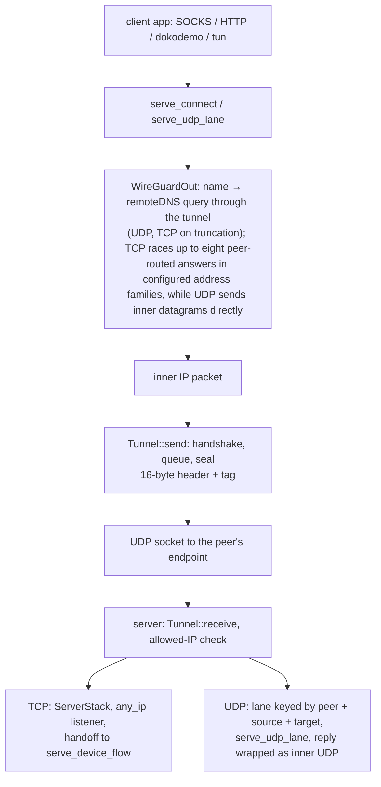

# The WireGuard tunnel, both roles

<!-- scope:begin -->
- paths: crates/ferrox-app/src/wg.rs, crates/ferrox-app/src/wg_stack.rs, crates/ferrox-app/src/wireguard.rs, crates/ferrox-core/src/wireguard/device.rs, crates/ferrox-core/src/wireguard/handshake.rs, crates/ferrox-core/src/wireguard/transport.rs
- symbols: find_wireguard_outbound, wireguard_settings
- scenarios: wireguard-raw
- engines: xray-core, sing-box
- go: ./proxy/wireguard/...
<!-- scope:end -->

Row 46: a `wireguard` handler carries IP packets over UDP. The outbound is the client — it dials the peer's endpoint, raises a handshake on the first flow, and puts every inner packet through the tunnel — and the inbound is the server, which answers an initiation, routes the decrypted packet by the peer's allowed IPs, and hands a TCP flow to the tree's own outbound or a datagram flow to the tree's own lane. Both roles carry IPv4 and IPv6 TCP and UDP, and answer an ICMP echo request to the device's own address at both families.

The wire is the reference's: a 16-byte transport header (type, receiver index, counter) and a 16-byte tag, 148-byte initiations, 92-byte responses, and the three reserved bytes where WARP writes its routing id. The reserved bytes are written after `mac1`/`mac2` and cleared before a message is parsed or checked, so a peer that fills them and one that leaves them zero read the same. The handshake is Noise_IKpsk2 with an optional pre-shared key; the timers are the reference's five seconds, ninety seconds, two minutes, three minutes and ten seconds, and a replayed timestamp and a replayed counter are refused. A responder answers into a pending keypair and promotes it on the first authenticated transport record, so the old session stays send-capable until the initiator proves it received the response.

The config is xray's own dialect. `secretKey`, `address`, `peers`, `mtu`, `reserved`, `remoteDNS`, `noKernelTun` are read with the reference's defaults: a missing address list is `10.0.0.1` and `fd59:7153:2388:b5fd::1`, a missing peer allowed-IP list is `0.0.0.0/0` and `::0/0`, a missing MTU is 1420, a reserved value is empty or exactly three bytes, and a missing `remoteDNS` list is the reference's four Cloudflare resolver addresses (two IPv4, two IPv6). Keys arrive as 64 hexadecimal characters, or as standard or URL-safe base64 with the padding ignored. A server's `users[*].account` is the peer, flattened the way the config builder flattens it. The role comes from the position: an outbound is the client, an inbound is the server, and an explicit `isClient` that contradicts the position is refused at startup.

The userspace stack is `smoltcp` 0.14 on both sides — one dependency for the TCP state machine, its windows, retransmits and IPv6, instead of the reference's gVisor netstack. The client connects a local flow to the destination the rules chose. The server resolves its outbound the way any served inbound does: a TCP flow takes the tag its rules name for `tcp`, a datagram the tag for `udp`, so two freedom outbounds with different redirects serve one tunnel. The server owns no address it receives: `any_ip` plus a wildcard listener raised on the SYN's port accepts `192.0.2.1:7` and `2001:db8::1:7` alike, then hands the established flow to `serve_device_flow` over a loopback pair. A datagram skips the state machine: the client frames the app's SOCKS5 datagram into an inner UDP packet and remembers the relay port that asked; the server keys a lane by peer, source and target, dials it through `serve_udp_lane`, and wraps each answer as the packet the client expects.

`noKernelTun: false` is the reference's kernel-TUN path. This tree opens no kernel device, so it names the divergence once and serves the userspace stack. `remoteDNS` is carried: a name the client is asked for becomes a DNS query through the tunnel to the configured server of the matching address family, and up to eight peer-routed answers in configured address families are raced; the first that completes pins that destination. A numeric target never asks. The answer is cached for the minimum record TTL, at most the reference's 300 seconds, so a burst of flows pays one lookup. The exchange is UDP first; a truncated answer is asked again over a TCP flow through the same tunnel, length-prefixed as the reference's retry is. The protobuf seam is the one the scenario suite uses: `xray.proxy.wireguard.DeviceConfig`, `PeerConfig` and a user's account decode into the same JSON the file form reads.

## Data path



## Measured

<!-- counts:begin -->
| key | value | checked by |
| --- | --- | --- |
| ops-retired-instructions | UNBLESSED | scripts/count-ops.sh |
| transport-header-bytes | 16 | ferrox-core-wireguard::tests::the_reference_message_sizes |
| initiation-bytes | 148 | ferrox-core-wireguard::tests::the_reference_message_sizes |
| response-bytes | 92 | ferrox-core-wireguard::tests::the_reference_message_sizes |
| default-mtu | 1420 | ferrox-app-wireguard::tests::the_defaults_are_the_reference_ones |
| tcp-bytes-echoed | 9 | ferrox-app-wg::tests::a_tcp_flow_crosses_the_tunnel_to_a_freedom_dial |
| client-datagram-bytes-echoed | 6 | ferrox-app-wg-stack::tests::a_client_datagram_lane_frames_and_unframes |
| server-datagram-bytes-echoed | 2 | ferrox-app-wg-stack::tests::a_server_datagram_lane_echoes_through_freedom |
| echo-answers-on-the-client | 2 | ferrox-app-wg-stack::tests::an_echo_to_the_devices_own_address_is_answered_on_the_tunnel |
| echo-answers-on-the-server | 1 | ferrox-app-wg-stack::tests::a_server_answers_an_echo_to_its_own_address |
<!-- counts:end -->

The size rows are the constants the record and handshake write, asserted against the reference's numbers. The echo rows are bytes, not durations: a TCP flow crosses both tunnel directions, the smoltcp handoff, the freedom dial and a loopback echo with its nine bytes unchanged; a client datagram lane frames a six-byte answer and unframes it; a server datagram lane frames a two-byte answer through `serve_udp_lane` and wraps the reply; and the stack answers an echo request to its own address at both families while refusing another destination. The scenario gate is `TestWireguard` in `upstream/pins.toml`; it is green in `conformance.yml` at this pin.

## Ops

```bash
./scripts/count-ops.sh report wireguard::device::tests::a_replayed_transport_counter_is_refused 'wireguard::device::Tunnel::send'
```

`UNBLESSED`. `scripts/count-ops.sh` needs valgrind, which does not exist on macOS/aarch64, so this count is CI-only (`ops.yml`) and nothing quotes it until the artefact has been read.

## Syscalls

**Not measured.** The sending path reaches a real UDP socket, and a loopback test cannot witness a syscall count: the reader's `recv_from` timeout and the writer's `send_to` are scheduler- and kernel-dependent. No in-memory stream observes this path, so no syscall row is claimed; `tcp-bytes-echoed` proves the bytes, not the calls behind them.

## Memory copies

**Not measured.** The plaintext is copied into a transport record and decrypted into the reader's buffer, and an inner packet is copied between `smoltcp` and the local stream. No test asserts pointer identity across those copies, so the page makes no copy or allocation row; `ops-retired-instructions` remains `UNBLESSED` for the same reason.

## Time

`benchmark-matrix.yml`, tier `full`, five repeats on 2026-10-28 (`AMD EPYC 9V45`, `wireguard-raw-*`). Legs are ferrox against xray-core in the same cell: down-8 client 165 vs 167 MiB/s (0.99x) and server 165 vs 170 (0.97x); duplex-8 client 106 vs 111 (0.95x) and server 117 vs 111 (1.05x); up-1 client 178 vs 192 (0.93x) and server 183 vs 192 (0.95x). CPU per GiB on the server leg is 8.8 s against xray-core's 10.4 s for down-8, 13.0 s against 16.6 s for duplex-8, and 6.0 s against 8.2 s for up-1; peak RSS is 12-29 MiB against 63-109 MiB. The shape behind it: one `smoltcp` stack and one socket thread per device, a 1 ms stack tick (10 ms for UDP lanes), a 512 KiB receive and 1 MiB send buffer per TCP direction, Cubic with immediate acknowledgements, and 256 received / 64 sent datagrams per stack turn. The socket asks for a 7 MiB queue, which Linux clamps to about 212 KiB, so a turn is bounded to what the peer can hold. A ferrox client through a ferrox server moves 64 MiB/s duplex against xray-core's 117, so the win is measured against the reference legs, not between two ferrox ends. An earlier full run on an EPYC 7763 measured 1.19x/1.00x down, 0.90x/1.00x duplex and 1.03x/1.11x up, so the shape holds across hosts.

## What we removed

The kernel device. The reference's client opens a TUN when `noKernelTun` is false and the platform has one, and the server's netstack is a separate path; this row serves both roles from the same `smoltcp` bridge and opens no device. The host resolver for a client name is also gone: the query rides the tunnel against `remoteDNS`, so the name and the answer are not visible to the host's resolver. The reserved bytes are handled in one place — after the MACs are computed, before any parse, and put back when a record is refused — so the WARP form and the vanilla form are the same code path rather than two.

The gVisor dependency. The reference's netstack pulls gVisor's `tcpip`; this tree's `smoltcp` is one small crate, and its only new transitive licence is `0BSD` (`managed`), now in `deny.toml`. It is a dependency change, not a measured speed claim.

Against sing-box, nothing is removed: its pinned WireGuard endpoint is a separate implementation, now the matrix's third server, and the translator maps this row's Xray-shaped config onto it. ZeroNet's pin carries no WireGuard lane. The pinned AmneziaWG device is a third implementation of the same wire format, not the source of this row; its kernel device and hand-rolled ChaCha20 are left where they are.

## What was not removed

No syscall or copy claim is made. The tunnel still copies an inner packet into a transport record and copies it out again; the stack owns a 512 KiB receive and a 1 MiB send buffer per connected flow and up to eight such pairs while a TCP flow races resolved answers, which is memory the reference's netstack also spends; a server datagram lane owns a loopback relay and two threads, and is reclaimed after the UDP idle budget, within the 4096 cap. Remote DNS races up to eight peer-routed answers in the configured address families for a TCP flow, and for UDP sends to up to eight until one name's reply pins that name; another name on the same lane still races. `noKernelTun: false` does not open a kernel device, so a config that expected the host's routes to see the tunnel does not get them, and an explicit `isClient` that contradicts the handler's position is a startup refusal rather than a silent role swap. A client whose peers name endpoints in both address families binds one dual-stack UDP socket and maps IPv4 endpoints through it; a single peer keeps either family. After 128 initiations in a second the responder answers a missing or stale `mac2` with a rotatable cookie reply, and the retry is accepted under the same load. The UDP reply reader takes every answer the lane's relay returns, including one a freedom `redirect` rewrote, and reports it to the client as the original target the inner packet named; a lane still drops a datagram whose framing it cannot parse.

## Pins

| what | where |
| --- | --- |
| the device config, peers, users and role | `upstream/xray-core/proxy/wireguard/`, `upstream/xray-core/infra/conf/wireguard.go` |
| the JSON defaults and key parsing | `upstream/xray-core/infra/conf/wireguard.go` |
| the netstack the userspace stack replaces | `upstream/xray-core/proxy/wireguard/netstack.go` |
| the scenario both roles answer | `upstream/xray-core/testing/scenarios/wireguard_test.go` |
| the endpoint the matrix translates to | `upstream/sing-box/option/wireguard.go`, `upstream/sing-box/transport/wireguard/endpoint.go` |
| the smoltcp stack and its device trait | `upstream/` nothing vendored; crate `smoltcp` 0.14 |
