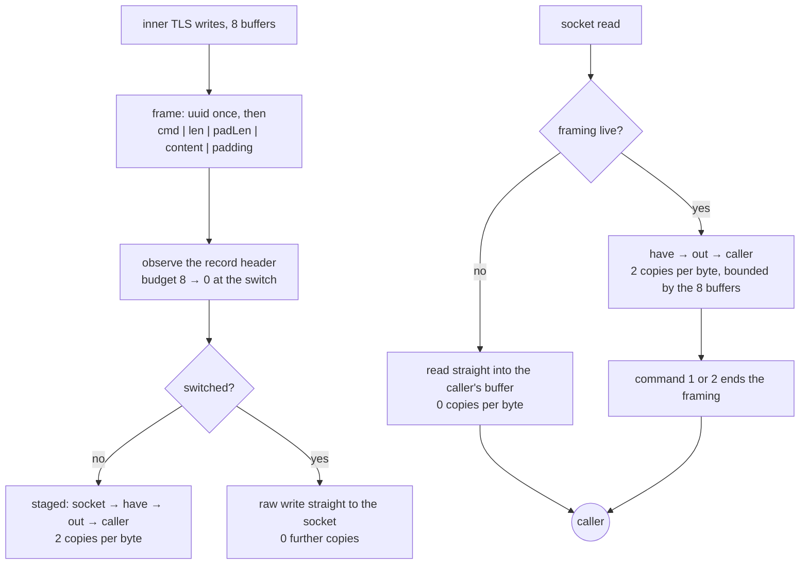

# XTLS Vision

Vision is the one framing in this tree that *stops existing*. Once the inner
TLS handshake is over, the padding frames stop and the stream becomes the raw
socket, so the framing's cost should be zero from that point on — not amortised,
not small. Zero.

The framing is: the first frame is prefixed with the 16-byte user UUID; every
frame is then `command(1) | length(2) | padLength(2) | content | padding`.
Commands are `0` continue, `1` end, `2` direct. Padding is zero-filled and its
length comes from the same seed table Xray uses (`{900, 500, 900, 256}`), so
the byte counts a DPI sees are the byte counts the reference produces.

For eight buffers in each direction the writer and the reader run a TLS filter:
`0x16 0x03` means a handshake record, `0x17 0x03 0x03` means application data,
and a `0x00 0x2b 0x00 0x02 0x03 0x04` window inside a 1.3 ServerHello means the
inner TLS negotiated a cipher worth switching for. Until that window closes,
every buffer is framed; after it, nothing is.

## Data path



## Measured

<!-- counts:begin -->
| key | value | checked by |
| --- | --- | --- |
| ops-retired-instructions | UNBLESSED | scripts/count-ops.sh |
| padding-command-bytes | 5 | ferrox-app-vision::tests::writing_frames_the_payload_and_heads_the_first_with_the_uuid |
| first-frame-uuid-bytes | 16 | ferrox-app-vision::tests::writing_frames_the_payload_and_heads_the_first_with_the_uuid |
| tls-buffers-inspected-before-the-switch | 8 | ferrox-app-vision::tests::both_directions_spend_the_same_filter_budget |
| user-space-copies-per-byte-while-framed | 2 | ferrox-app-vision::tests::the_framing_switch_ends_the_staging |
| user-space-copies-per-byte-after-the-switch | 0 | ferrox-app-vision::tests::the_framing_switch_ends_the_staging |
| user-space-copies-per-byte-written-while-framed | 0 | ferrox-app-vision::tests::the_writer_hands_the_callers_payload_by_pointer |
| framed-staging-buffer-bytes | 16384 | ferrox-app-vision::tests::the_framed_staging_buffers_stay_at_one_record |
| seal-open-staging-allocations | 0 | ferrox-bench-gate-2 |
<!-- counts:end -->

## Ops

```bash
./scripts/count-ops.sh report \
  vision::tests::the_framing_switch_ends_the_staging \
  'vision::Link::read_direct'
```

`UNBLESSED`, as above.

## Time

**Not measured on this branch.** `ferrox-bench` runs a Vision allocation gate
(`gate_vision_allocs`) over content lengths 0, 1, 64, 1400 and 8171 and refuses
any allocation, any allocated byte and any zero-fill; the wall clock for this
framing is not separately timed and no duration is quoted here. Allocation
counts are deterministic and are gated; durations are not. `Link`'s own working
set is gated by capacity, not by an allocator window, and the next paragraphs
say what that gate sees.

One row on this page names a gate that does not cover it, and it is renamed
rather than deleted so the claim stays true: `seal-open-staging-allocations 0`
is `ferrox-bench-gate-2`, and gate 2 drives the **stateless**
`vless::VisionSeal`/`vless::VisionOpen` pair in `ferrox-core`. That pair is a
second, independent implementation of this framing. It shares nothing with
`vision::Link` in `ferrox-app` — no `have`, no `out`, no `hat`/`oat`, no
`tls.budget` filter, no `read_direct` — and the data path above is `Link`
throughout.

**`vision::Link` was the one buffer in this tree sized for a whole relay and
paid for whether the relay used it or not.** `Link::new` opened `have` and `out`
at `Vec::with_capacity(RELAY_BUFFER)`, 256 KiB each, and `fill` read a full
`RELAY_BUFFER` per framed pass — 512 KiB resident per endpoint for the life of
the connection, on a window that exists only until the switch. Past the switch
neither buffer is touched again: reads go through `read_direct` into the
caller's buffer and writes go direct, so the reservation bought nothing after
the handshake and was never freed. The window is now `RELAY_SMALL_BUFFER`,
16 KiB, one `rustls` record and the relay's own first read.

What the smaller window changes is the **read granularity of the framed pass**,
not the bytes: a handshake larger than one record drains over more `fill`s. That
is exactly the case the framing already had to survive — `unpad` carries a frame
across reads (`a_frame_split_across_reads_is_reassembled`, and
`seeded_splits_read_back_as_whole_content` replays one seeded chunking against
whole content) — so the count moved and the output did not. The bulk, which is
every byte after the switch, never read through `have` and reads no more or
fewer syscalls than before.

The gate is the capacity, held steady: `the_framed_staging_buffers_stay_at_one_record`
drains 24 padded frames plus a 40 KiB tail, asserts the bytes round-trip, and
asserts `have.capacity()` equals the 16 KiB window rather than the 256 KiB it
used to reach — red at 262144 on the old size, green at 16384 on the new one.

The two rows beside the renamed one are properly gated: both
`user-space-copies-per-byte-while-framed` and `-after-the-switch` name
`the_framing_switch_ends_the_staging`, which really does drive `Link`.

## What we removed

Vision was the worst-shaped carrier in this tree before the change, and the
reason is worth writing down: it had **three** user-space copies per byte
throughout the whole session, not only during the handshake.

- **After the switch, two of the three copies are gone.** `read` used to read
  into a `chunk` buffer, extend `out` from it, and then copy out of `out` into
  the caller's buffer, on every call, forever. `read_direct` now hands the
  caller's buffer to the session when the framing is over, so the post-handshake
  steady state — which is every byte of every real connection — costs zero
  user-space copies. `the_framing_switch_ends_the_staging` counts staged bytes
  and asserts that not one byte after the switch went through a staging buffer.
- **A stream that never carried Vision now stops paying for the check.** If the
  first 16 bytes are not the user UUID the stream is not addressed to this
  session and never will be; `unpad` records that by clearing `padding`, so the
  pass-through path drops from three copies to zero instead of re-comparing 16
  bytes per read for the life of the connection.
- **One pooled buffer per incoming buffer, unconditionally.** Xray's
  `XtlsUnpadding` (`proxy/proxy.go:561`) takes a fresh 8 KiB `buf.Buffer` for
  *every* buffer that arrives once Vision is engaged, before any header check
  beyond the UUID compare, and `IsCompleteRecord` (`:410`) allocates a slice the
  size of the whole `MultiBuffer` and copies the whole thing into it on every
  padded write — so while padding, Xray copies every byte three times too. This
  tree's `staging` buffer is cleared and reused, and `ferrox-bench`'s
  `gate_vision_allocs` requires zero allocations at every length.
- **A flush that reads through the wrong layer.** `Link::flush` pushed the
  outer session, whose `complete_io` reads as well as writes; after the write
  side went direct that read ate raw bytes and the session died on the spot,
  which is the `BadRecordMac`-then-silence the direct-switch row failed with.
  The flush now follows the same dispatch as the write, and
  `vision_direct_switch_carries_inner_tls_over_loopback` is what says so.
- **A bound paid before it can matter.** The `Link` throws the alignment switch
  itself the moment its filter commits to 1.3, so the plain-`TLS` accept only
  tracks record ends until then and bulk lanes that never see a `ServerHello`
  never engage.

- **Five single-byte header iterations read as one five-byte load.** The
  read loop's header trips have no observable in between, so a whole header
  parses at once and a split one keeps the byte loop;
  `seeded_splits_read_back_as_whole_content` replays one seeded chunking
  against whole content, tail included.

- **A 512 KiB working set for a window that closes at the handshake.**
  `Link::new` reserved `have` and `out` at `RELAY_BUFFER` and `fill` read that
  much per framed pass, so every Vision endpoint held 512 KiB of relay-sized
  staging for the whole connection even though both buffers go unused the moment
  the switch lands. The window is now one `rustls` record,
  `RELAY_SMALL_BUFFER`; the bytes are unchanged, and what moved is how many
  `fill`s a larger-than-one-record handshake takes — which is a case the framing
  was already required to survive. `the_framing_staging_buffers_stay_at_one_record`
  holds the capacity at 16 KiB where it used to reach 256 KiB.

- **The write path's staging copy of the caller's payload.** `frame` used to
  `staging.extend_from_slice(buf)` before handing the frame to the session, one
  user-space copy per written byte while the framing was live. The frame now
  goes over as three slices — head, the caller's own buffer, and a static zero
  run for the padding — through `RecordAlignment::write_all_slices`, which
  `RustlsProvider` and `RustlsServerProvider` implement over `write_vectored`
  so rustls sees one payload and emits one record. The wrapper types in the
  Vision path (`RealityServer`, `RealityClientSession`) forward, so the
  coalescing impl is what actually runs.
  `the_writer_hands_the_callers_payload_by_pointer` witnesses it: the pointer
  that reaches `write_all_slices` is the caller's pointer, and it is still the
  caller's pointer after the caller reallocs. `write_traffic_holds_the_buffer_capacities_steady`
  gates the removal on the two remaining `Vec`s in `Link`: `have.capacity()` and
  `out.capacity()` do not move across 64 writes, so no buffer came back to take
  `staging`'s place. What got worse: `coalesce` allocates one small `Vec<IoSlice>`
  per call to hand rustls an arbitrary-length slice list, where the old code
  allocated none (it reused the pre-sized `staging`). At a 2 KiB payload the
  allocation is a fraction of the memcpy it replaces; the copy was per-byte,
  the Vec is per-record.

What was deliberately **not** removed: the seed table and the padding itself.
Padding bytes are wire bytes; making them random instead of zero would change
the output, and the point of this repository is that it does not.

## Pins

| what | where |
| --- | --- |
| framing, seeds, filter budget | `upstream/xray-core/proxy/proxy.go` |
| the same wire bytes | `upstream/zeronet/crates/zero-protocol/src/vision.rs` |
| the flow name and the `security` gate | `ferrox-core-transport::Support` |