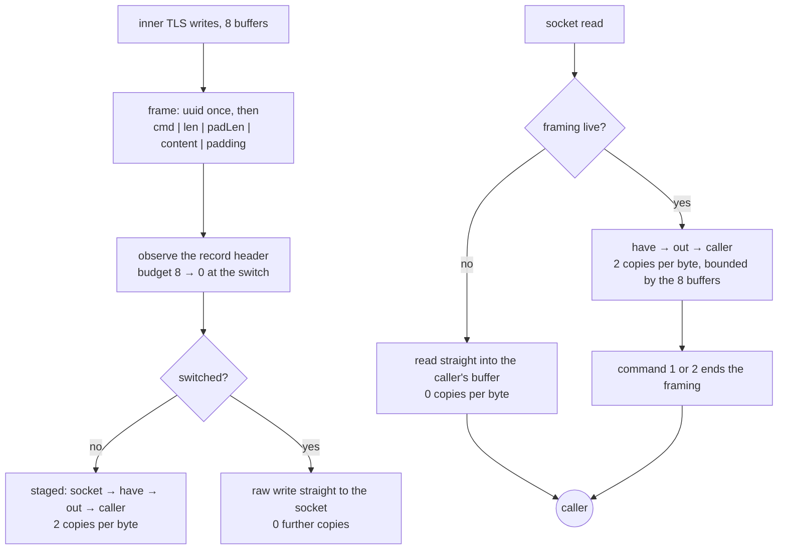

# XTLS Vision

Vision is the one framing in this tree that *stops existing*. Once the inner
TLS handshake is over, the padding frames stop and the stream becomes the raw
socket, so the framing's cost should be zero from that point on — not amortised,
not small. Zero.

The framing is: the first frame is prefixed with the 16-byte user UUID; every
frame is then `command(1) | length(2) | padLength(2) | content | padding`.
Commands are `0` continue, `1` end, `2` direct. Padding is zero-filled and its
length comes from the same seed table Xray uses (`{900, 500, 900, 256}`), so
the byte counts a DPI sees are the byte counts the reference produces. One frame
carries at most 8171 content bytes — Xray's `buf.Size` of 8192 less the uuid and
the header — so a longer write leaves as several frames, never as one frame the
reference's reader refuses.

For eight buffers in each direction the writer and the reader run a TLS filter:
`0x16 0x03` means a handshake record, `0x17 0x03 0x03` means application data,
and a `0x00 0x2b 0x00 0x02 0x03 0x04` window inside a 1.3 ServerHello means the
inner TLS negotiated a cipher worth switching for. Until that window closes,
every buffer is framed; after it, nothing is.

## Data path



## Measured

<!-- counts:begin -->
| key | value | checked by |
| --- | --- | --- |
| ops-retired-instructions | UNBLESSED | scripts/count-ops.sh |
| padding-command-bytes | 5 | ferrox-app-vision::tests::writing_frames_the_payload_and_heads_the_first_with_the_uuid |
| first-frame-uuid-bytes | 16 | ferrox-app-vision::tests::writing_frames_the_payload_and_heads_the_first_with_the_uuid |
| largest-framed-block-bytes | 8171 | ferrox-app-vision::tests::a_bulk_write_frames_every_block_inside_the_bound |
| tls-buffers-inspected-before-the-switch | 8 | ferrox-app-vision::tests::both_directions_spend_the_same_filter_budget |
| user-space-copies-per-byte-while-framed | 2 | ferrox-app-vision::tests::the_framing_switch_ends_the_staging |
| user-space-copies-per-byte-after-the-switch | 0 | ferrox-app-vision::tests::the_framing_switch_ends_the_staging |
| user-space-copies-per-byte-written-while-framed | 0 | ferrox-app-vision::tests::the_writer_hands_the_callers_payload_by_pointer |
| uuid-bytes-copied-per-link | 0 | ferrox-app-vision::tests::the_writer_hands_the_uuid_by_pointer_on_the_first_frame |
| framed-staging-buffer-bytes | 16384 | ferrox-app-vision::tests::the_framed_staging_buffers_stay_at_one_record |
| seal-open-staging-allocations | 0 | ferrox-bench-gate-2 |
| coalesce-segment-allocations | 0 | ferrox-core-tls::rustls_backend::tests::the_framer_path_coalesces_without_a_heap_buffer |
<!-- counts:end -->

## Ops

```bash
./scripts/count-ops.sh report \
  vision::tests::the_framing_switch_ends_the_staging \
  'vision::Link::read_direct'
```

`UNBLESSED`, as above.

## Time

**Not measured yet.** `ferrox-bench` runs a Vision allocation gate
(`gate_vision_allocs`) over content lengths 0, 1, 64, 1400 and 8171 and refuses
any allocation, any allocated byte and any zero-fill; the wall clock for this
framing is not separately timed and no duration is quoted here. Allocation
counts are deterministic and are gated; durations are not. `Link`'s own working
set is gated by capacity, not by an allocator window, and the next paragraphs
say what that gate sees.

One row on this page names a gate that does not cover it, and it is renamed
rather than deleted so the claim stays true: `seal-open-staging-allocations 0`
is `ferrox-bench-gate-2`, and gate 2 drives the **stateless**
`vless::VisionSeal`/`vless::VisionOpen` pair in `ferrox-core`. That pair is a
second, independent implementation of this framing. It shares nothing with
`vision::Link` in `ferrox-app` — no `have`, no `out`, no `hat`/`oat`, no
`tls.budget` filter, no `read_direct` — and the data path above is `Link`
throughout.

**`vision::Link` was the one buffer in this tree sized for a whole relay and
paid for whether the relay used it or not.** `Link::new` opened `have` and `out`
at `Vec::with_capacity(RELAY_BUFFER)`, 256 KiB each, and `fill` read a full
`RELAY_BUFFER` per framed pass — 512 KiB resident per endpoint for the life of
the connection, on a window that exists only until the switch. Past the switch
neither buffer is touched again: reads go through `read_direct` into the
caller's buffer and writes go direct, so the reservation bought nothing after
the handshake and was never freed. The window is now `RELAY_SMALL_BUFFER`,
16 KiB, one `rustls` record and the relay's own first read.

What the smaller window changes is the **read granularity of the framed pass**,
not the bytes: a handshake larger than one record drains over more `fill`s. That
is exactly the case the framing already had to survive — `unpad` carries a frame
across reads (`a_frame_split_across_reads_is_reassembled`, and
`seeded_splits_read_back_as_whole_content` replays one seeded chunking against
whole content) — so the count moved and the output did not. The bulk, which is
every byte after the switch, never read through `have` and reads no more or
fewer syscalls than before.

The gate is the capacity, held steady: `the_framed_staging_buffers_stay_at_one_record`
drains 24 padded frames plus a 40 KiB tail, asserts the bytes round-trip, and
asserts `have.capacity()` equals the 16 KiB window rather than the 256 KiB it
used to reach — red at 262144 on the old size, green at 16384 on the new one.

The two rows beside the renamed one are properly gated: both
`user-space-copies-per-byte-while-framed` and `-after-the-switch` name
`the_framing_switch_ends_the_staging`, which really does drive `Link`.

## What we removed

Vision was the worst-shaped carrier in this tree before the change, and the
reason is worth writing down: it had **three** user-space copies per byte
throughout the whole session, not only during the handshake.

- **After the switch, two of the three copies are gone.** `read` used to read
  into a `chunk` buffer, extend `out` from it, and then copy out of `out` into
  the caller's buffer, on every call, forever. `read_direct` now hands the
  caller's buffer to the session when the framing is over, so the post-handshake
  steady state — which is every byte of every real connection — costs zero
  user-space copies. `the_framing_switch_ends_the_staging` counts staged bytes
  and asserts that not one byte after the switch went through a staging buffer.
- **A stream that never carried Vision now stops paying for the check.** If the
  first 16 bytes are not the user UUID the stream is not addressed to this
  session and never will be; `unpad` records that by clearing `padding`, so the
  pass-through path drops from three copies to zero instead of re-comparing 16
  bytes per read for the life of the connection.
- **One pooled buffer per incoming buffer, unconditionally.** Xray's
  `XtlsUnpadding` (`proxy/proxy.go:561`) takes a fresh 8 KiB `buf.Buffer` for
  *every* buffer that arrives once Vision is engaged, before any header check
  beyond the UUID compare, and `IsCompleteRecord` (`:410`) allocates a slice the
  size of the whole `MultiBuffer` and copies the whole thing into it on every
  padded write — so while padding, Xray copies every byte three times too. This
  tree's `staging` buffer is cleared and reused, and `ferrox-bench`'s
  `gate_vision_allocs` requires zero allocations at every length.
- **A flush that reads through the wrong layer.** `Link::flush` pushed the
  outer session, whose `complete_io` reads as well as writes; after the write
  side went direct that read ate raw bytes and the session died on the spot,
  which is the `BadRecordMac`-then-silence the direct-switch row failed with.
  The flush now follows the same dispatch as the write, and
  `vision_direct_switch_carries_inner_tls_over_loopback` is what says so.
- **A bound paid before it can matter.** The `Link` throws the alignment switch
  itself the moment its filter commits to 1.3, so the plain-`TLS` accept only
  tracks record ends until then and bulk lanes that never see a `ServerHello`
  never engage.

- **Five single-byte header iterations read as one five-byte load.** The
  read loop's header trips have no observable in between, so a whole header
  parses at once and a split one keeps the byte loop;
  `seeded_splits_read_back_as_whole_content` replays one seeded chunking
  against whole content, tail included.

- **A 512 KiB working set for a window that closes at the handshake.**
  `Link::new` reserved `have` and `out` at `RELAY_BUFFER` and `fill` read that
  much per framed pass, so every Vision endpoint held 512 KiB of relay-sized
  staging for the whole connection even though both buffers go unused the moment
  the switch lands. The window is now one `rustls` record,
  `RELAY_SMALL_BUFFER`; the bytes are unchanged, and what moved is how many
  `fill`s a larger-than-one-record handshake takes — which is a case the framing
  was already required to survive. `the_framing_staging_buffers_stay_at_one_record`
  holds the capacity at 16 KiB where it used to reach 256 KiB.

- **The write path's staging copy of the caller's payload.** `frame` used to
  `staging.extend_from_slice(buf)` before handing the frame to the session, one
  user-space copy per written byte while the framing was live. The frame now
  goes over as slices — uuid on the first frame, then head, the caller's own
  buffer, and a static zero run for the padding — through
  `RecordAlignment::write_all_slices`, which `RustlsProvider` and
  `RustlsServerProvider` implement over `write_vectored` so rustls sees one
  payload and emits one record. The wrapper types in the Vision path
  (`RealityServer`, `RealityClientSession`) forward, so the coalescing impl is
  what actually runs.
  `the_writer_hands_the_callers_payload_by_pointer` witnesses it: the pointer
  that reaches `write_all_slices` is the caller's pointer, and it is still the
  caller's pointer after the caller reallocs. `write_traffic_holds_the_buffer_capacities_steady`
  gates the removal on the two remaining `Vec`s in `Link`: `have.capacity()` and
  `out.capacity()` do not move across 64 writes, so no buffer came back to take
  `staging`'s place. The per-record segment list is gone too: `coalesce` laid the
  `IoSlice`s out in a `Vec` it collected per call, where the old `staging` path
  allocated none; the four segments the framer hands (`uuid | head | payload |
  padding`, at most) now ride a stack array, so the write path emits one record and
  allocates nothing of its own. `the_framer_path_coalesces_without_a_heap_buffer`
  counts allocations across `coalesce` at the framer's segment shape and holds them
  at zero; a wider list still goes out in one `write_vectored` by a heap path that
  test also drives, so the fallback is gated rather than dead.

- **The stack head's zero-fill and the uuid copy into it.** The 21-byte
  `let mut head = [0u8; SHORTEST_FRAME]` wrote 21 zeros every call and then
  overwrote 5 of them with `cmd|clen|plen`; on the first frame, `frame_head`
  also `copy_from_slice(uuid)`'d the 16 link bytes into `head[..16]` — a second
  copy of a payload that already lived in `self.uuid`, and on later frames the
  remaining 16 zeroed bytes were never read because only `head[..5]` was
  handed to `write_all_slices`. `frame_head` now returns the 5-byte head by
  value (`[command, clen_hi, clen_lo, plen_hi, plen_lo]`), so there is no
  pre-init at all: the array's only writes are the five bytes that go on the
  wire. The uuid reaches the session as `&self.uuid[..]` prepended as its own
  slice on the first frame; `write_all_slices` then sees four parts on that
  first frame (`uuid | head | buf | zeros`) and three after (`head | buf |
  zeros`). `the_writer_hands_the_uuid_by_pointer_on_the_first_frame` witnesses
  the removed uuid copy by pointer identity: the slice that reaches the session
  is a view of `Link::uuid`, and it is handed once. Nothing got worse — the
  record shape and rustls' `payload_owner` length go up by one only on the
  first frame, and the per-write stack zero-fill drops from 21 bytes to none.

- **Dead production arithmetic on the read path.** `staged` counted framed bytes
  for `the_framing_switch_ends_the_staging`, but the field and its five `+=`
  sites in `fill`, `unpad` and `flush_truncated` were reachable in the shipped
  binary even though nothing outside `#[cfg(test)]` ever read them. The field,
  the initialiser and the increments are now behind `#[cfg(test)]` through an
  inlined `stage(n)` helper whose non-test arm folds to nothing; production pays
  zero per-byte bookkeeping. The claim is structural — `cargo build`'s field
  list on the release `Link` has one fewer `usize` — not a runtime count, so
  nothing runs to gate it and it is stated here in prose rather than a table.

- **A bulk write that no reader on the wire accepts.** `copy_stream` hands
  `Link::write` one buffer of up to `RELAY_BUFFER`, 256 KiB, and the frame's two
  lengths are `u16`s: past 8171 content bytes the block is larger than the
  reference's whole `buf.Size` (8192) including the 16-byte uuid and the 5-byte
  header, and past 65535 `(buf.len() as u16)` wraps the header to a smaller
  number than the bytes behind it. `zeronet` refuses the first outright —
  `"Vision frame exceeds the Xray plaintext bound"`
  (`upstream/zeronet/crates/zero-protocol/src/vision.rs:325`) — and the second
  desynchronises any peer that trusts the header, which is how a Vision session
  ends in silence rather than in an error. The reference never makes such a
  frame: `ReshapeMultiBuffer` (`upstream/xray-core/proxy/proxy.go:463`) splits
  every piece of `buf.Size - 21` or more *before* `XtlsPadding` frames it, and
  the padding clamp `buf.Size - 21 - contentLen` (`:517`) keeps
  uuid+header+content+padding inside 8192. This tree now frames blocks of
  `8192 - SHORTEST_FRAME = 8171`, the largest block the bound allows, so it
  makes the fewest of them: one 256 KiB relay buffer leaves 33
  `write_all_slices` calls, where the reference's halving of each 8192-byte
  piece needs 64 frames and 32 writer calls for the same bytes. The payload
  still goes out by pointer — `a_bulk_write_frames_every_block_inside_the_bound`
  walks all 33 headers, checks every `content + padding` against the bound, and
  asserts each block's pointer is `caller + framed_so_far` — so the fix cost no
  copy.

  Two things were kept on the caller buffer rather than the block, because the
  reference keeps them there: the filter budget counts one packet per caller
  buffer (`XtlsFilterTls` decrements `NumberOfPacketToFilter` once per
  `WriteMultiBuffer`, `proxy.go:354`), and the switch command lands on the last
  piece of that buffer (`i == len(mb) - 1`, `proxy.go:371`). Counting either per
  block would end the framing after eight *blocks* instead of eight buffers.

  What got worse is the framed pass's record count: while the framing is live,
  a bulk caller buffer now issues `ceil(len / 8171)` records where it used to
  issue one. That single record was one the pinned reader refuses, so the old
  cost was not a working cost; the pass runs only until the switch, and every
  byte after it still leaves through `write_out` unframed.

What was deliberately **not** removed: the seed table and the padding itself.
Padding bytes are wire bytes; making them random instead of zero would change
the output, and the point of this repository is that it does not.

## Pins

| what | where |
| --- | --- |
| framing, seeds, filter budget | `upstream/xray-core/proxy/proxy.go` |
| the same wire bytes | `upstream/zeronet/crates/zero-protocol/src/vision.rs` |
| the flow name and the `security` gate | `ferrox-core-transport::Support` |

## CI scope

What a change here owes, read by `scripts/ci-scope.py`; see [`docs/ci-scope.md`](../ci-scope.md).

<!-- scope:begin -->
- paths: crates/ferrox-app/src/vision.rs
- symbols: vision
- oracle: vision
<!-- scope:end -->
